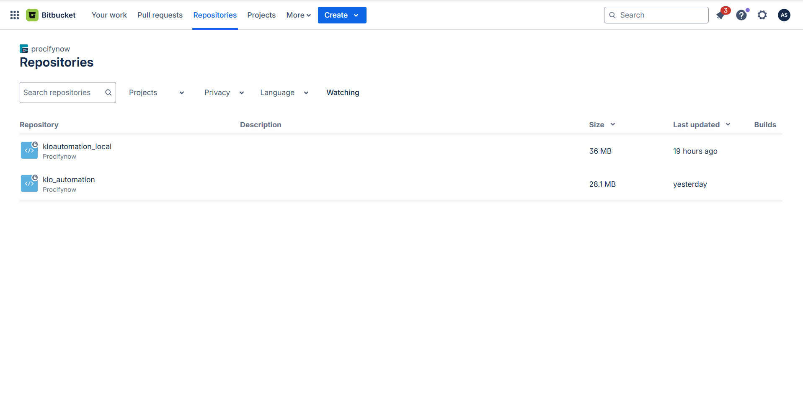
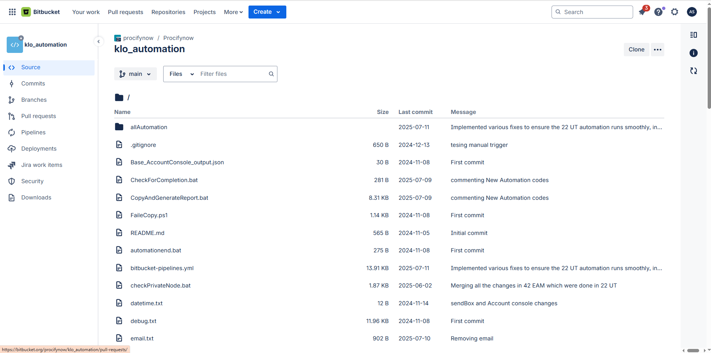
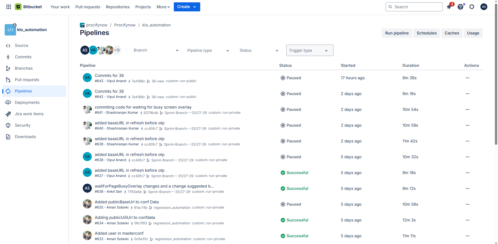
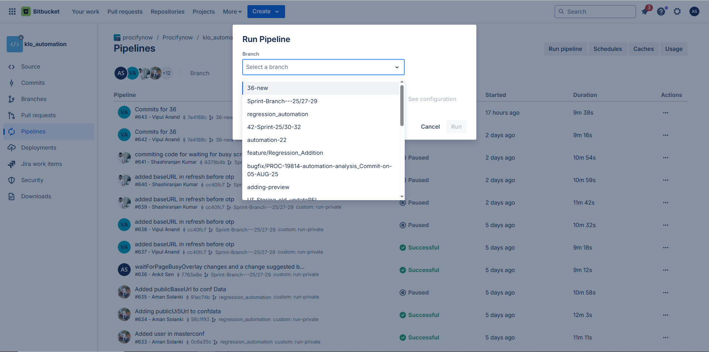
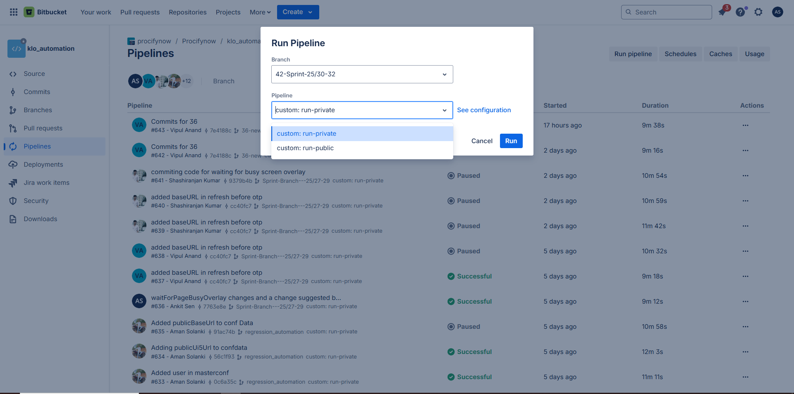
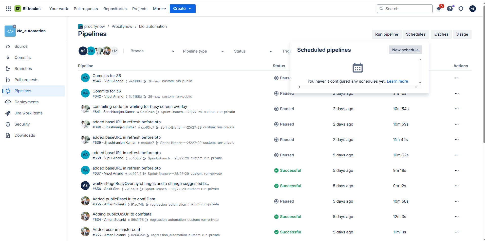
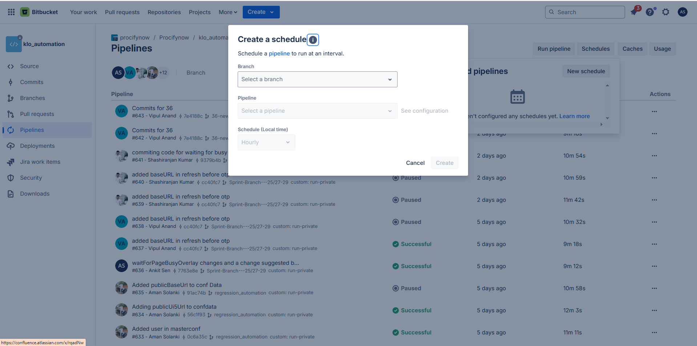

# How to run A Pipeline

1.  Open **Bitbucket** and go to the **Repositories** section. From the list, select your target repository (in our case, **klo_automation**).

2.  Once inside the repository, navigate to the **Pipelines** tab

3.  Click on **Run Pipeline**.

4.  From the branch dropdown, choose the branch you want to run.

5.  Next, select the pipeline type from the pipeline dropdown — you’ll see two options:

- **custom: run-public-master1** → Use this if your server is publicly accessible (e.g., our 42 and 36 servers) and you want to run Editors automation.

- **custom: run-public-master2** → Use this if your server is publicly accessible (e.g., our 42 and 36 servers) and you want to run tools and other automation.

- **custom: run-private-master1** → Use this if your server is not publicly accessible (e.g., server 22) and you want to run Editors automation.

- **custom: run-private-master1** → Use this if your server is not publicly accessible (e.g., server 22) and you want to run tools and other automation.

> 

## How to schedule a pipeline

In **Bitbucket Pipelines**, you can schedule a pipeline so it runs automatically at specific times without manually triggering it.

**1. Open the Repository**

- Go to **Bitbucket** → **Repositories** → Select your repository (e.g., klo_automation).

**2. Go to Pipeline Settings**

- Navigate to **Pipelines** → Click on **Schedules** in the left-hand menu.

**3. Create a New Schedule**

- Click **Add schedule** (or **Create schedule**, depending on your Bitbucket version).

**4. Configure the Schedule**

- **Branch** → Choose the branch you want the pipeline to run on.

- **Pipeline** → Select which pipeline definition to run (e.g., custom: run-public-master1 or custom: run-public-master2 or custom: run-private-master1 or run-private-master2).

- **Frequency** → Choose how often it should run:

  - **Daily**

  - **Weekly**

  - **Custom CRON** (for advanced scheduling, like every 15 mins, every Monday at 9 AM, etc.).

> **Example CRON expressions** in Bitbucket:

- 0 9 \* \* \* → Every day at 9:00 AM.

- 0 \*/6 \* \* \* → Every 6 hours.

- 30 2 \* \* 1 → Every Monday at 2:30 AM.

Note :- when you schedule a pipeline in **Bitbucket**, all times are interpreted in **UTC**, not your local time.

**5. Save the Schedule**

- Click **Save**. Bitbucket will now automatically trigger the pipeline according to the schedule you set.
