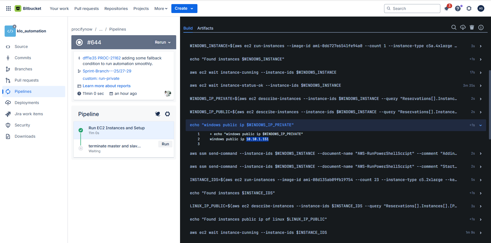
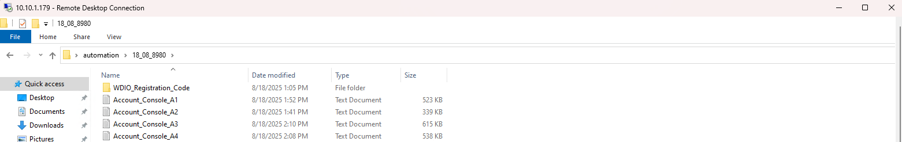

# How to Verify Automation is Running After Pipeline Build.

1.  Once the pipeline build finishes, it will pause.In the build logs, locate the line displaying the IP address of the main Windows system.

2.  Using that IP, establish an RDC (Remote Desktop Connection) to the main Windows system. For the required user ID and password, contact the testing team.

3.  After connecting via RDC, open review the log files for each automation to ensure they have started successfully and that registration is functioning correctly in all automations.

### Where are the log files located?

- Take Remote Desktop Connection (RDC) of the main Windows system.

- If logged in as Administrator, open the Automation folder located on the desktop.

- If using a non-administrator account, navigate to C:\Users\Administrator\Desktop\Automation.

- Inside the Automation folder, open the subfolder named with the current date.

- Inside that folder, you'll find log.txt files for each automation process.

