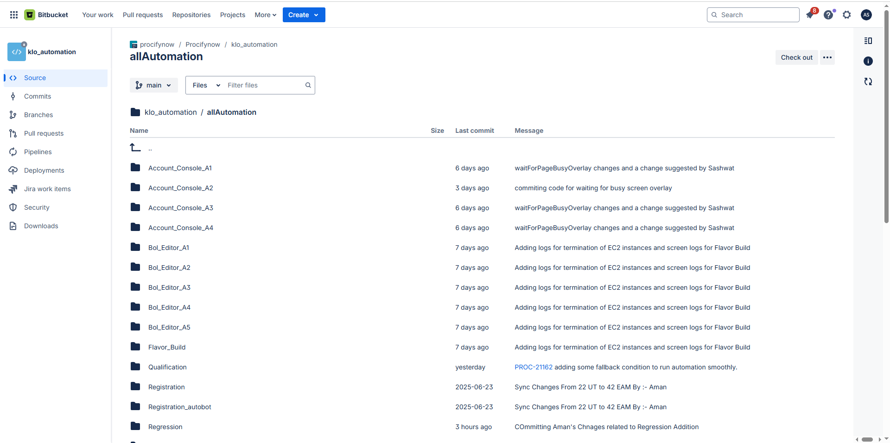
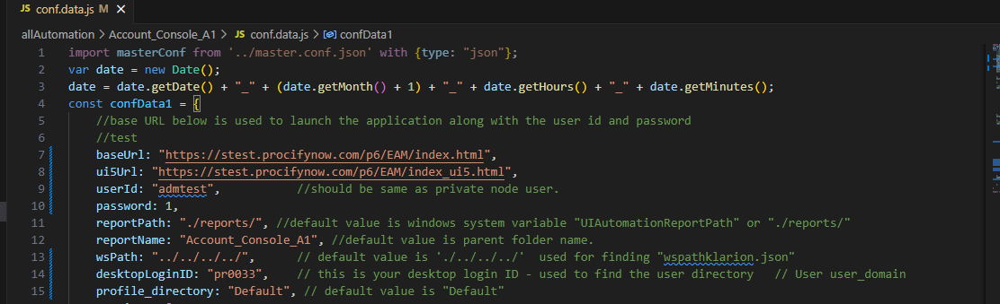
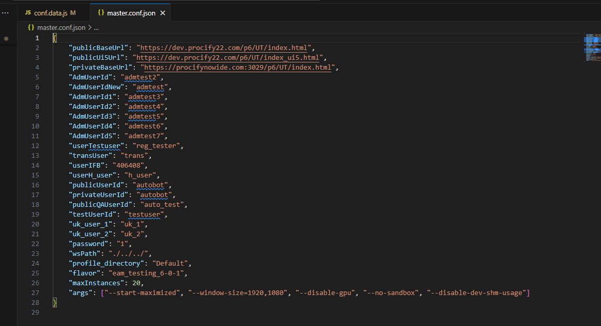
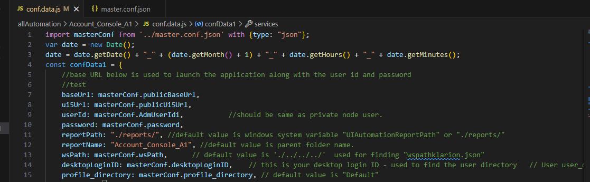
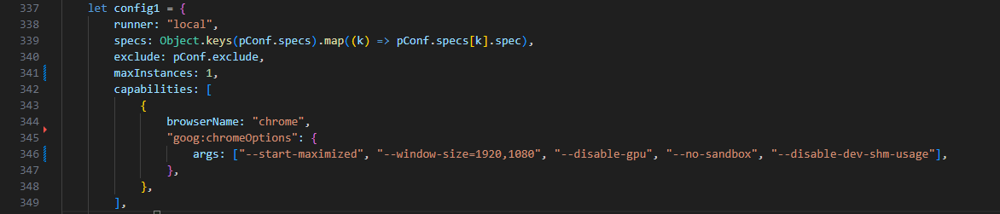
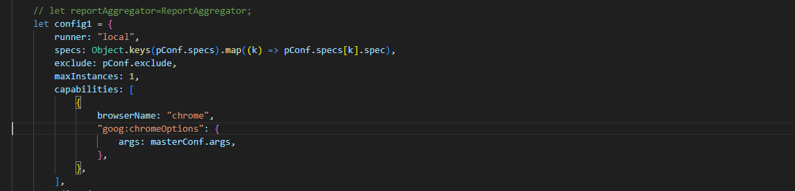
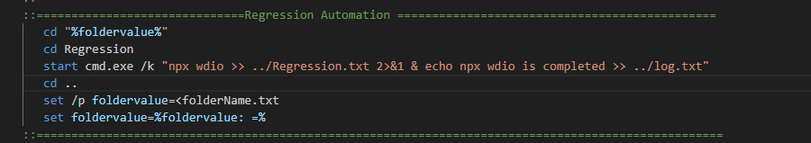
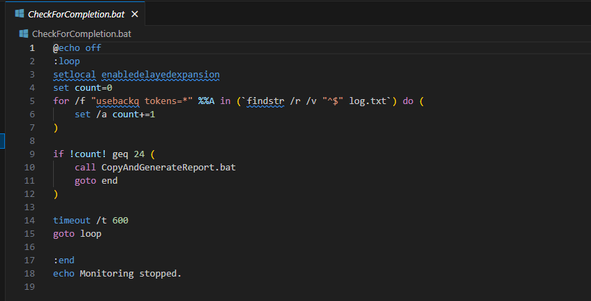
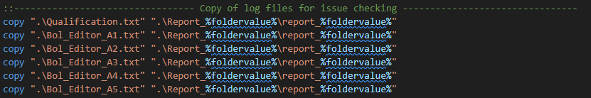
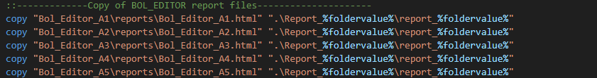

# Automation Updates : Adding New Automation from local to AWS

1.  **Add your new automation folder inside allAutomation folder.**

> Here You’ll need to incorporate the automation files and folders you’ve created, following a standard project structure.
>
> 

2.  **Changes in conf.Data.js**

> If you're running automations locally, your conf.data.js file may contain hardcoded values, as shown in the example below. However, in AWS, all configurations in conf.data.js are dynamic and sourced from master.conf.json.
>
> 
>
> Add the following import statement at the top of your conf.data.js:
>
> import masterConf from '../master.conf.json' with \{type: "json"\};
>
> Open master.conf.json and check whether the variables you need are already declared.If they are missing, add them manually.
>
> 
>
> Replace hardcoded values in conf.data.js with references to the corresponding variables from masterConf. Refer to the example shown in the image below for guidance.
>
> 

3.  **Changes in KloAuWdio.js file inside kloAU folder in a automation**

> If you're running automations locally, your kloAuWdio.js file may contain hardcoded values in the args section of config, as shown in the example below. However, in AWS, all configurations in conf.data.js are dynamic and sourced from master.conf.json.
>
> 
>
> Add the following import statement at the top of your kloAuWdio.js:
>
> import masterConf from '../master.conf.json' with \{type: "json"\};
>
> Then, replace all hardcoded values in conf.data.js with references to the corresponding variables from masterConf. These changes ensure that your automation setup is flexible and optimized for dynamic execution in AWS environments. Refer to the example shown in the image below for guidance.
>
> 

4.  **Changes in master.bat**

> In master.bat, add the path to the newly added automation.
>
> Refer to the following code snippet for guidance:
>
> 
>
> The first line navigates to the folder created with the current date. The second line navigates to the target repository inside that folder (i.e., the newly added automation). Inside that folder, a new command prompt is opened and npx wdio is executed to start the automation. The output of the automation running in the command prompt is saved to Regression.txt(change the name according to the automation created). Once the automation completes, the message "npx wdio is completed" is appended to log.txt.

5.  **Changes in checkforcompletion.bat**

> Update the count based on the number of new automations added.
>
> For example, if you’ve added **2 new automations**, increase the count by 2.So, if the original count was **24**, update it to **26**.
>
> 

6.  **Changes in copyandgeneratereport.bat**

> The copyandgeneratereport.bat script is primarily used to copy report and log files between systems and to an S3 bucket. In addition to file transfers, it also generates reports that are intended to be attached in emails.
>
> ::------ Copy of Automations report files one directory back -------
>
> copy "Flavor_Build\reports\Flavor_Build.html" ".\\
>
> copy "Unique_Key_1\reports\Unique_Key_1.html" ".\\
>
> copy "Unique_Key_2\reports\Unique_Key_2.html" ".\\
>
> copy "Vh_Testing\reports\Vh_Testing.html" ".\\
>
> The code snippet shown above copies HTML report files from their respective automation subdirectories—such as Flavor_Build, Unique_Key_1, Unique_Key_2, and Vh_Testing—into the parent directory, which corresponds to the automation folder within the date-specific folder. This intermediate step organizes the reports in a central location, preparing them for a subsequent move to the final reports folder in later stages of the script. So if you are adding any new automation add a new line here by changing you automation folder name and report name.
>
> If you're adding a new automation, make sure to include a new line in this section by specifying the appropriate automation folder name and the corresponding report file name.
>
> ::-----------------GENERATE REPORT--------------------------------
>
> call finalreportgenerater.bat Bol_Editor_A1
>
> call finalreportgenerater.bat Bol_Editor_A2
>
> call finalreportgenerater.bat Bol_Editor_A3
>
> call finalreportgenerater.bat Bol_Editor_A4
>
> This part of the script runs finalreportgenerater.bat for each automation module to generate a summary of its test results. The batch file reads the current date, locates the module’s HTML report, extracts key metrics like pass/fail counts and execution time, and formats them into HTML summary lines. These lines are then added to categorized report files—report_pass.txt, report_fail.txt, or report_notRun.txt—based on the outcome. Each summary includes links to the full reports stored in an S3 bucket, making it easy to access detailed results.
>
> If you're adding a new automation, be sure to add a new line in this section using the correct automation folder name—assuming the folder name matches the report file name.
>
> 
>
> This part of the script copies all the log files from the date-specific folder inside the automation directory to the reports folder. From there, the files are uploaded to an S3 bucket, making them publicly accessible from anywhere.
>
> If you're adding a new automation, make sure to include a new line in this section by specifying the appropriate automation log file name.
>
> 
>
> This part of the script copies all the report files from the date-specific folder inside the automation directory to the reports folder. From there, the files are uploaded to an S3 bucket, making them publicly accessible from anywhere.
>
> If you're adding a new automation, make sure to include a new line in this section by specifying the appropriate automation folder name and the corresponding report file name.
