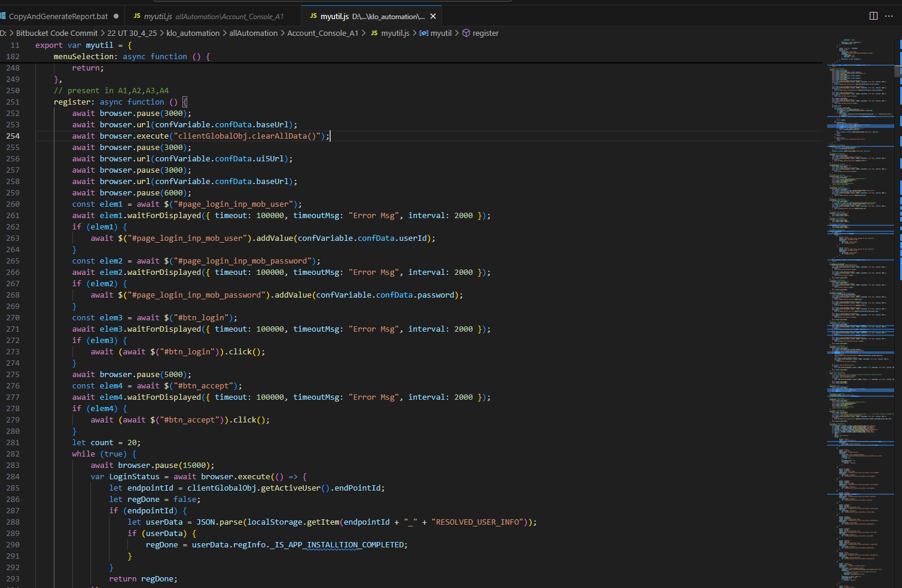
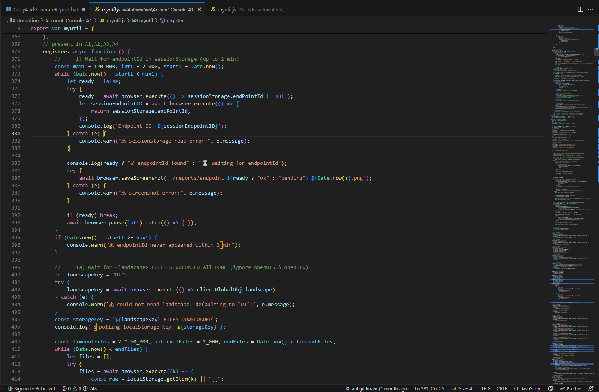

# Registration Code changes

The original registration script was built with a **linear, pause-heavy structure**. It relied on fixed browser.pause() intervals between navigation steps and form interactions, assuming that the UI and backend would be ready within those timeframes. It performed the following steps:

- Navigated to multiple URLs in sequence.

- Executed clientGlobalObj.clearAllData() to reset client-side state.

- Waited for login input fields using waitForDisplayed() and filled them with credentials.

- Click the login and accept buttons.

- Entered a polling loop to check if registration was completed via localStorage.

However, this approach had **critical limitations**:

- It did **not verify if the page was fully ready** before interacting with elements.

- It lacked **error handling** and **diagnostics** (e.g., no screenshots or logs for debugging).

- It assumed that all required data (like endPointId or downloaded files) would be available immediately after navigation.

- **In AWS environments, this led to blank screens during registration because some asynchronous calls were still in progress, and the automation moved ahead too quickly.**

The structure of the previous registration code are illustrated below ➖

To address the shortcomings of the earlier implementation—especially the blank screen issue observed in AWS environments—the registration script was redesigned with a more resilient, diagnostic-driven approach. The updated code introduces structured polling, conditional logic, and robust error handling to ensure the automation waits for all necessary conditions before proceeding. It now performs the following steps:

- Waits for endPointId to appear in sessionStorage, retrying for up to 2 minutes and logging progress with screenshots.

- Polls localStorage for \<landscape\>\_FILES_DOWNLOADED status, ensuring all relevant flavors (excluding openUI5 and openUI6) report "DONE" before continuing.

- Navigates through multiple URLs with retry logic, waiting for the \#loginHeader element to confirm page readiness.

- Executes clientGlobalObj.clearAllData() only when required, improving efficiency and reducing unnecessary resets.

- Overrides window.confirm() to auto-accept prompts, preventing modal interruptions during automation.

- Waits for login input fields to become visible before entering credentials, using retry loops to handle delayed rendering.

- Ensures the \#btn_accept button is visible, enabled, and scrolled into view before clicking, improving interaction reliability.

- Polls for registration completion for up to 9 minutes, checking for the \_IS_APP_INSTALLTION_COMPLETED flag in localStorage.

- Injects UI5 and captures the client version once registration is confirmed, completing the flow with contextual awareness.

These changes were introduced specifically to resolve issues in AWS environments, where backend or client-side calls were taking longer to complete after navigation. The earlier code did not wait for these asynchronous operations, causing the automation to proceed prematurely and resulting in blank screens. The new implementation ensures readiness at every step, making the registration flow stable, reliable, and cloud-friendly.

The structure of the new registration code are illustrated below ➖

**Note: Automation running on private nodes uses a different registration flow. Please review and update your code accordingly.**
