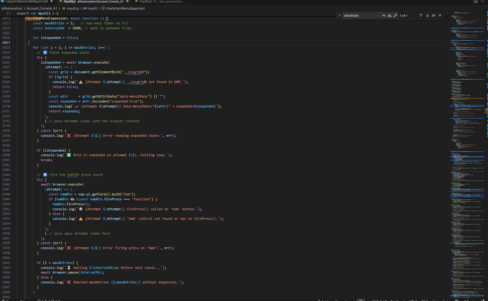
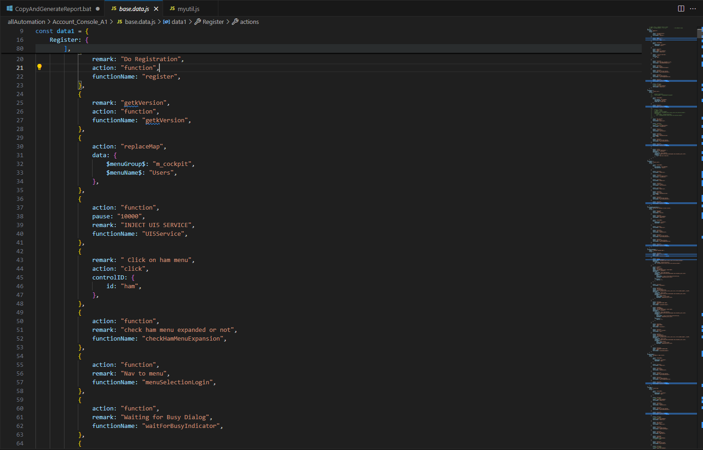

# Ham Menu Code Changes

After registration in AWS, the menu wasn’t always clickable—automation was jumping ahead before it had finished loading.

To further stabilize post-registration behavior—especially in AWS environments where UI components may load asynchronously—a new safeguard was introduced to ensure the ham menu expansion completes before proceeding. This was necessary because menu navigation was intermittently failing when the automation advanced before the menu system had fully initialized.

- Waits up to 5 times with 2-second intervals to check if the ham menu grid (\_\_cssgrid0)(id for the whole menu ) is expanded.

- Uses data-menu2hbox attribute to determine expansion state (expanded-true). This checks whether the menu is expanded or not.

- Logs each attempt with detailed status messages for visibility and debugging.

- If not expanded, triggers the SAPUI5 firePress() event on the ham button (ham) to manually initiate expansion.

- Handles errors gracefully during both state checks and press events.

- Waits between retries to allow UI components time to load and respond.

- Provides a final summary indicating whether the menu successfully expanded or failed after all attempts.

**Note: To use the checkHamMenuExpansion function effectively, you must first trigger a click on the ham menu first in the data file and then using a separate function called menuSelectionLogin. This is necessary because, in the earlier approach, we used a function named menuSelection, which handled both the expansion of the hamburger menu and the selection of the menu header and its child items. However, since checkHamMenuExpansion now explicitly checks whether the hamburger menu is expanded—and expands it only if needed—we need to ensure the menu is clicked once beforehand. That initial click is handled in the data file before invoking checkHamMenuExpansion. If the menu is already expanded, the function does nothing; otherwise, it triggers the expansion. After confirming the menu state, we then call menuSelectionLogin to proceed with selecting the appropriate menu header and child. We avoid using menuSelection here because it includes its own ham menu click logic, which could interfere with the flow—causing the menu to open and then immediately close if called after checkHamMenuExpansion. At the same time, we can't remove the hamburger click from menuSelection entirely, as it's still needed in scenarios where the page is refreshed and the menu state resets.**

The structure of the new menu selection code in data file is illustrated below ➖

