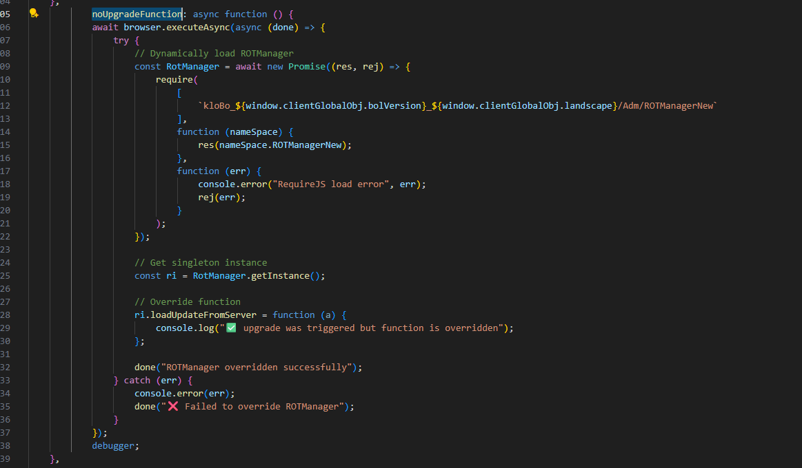

# noUpgradeFunction to suppress upgrade prompts for the user

Previously, automation processes occasionally failed due to the unexpected appearance of an upgrade popup during execution. To address this issue, we introduced the noUpgradeFunction(), which effectively suppresses the upgrade popup and ensures smoother automation flow.

**Important Usage Notes:**

- The upgrade popup suppression must be re-applied **after each registration** and **after every page refresh**.

- This is necessary because the overridden function responsible for suppressing the popup is reset to its original state upon page reload.
