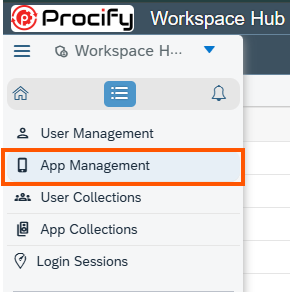
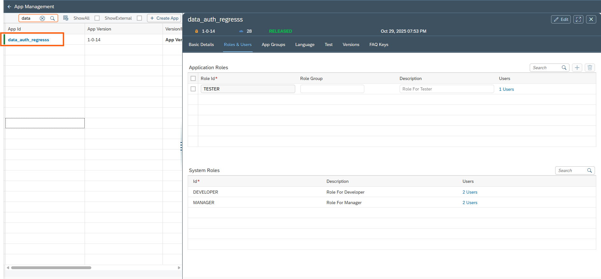
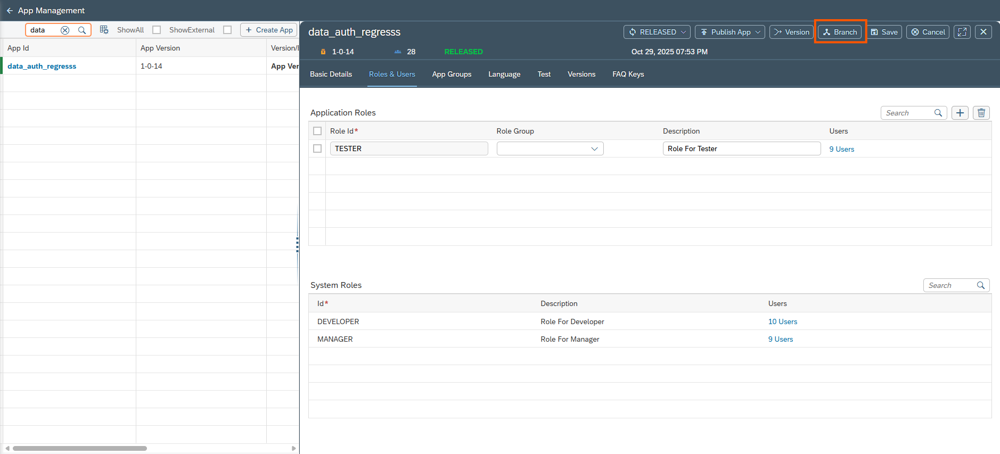

# App Branching

App Branching is done to create a branch of the actual app. This branch will be helpful in cases where the team wants to work on next-phase developments and at the same time provide fixes for the released application. Developers can create a new branch for the next phase of development and use this for the developments. When the developments are complete, the branch can be merged with the latest version of the app.

To simplify this let's take a look at the below explanation:

In the above diagram, we have an app named **eam_6.0.1**. Now there is a major enhancement that needs to be done for this app. This enhancement might take a long period to develop. This will automatically pause the further development progress of the app.

Therefore, we will create a branch for this app. All the major developments will be done in this branch app. In the meantime, minor fixes and other changes are made to the main app and the versions are updated. Once the enhancement is complete the branch app will be exported along with the latest version and both will be merged into one major app version as the final product.

## Process to create an app branch

**Step 1:** From the menu navigate to the App Management page of the Workspace Hub.

> 

**Step 2:** Navigate to the App by clicking on the app link from the app list for which the branch needs to be created from the apps list section.

**Step 3:** Create a branch for the app by clicking on the **Branch** action button. It will create a new branch version for the selected app.

Note: Branches button will be enabled only on the released app version

**Note:** If the app version is of type branch then the branch checkbox will be enabled.

**Step 4:** Change the version if needed and click on the save button to save the changes.

Now, our Branch app has been created.

**Step 5:** Assign the users for this new branch in the roles & users tab(need to be manually added, will not be copied from the branched version)

**NOTE : Branch flavors cannot be transported or moved to any system. For doing so, create a new version, merge that branch to the new version and then move the new version to any system.**
