# App Merging

It allows developers to compare two apps and prepare a newly exported (zip) file that can be imported to another app.

## Process to use

**Step 1:** Go to the **export** section, fill in the required fields and click on **download.**

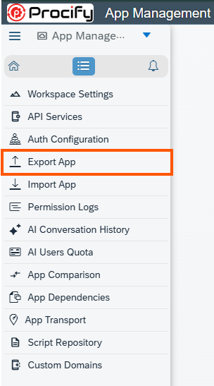

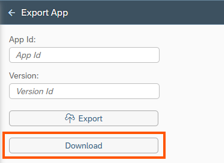

**App ID:** Flavor ID name.

**Version:** Version of the flavor.

**Export:** Export the flavor directly. This will create a zip in the server.

**Download:** The download button will download the zip of the given flavor.

**NOTE:** Export both the apps' zip for merging purposes.

**Step 2:** Go to the **compare** section and upload both the zip files to **Set 1** and **Set 2.**

- **Set 1:** App 1 zip which will compare with Set 2.

- **Set 2**: App 2 zip which will compare to Set 1.

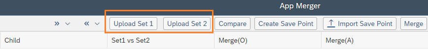

**Step 3:** After uploading the Zips, click on the **compare** action button. Compare button will list down all the differences between your apps.

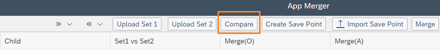

**Child** - It shows whether the relations of the root object are different.

**SET1 Vs SET2** - compares whether the root object( like m_entities, mu_screen, etc.) is same, different, or present only in one of the sets.

**Merge(O)**- It will merge the whole object (like **m_entities**, **mu_screen**, etc..)

Merge(O) field has a drop-down which has Vh items and a description of Vh items are mentioned below:

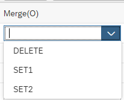

**Delete:** It will delete the particular object from Merging.

**Set 1:** After selecting SET 1, the object of set 1 will be added for Merging. Or we can say, it

will pick the object from set 1 for Merging.

**Set 2:** After selecting SET 2, the object of set 2 will be added for Merging. Or it will pick the object from set 1 for Merging.

**Merge(A)**- It will merge the particular attribute(e.g. properties) of the object. We can also provide custom values via using Merge(A)- CUSTOM.

Merge(A) field has a drop-down which has Vh items and the description of Vh items is mentioned below:

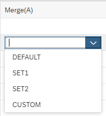

**Default:** Contributes to the default way of merging.

**Custom:** Custom is used to add custom values for attributes of the object.

**NOTE:** Special care needs to be taken while merging, If you are adding property then property type also needs to be added.

After clicking on any row, the difference between the two flavors for that row will be listed in another table.

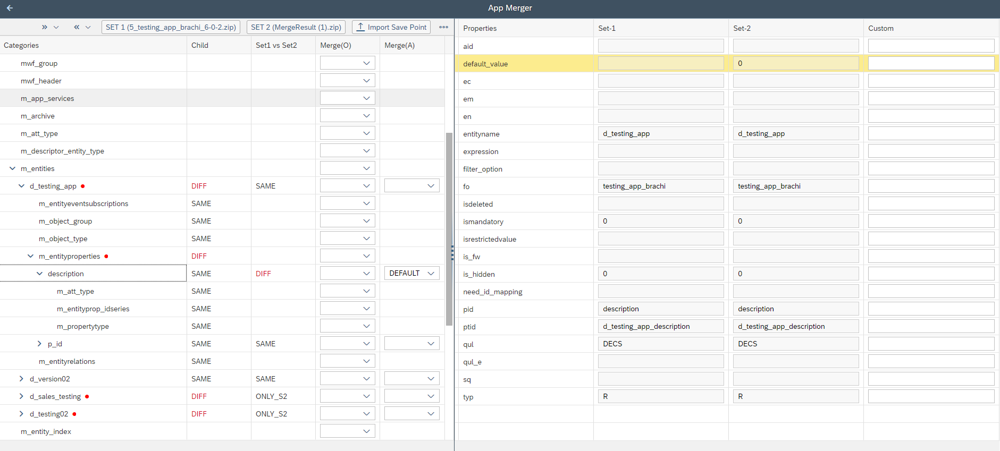

**Properties:** Properties of the object or attributes

**Set 1:** Shows the values of properties

**Set 2:** Shows the values of properties

**Custom:** Used to add custom values for object attributes (e.g properties)

**Red dots (⬤):** It specifies that the particular object or attributes have differences between the flavors

**Yellow Highlight** will specify the exact difference of the selected object or attribute.

**Step 4:** Click on the merge action button, A zip will be downloaded.

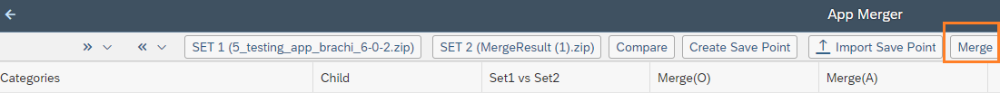

**Step 5:** Create a new version of the app and import the downloaded ZIP to it.

For importing, go to the import section and upload a Zip file using the **Upload zip file** button.

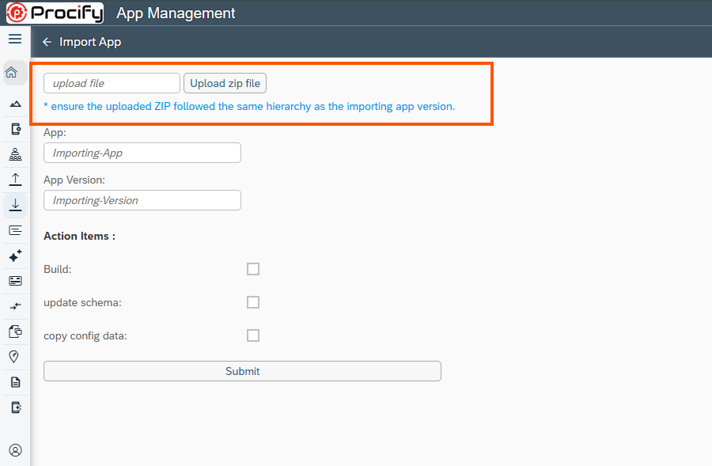

**Importing- app:** The app id which you want to import.

**Importing- Version:** The app ID which you want to import.

**Build:** to build the app which you want to import.

**Update Schema:** do updateSchema for the app which you want to import.

**Copy config data:** copy the config data for the app which you want to import.

Fill in the mandatory fields and click on the **Submit** button.

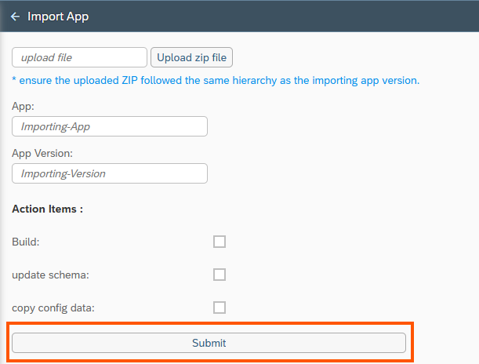

**Step 6:** see the dialogue **Import Status** to check the status of the import.

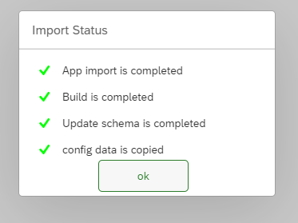

**Step 7:** After importing the app, the app needs to be published. This can be done via the Workspace Hub’s **App Management** page.

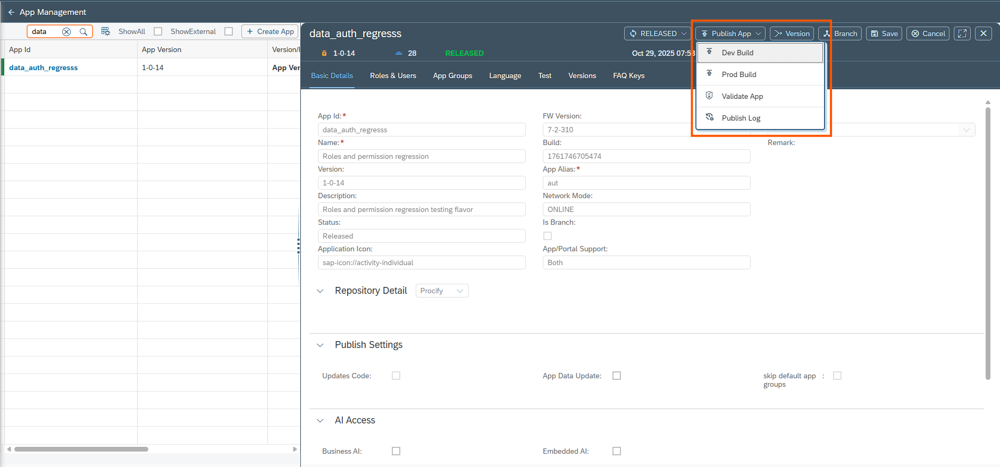
