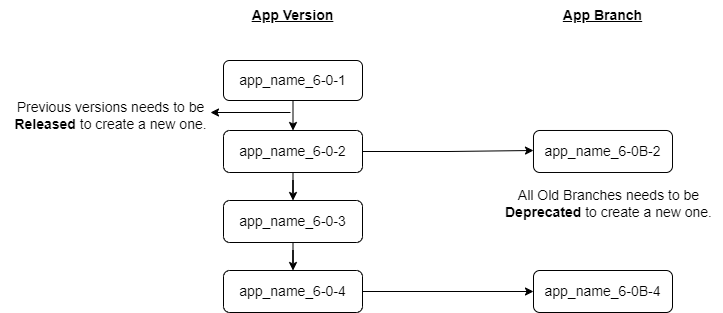

# App Version

App Version represents the version of the particular app. It represents the fixes and changes the developer has provided to the particular app.

**Note:** New version creation is recommended while giving any major/minor/patch fixes or any new changes.

## Steps to create a version

1.  Navigate to the **Menu** named **App Management** under **Workspace Hub** where you will find all the **apps** that are accessible as a **MANAGER Role.**

2.  Select the required **App,** it will navigate to the Detail Page of the **App** where you can find all the details regarding it.

3.  On click of edit, you can make the App changes as per the required access.

4.  On **Edit**, you will get an option of **Version** (if the status is RELEASED), on click of it a new version will come up with all the required changes automatically.

5.  For confirmation and convenience, you will have the option to **Save the details.**

**Note:** It is recommended to maintain the sequence for the version as provided in the image.

After new version creation, Refresh is required for creating a screen in Procify Page Builder.
