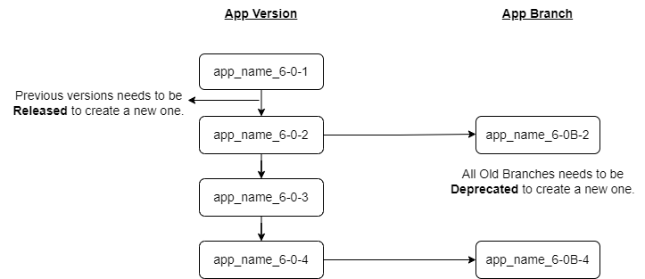

# App Branch Creation

App Branching is done to create a branch of the actual app. This branch will be helpful in cases where the team wants to work on next-phase developments and at the same time provide fixes for the released application.

**Note:** New Branch creation is recommended after the creation of each version. There should be no multiple branches on each version.

## Steps to create a branch

1.  Navigate to the **Menu** named **App Management** under **Workspace Hub** where you will find all the **apps** that are accessible as a **MANAGER Role.**

2.  Select the required **App,** it will navigate to the Detail Page of the **App** where you can find all the details regarding it.

3.  On click of edit, you will have **access** to make the changes of **App** as per the required access.

4.  On **Edit**, you will get an option of **Branch** (if the status is ACTIVE), on click of it a new Branch will come up with all the required changes automatically.

5.  Version Number can’t be changed for Branch for the proper sequence option.

6.  For confirmation and convenience, you will have the option to **Save the details.**

**Note:** It is recommended to maintain the sequence for branches as provided in the image.
