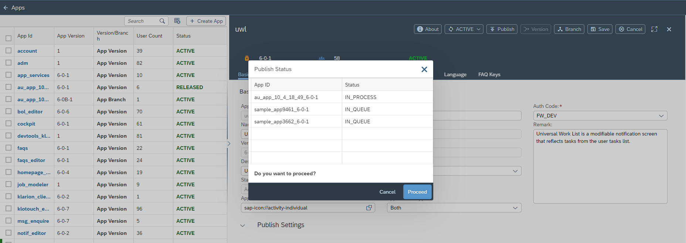
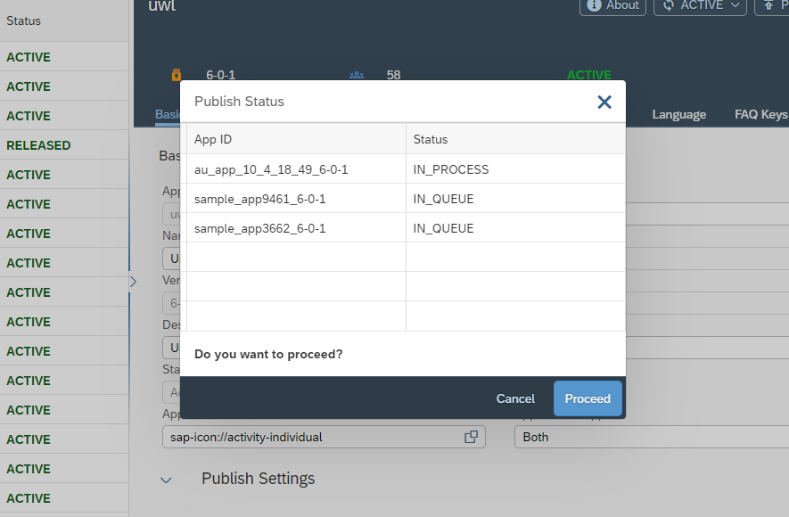

# Publish Status Process

Publish Status Process is used to check if any other app build is in progress / in queue. It helps with sequence and smooth processes.

It checks which apps are **in process** or **in queue** to be **Built** before you proceed with the current app. If you still want to proceed then you can click on the **Proceed** button.

