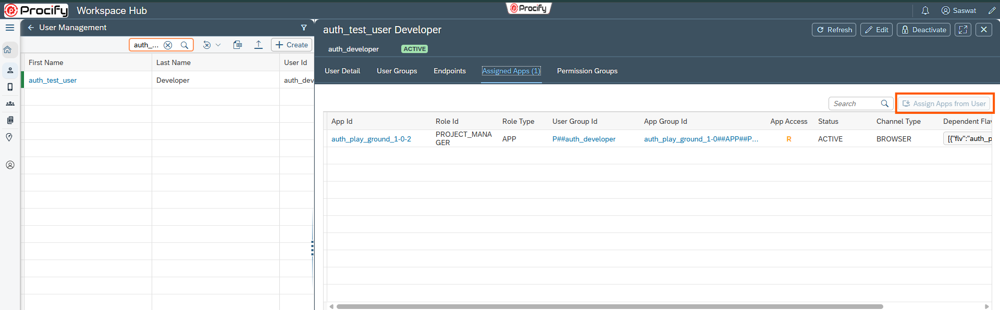
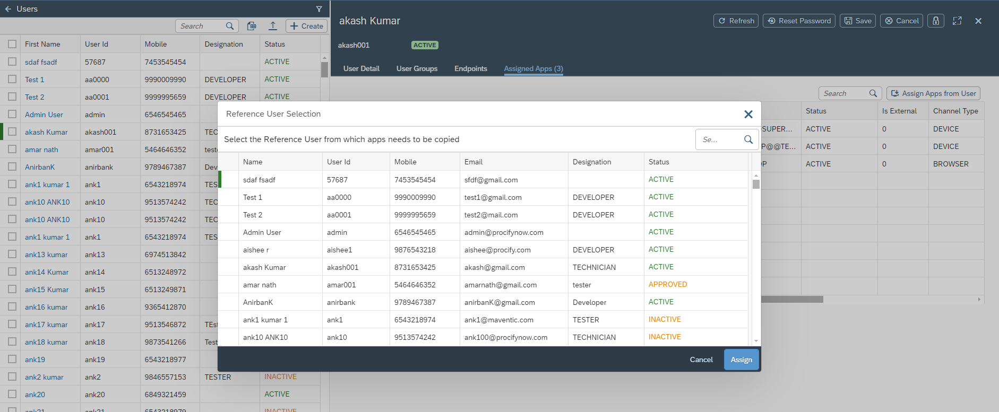
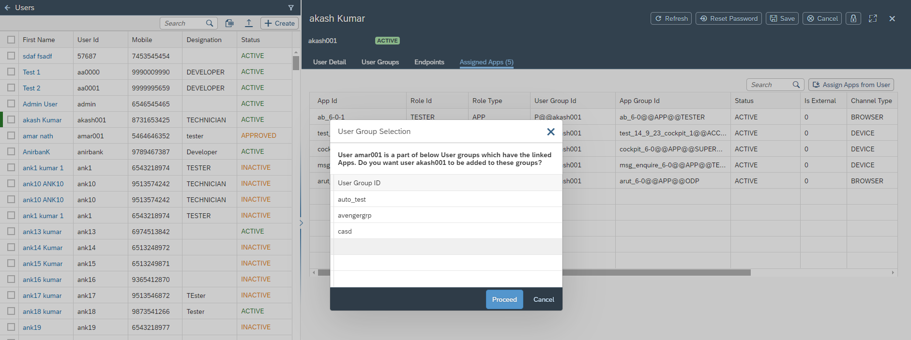
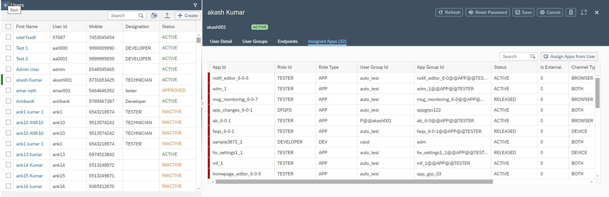

# Assign Apps from User

The Assign Apps from User Process is used for assigning the apps and user groups (linked to App Groups) will be assigned from the reference user as per the requirements and the same apps will be available to use after the registration.

- **Users' individual apps will be assigned from the reference user.**

- **User Groups will be assigned to the Selected User from the Reference User based on the confirmation.**

- **Assigned Apps count will be shown based on the apps assigned to the selected User.**

1.  Assign Apps from the User button will be available in the Assigned Apps section of User Detail Screen on click of edit.

2.  On click of it, it will ask about the Reference User to select from which apps need to be copied.

**

Note: After confirming, Reference User’s individual apps will be assigned to the selected user and that will be marked as dirty.

**3. After assigning, it will ask more about the User Groups assigned to the selected reference user so whether you want to be added to these User Groups also?

**
**

4\. After confirmation, it will show the new updated changes in the list.

5\. On save, apps will be assigned to the selected user and the count will be updated.
