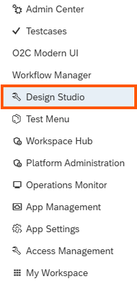
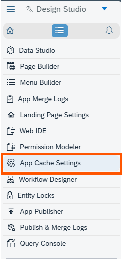
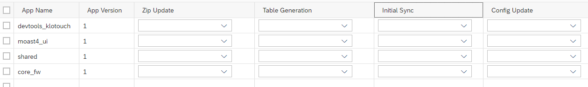

# Process to navigate to the App Cache Settings

**Step 1- Access to Klotouch Portal**

Open the kloTouch portal, and click on the menu button ( ) from the top left of the screen. In the Menu bar, there is an option named **Design Studio**. Click on it.

**Step 2- Access to the App Cache Settings**

Under the Design Studio, there are various options. Click on the App Cache Settings.

You will be taken to the App Cache Settings

