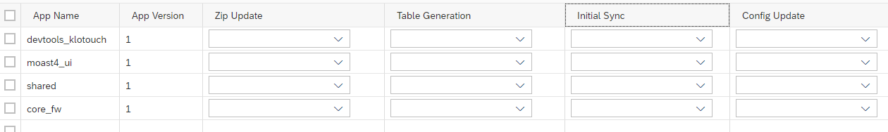

# Features of the App Cache Settings

The App Cache Settings looks like a table with various features. Following are the details of those features:

|  |  |
| --- | --- |
| **Features** | **Description** |
| Zip Update | Update the zip of any application in the browser. It will update offline files (files which are coming from browser cache) |
| Table Generation (web SQL) | Table generation provides two options: • Drop tables and create new ones. This means the old table will be dropped and a new table will be created instead. • Delete the data from the existing table. |
| Initial Sync | Here you will be able to get data from the server database into browser web SQL tables. A Web SQL is a database at the client side (browser or device). |
| Update Config | Update application-related configs. (eg- vh config) |

