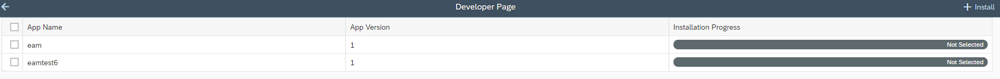

# Installation of available apps through the App Cache Settings

**Available apps** - Apps which are assigned to the user but not installed during the registration process because their installation type is marked as **onDemand** from the **ADM cockpit**.

To install such apps use the available apps option on the App Cache Settings which is present at the top right corner of the screen as shown in the below image.

On click of the above available option the below screen will open. 

Select apps which need to be installed and click on install in the top right corner.

**Note - After successful installation of apps one refresh is required to get updated apps to appear in the application.**
