# App Merging

**App merging** is the process of merging one application branch with the current main branch (or vice versa) or merging one active branch into another active branch. It is important to note that this process merges **metadata only.**

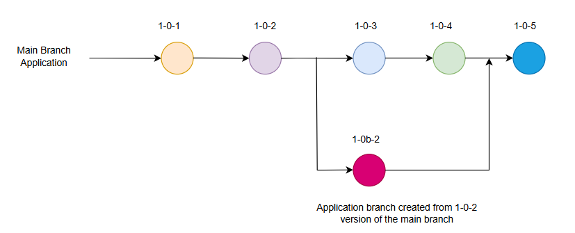

### Prerequisites; 

- **Need to assign cockpit and account flavors**

- **Developer access is required to work on the targeted flavor.**

- **Deployment of the app/flavor should occur within a development environment**.

- **If you're merging into the main version, the main version must be active; if merging into a branch version, then the branch must be active.**

**For Example:** From version 1.0.2 of our app, we created a new branch, 1.0B.2, for developing a new feature. While the feature is being developed, changes may still occur in the main branch. Once the new feature is completed, we need to merge it back into the main branch.

| **Version Type**        | **Description**                                         | **Example** |
|-------------------------|---------------------------------------------------------|-------------|
| **Base Version**        | The starting version from which the branch was created. | **1.0.2**   |
| **Latest Main Version** | The most recent, stable version of the main branch.     | **1.0.5**   |
| **Branch Version**      | The version where the new feature has been developed.   | **1.0B.2**  |

## 1.1.The Process to Merge

For the application merge, we need to consider three versions of the application:

1.  **Target Version**

2.  **Source Version**

3.  **Base Version**

### 1.1.1. Target Version

The **Target Version** is where the changes will be applied after the merge. It is **pre-filled by default** based on where the user initiated the merge from.

- If the user navigates from a **Branch**, then that branch is the Target.

- If the user navigates from a **Latest Main Version**, then that main version is the Target.

| **User Navigated From** | **Target Version** |
|-------------------------|--------------------|
| A **Branch**            | That Branch        |
| A **Main Version**      | That Main Version  |

### 1.1.2. Source Version

The **Source Version** is selected by the user from a dropdown. The dropdown options depend on the type of Target:

| **Target Type**  | **Source Options**                          |
|------------------|---------------------------------------------|
| **Branch**       | **Main Released Versions, Active Branches** |
| **Main Version** | Only **Branches** of the App                |

### 1.1,3. Base Version

The **Base Version** is **automatically determined** based on the selected Source and Target. It represents the **common ancestor** between the two — the point from which both versions diverged.

You want to compare how **both the Source and Target** have changed **since they split from the same origin** — that's the **Base**.

Usually, the Base Version is the version from which:

- The **Branch was created**, or

- The **Main Version was forked** for changes.

| **Scenario** | **Base Version Logic** |
|---|---|
| **Branch → Main** 🔄 **Main → Branch** | The version from which the Branch was created The version from which the Branch was created |
| **Branch → Branch** | The most recent common version in both branch sequences |

## 1.2.Conflicts

If there is any altered content in both the **Latest Main Version** and the **Branch Version**, it will be considered a conflict and must be resolved by the developer (user).

The user will be presented with a selection option to choose either the Main Version or the Branch Version for the merge. Any further modifications can be made after the merge is imported into the version if needed.

The conflicts should be resolved by the user based on their selection and any required adjustments as shown below;

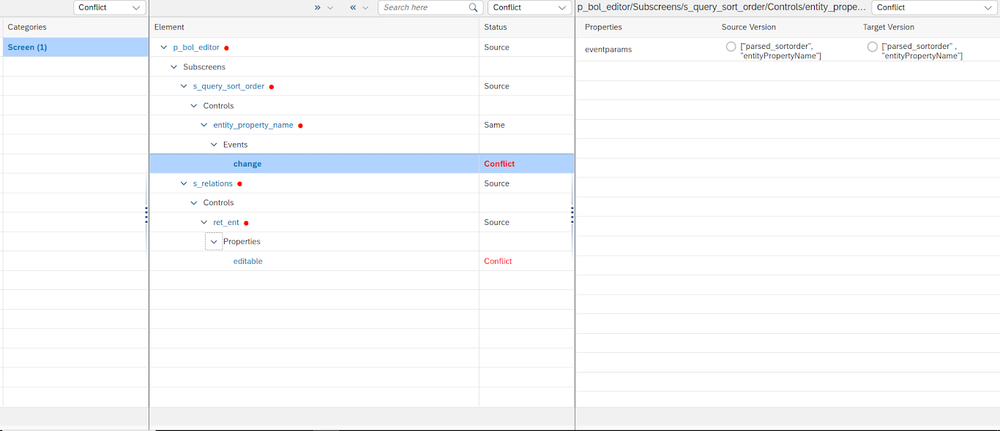

**Example:  
** To illustrate the merge concepts discussed above, let's consider a simple scenario.

**Case 1: Auto-Merge  
** The title on our screen is **"App Console"**. In the **Branch Version**, we are updating the title to **"Workspace Hub"**.

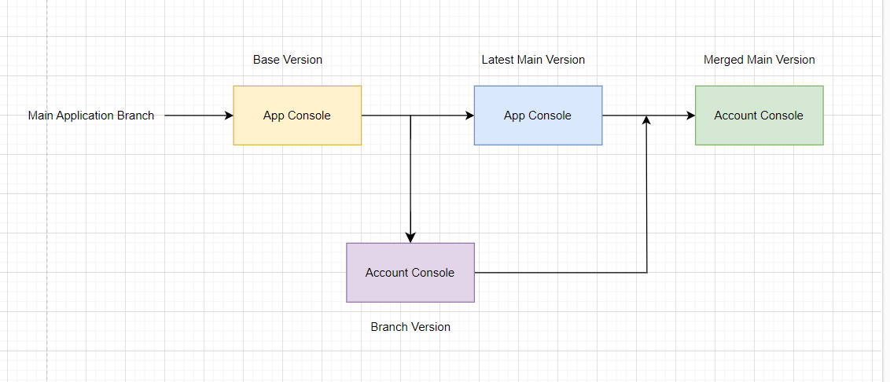

**Case 2: Auto-Merge  
**The title on our screen is **"App Console"**. In the **Main Branch Version,** we are changing the title to **"Workspace Hub".**

During the merge, the changes will be compared with the three sets, and it will be determined that the update is only in the **Main Branch Version.** Since this is an update exclusive to the Main Branch, it will be auto-merged into the branch without any conflicts.

**Case 3: Conflict  
** The title on our screen is **"App Console"**.

- In the **Branch Version**, we are changing the title to **"Workspace Hub"**.

- In the **Main Version**, we are changing the title to **"Account Cockpit"**.

During the merge, the changes will be compared across the three sets. It will be determined that there are changes in both the **Branch Version** and the **Main Version** when compared to the **Base Version**. This results in a **conflict**, as both versions have different updates to the title.

The user will need to manually resolve this conflict by selecting the appropriate title or making adjustments as needed.

| **Aspect** | **Details** |
|---|---|
| **Merge Target** | Only the **active version** (Main or Branch) can receive merged changes. |
| **Merge Concurrency** | Only **one branch merge at a time** is allowed. No support for simultaneous merges. |
| **Automatic Merge Scope** | Only **metadata** merges are handled automatically. |
| **Manual Merge Required** | **Files** like controllers, entities, queries, utils, resources require **manual intervention**. |
| **Unchanged Items** | No changes are applied if items are identical across all three versions (Base, Branch, Main). |
| **Auto-Merge Conditions** | Change exists **only in Branch Version** → Auto-merge Change exists **only in Latest Main Version** → Auto-merge |
| **Conflict Handling** | - If conflicts exist, they must be resolved **manually** by the user. - Compare **Branch vs Base** and **Main vs Base** to identify differences. - Then compare the resulting changes for **conflicts**. |
| **Default Target** | The **Target App Version** is pre-filled based on the version/branch the user navigated from. |
| **Source Options Based on Target Type** | If Target is a **Branch**, Source dropdown lists Released **Main versions** and **Active Branches**. If Target is a **Main version**, Source dropdown lists only **Branches**. |
| **Base Version Selection** | **Automatically determined** based on Source and Target versions. |
| **Supported Merge Directions** | ✅ Branch → Main ✅ Main → Branch ✅ Branch → Branch |

## 1.3.Navigation to the Screen

**Step 1:** Navigate to the **App Management** screen in the **Workspace Hub**.

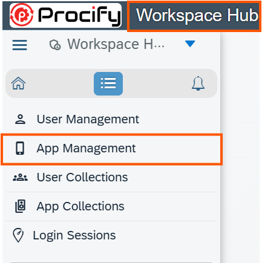

**Step 2:**Click the **"Compare and Merge"** button.This will navigate the user to the **App Merger** screen.

**Note**: The **"Compare and Merge"** button will only be visible in the **Active version or branch** of the app.

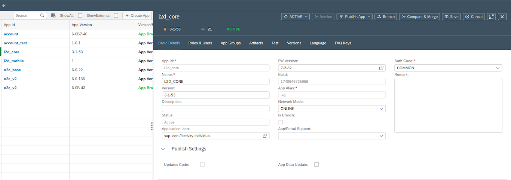

**Step 3: Compare and Merge** dialogue box will appear as shown below.

1.  The **Target App** will be automatically set to the app version from which the user navigated. (Refer [<u>Target version</u>](#target-version) to know more).

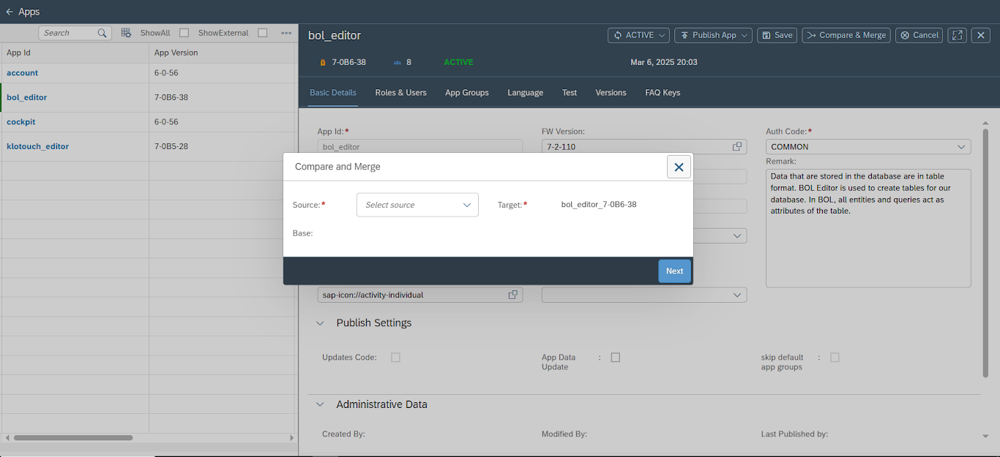

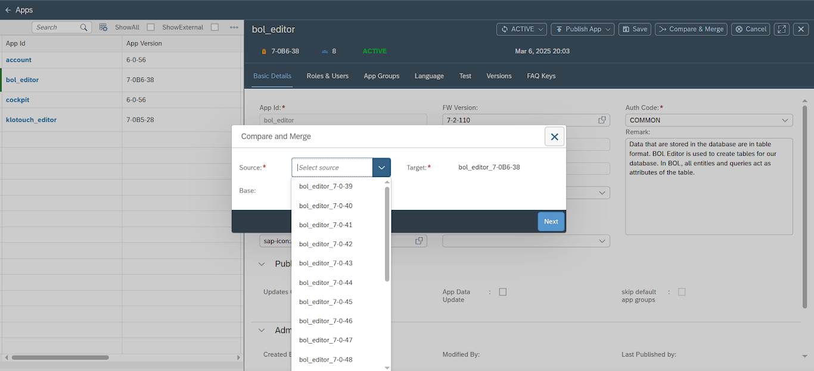

2.  Select the source from the dropdown list you wanted to compare and merge.

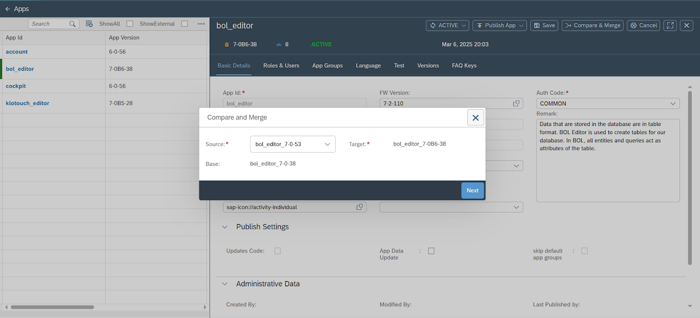

**Step 4: App Selection:**

1.  An **App Selection popup** will be displayed to the user as shown below;

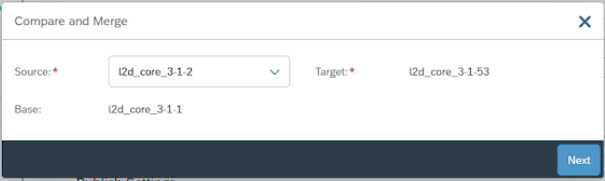

**Step 5. Click "Next" to proceed with the build.**

1.  The process may take some time depending on the size of the flavor and the scope of development changes.

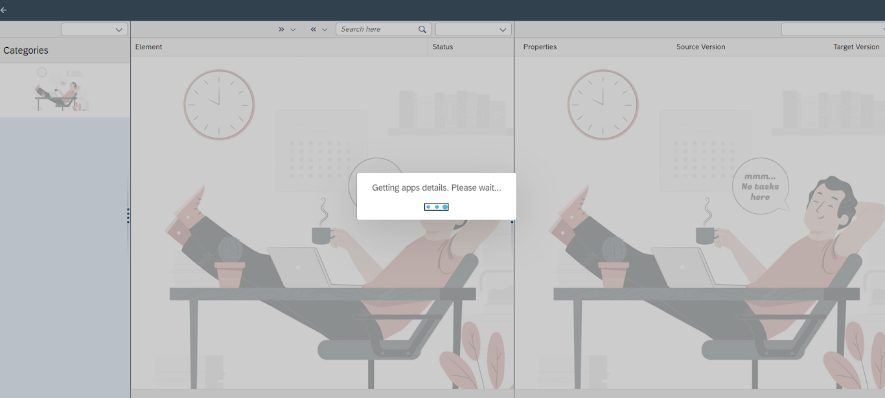

2.  By default, an Auto-Merge will be performed.

3.  Only the conflicting items will be presented to the user for review and manual resolution.

4.  The red dot Icon shows the conflict in the child as shown below;

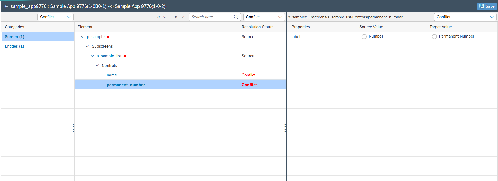

5.  Use the filter option to **Show all items.**

6.  The screen is split into three sections, displaying categories, their corresponding elements and its status, and detailed information for each item. [<u>(Section 1.4)</u>](#app-merge-screen-post-compare-phase)

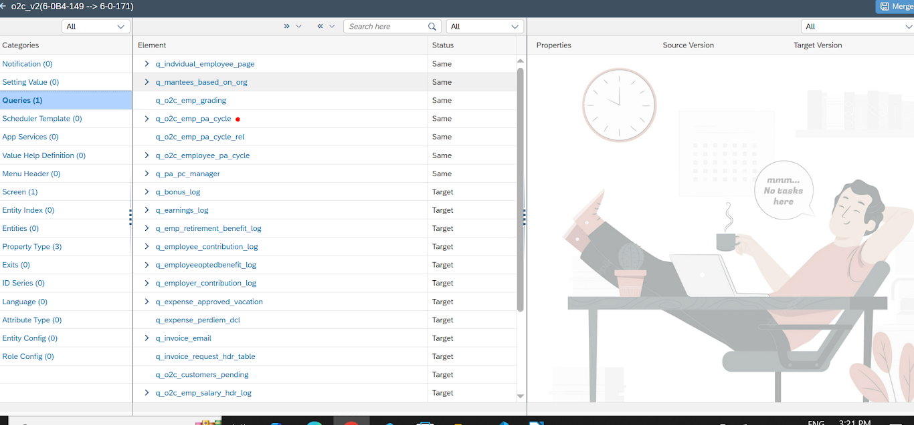

7.  In the Categories section, select the category with a number in brackets as shown in the screenshot above—this indicates a conflict that can be reviewed after the compare and merge process.

**Step 6: Resolving conflict**

1.  On click of the link, the attributes will be shown on the right side.

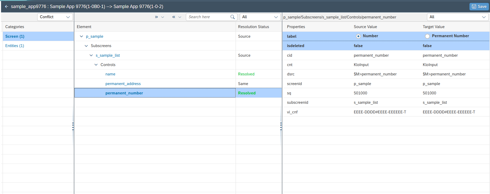

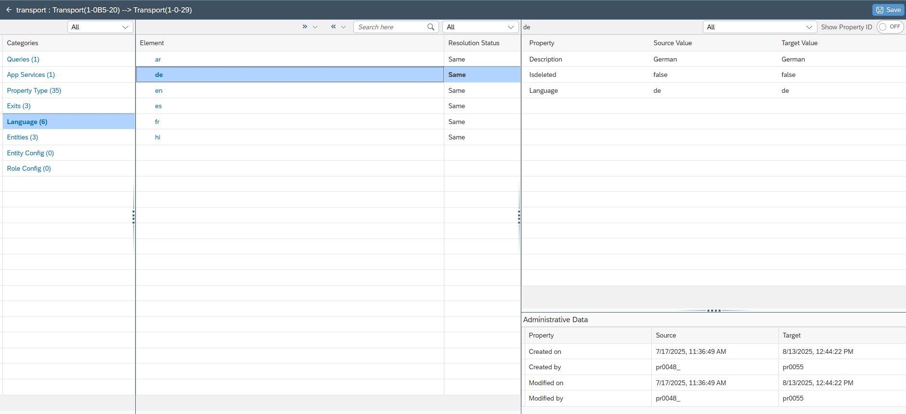

2.  The user can choose to resolve conflicts by selecting either from the **Source Value** or the **Target Value**. This allows the user to focus on resolving conflicts while also providing flexibility in their choice of version for resolution.

3.  The Administrative Data screen displays creation (Created By, Created On) and modification (Modified By, Modified On) details for both the Source and Target.

4.  If a user tries to proceed with the merge without resolving all identified conflicts, the system will prevent the merge from continuing and display a warning.

> For example, as shown in the screenshot below, if conflicts are still present and the user clicks the **Save** button, a **warning notification** will appear indicating that conflicts need to be resolved before proceeding.
>
> This ensures that no changes are accidentally overwritten or merged incorrectly due to unresolved discrepancies between versions.

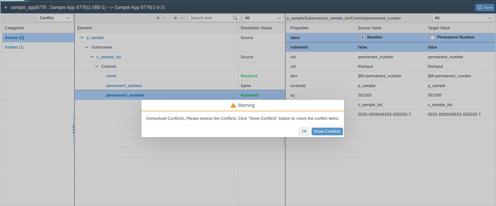

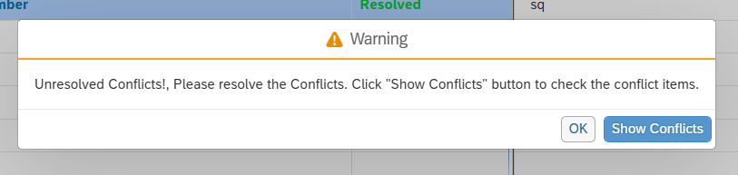

**Step 7: Save**

1.  Click **'Save'** to initiate actions such as publish, update schema, and config data in the background.

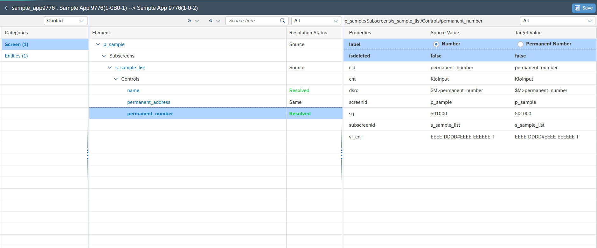

2.  When you click **'Save'**, a confirmation message will appear, as shown below, prompting you to proceed.

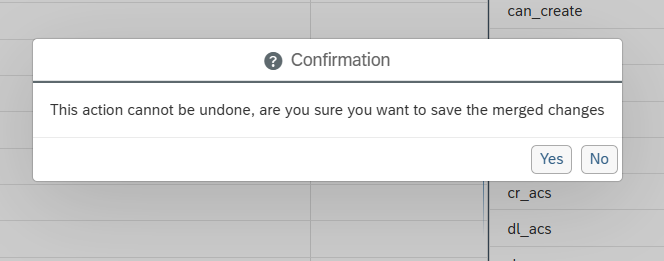

3.  Once the merge process begins, it may take some time to complete these steps: -Merging application versions  
    > -Publishing the merged application  
    > -Update schema  
    > -Copying configuration data

4.  The merge is considered complete when all steps in the process display a checkmark, indicating successful execution.

> 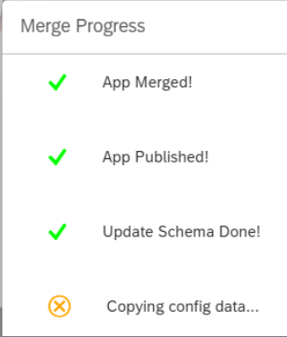

5.  If an error occurs during the merge process, the **"Show Logs"** option will display the error log as shown below;

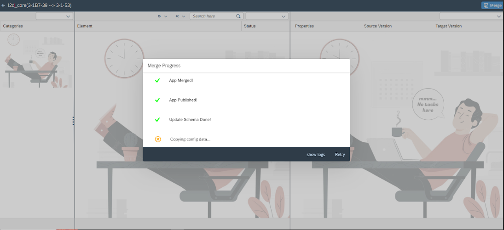

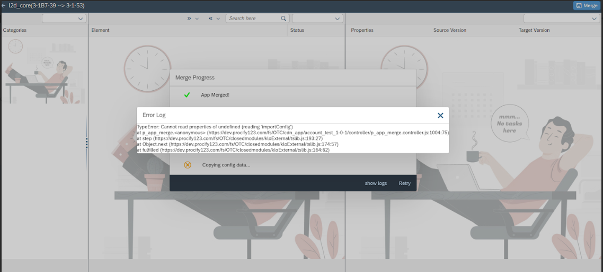

6.  If everything is successful, it will navigate back to the **App Management screen.**

7.  If source is branch then after merge before navigation user can opt to change the status of app to MERGED by clicking **YES.**

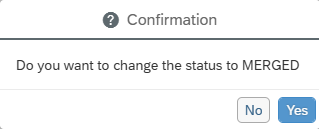

When there are unsaved (dirty) changes, navigation away from the current screen is prevented.

- A warning message is displayed with the following prompt:  
  > **"You have some changes that are not saved."**

- If the user selects **"Discard"**, navigation is allowed, and any unsaved changes are discarded.

- If the user selects **"Cancel"**, the warning message is closed, and navigation is halted, allowing the user to stay on the current screen.

> 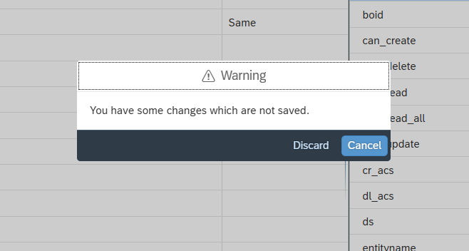

### **⚠️ Attention (Special Case)**

**📌 Note: If a child flavor is selected, a warning message will be displayed to inform the user.**

#### Example:

1.  **Current Versions:**

    - **Parent App Version**: 1.0.5

    - **Child App Version**: 1.0B.2 (with custom features)

2.  **Scenario:**

    - Developer 1 makes updates to the **Parent App** (e.g., new bug fixes, feature enhancements).

    - Developer 2 works on the **Child App** (e.g., new UI design).

3.  **Merging Child App:**

    - Developer 2 attempts to merge the child app

4.  **Warning Displayed:  
    > **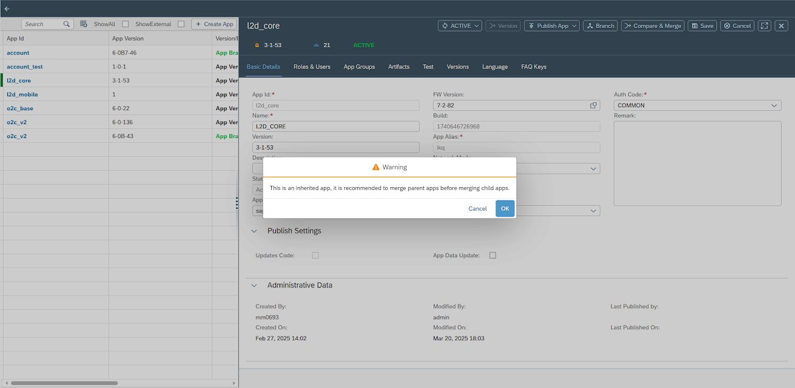

5.  **Action Taken:**

    - Developer 2 merges **Parent App (1.0.5)** first.

    - After the parent app is merged, Developer 2 proceeds with merging **Child App (1.0B.2)**, ensuring that all changes are consistent.

## 1.4. App Merge Screen (Post-Compare Phase);

The screen is split into three sections, displaying categories, their corresponding elements and its status, and detailed information for each item.

### 1.4.1. Categories – Grouped Conflict Areas

The **Categories** section ( on the left side of the screen) presents a list of all major areas where differences were detected during the comparison. These are grouped into logical classifications, such as:**Notifications**,**Settingvalue,Queries, Menuheader,screen,Property type etc.**

Some of these categories may display a **number in brackets (e.g., "Queries (2)")**, which indicates the count of conflicts found in that category. This helps users quickly identify where attention is needed.

### 1.4.2. Elements – Individual Conflicting Items

When you click on a category, the **Elements** section (middle pane) shows a list of individual items within that category that have been flagged with **conflicts.**Each element here represents a specific piece of the application—such as a particular UI component, a schema field, or a configuration file.

***Example:*** Clicking on **"Screen (1) "** reveals conflicting fields like p_bol_editor, s_query_sort_order, entity_property_name, s_relations,ret_ent.

### 1.4.3. Details – Conflict Resolution Interface

Once an element is selected, the Details section (rightmost pane) displays properties in side-by-side or split view showing how that specific item differs between the Source version and the Target version . This area allows you to:

- Review both versions of the element

- Understand what changed in each version since the Base

- Manually resolve conflicts by choosing one version, merging changes, or customizing a final output

**Example**: If both versions have updated the entity_property_name field differently, you can decide which version to keep or manually edit the final result.

## 1.5. Quick Filter Options

Use these filters to quickly navigate merge items based on their status:

| **Filter**      | **Description**                                                            |
|-----------------|----------------------------------------------------------------------------|
| **✅ Resolved** | **Shows only items that were auto-merged or manually resolved.**           |
| **⚠️ Conflict** | **Displays only items that have merge conflicts and require user action.** |
| **📄 All**      | **Shows all items — both resolved and conflicting.**                       |

### 1.5.1. Resolved

Items that have either been:

- Automatically merged (no conflict)

- Manually resolved by the user

**Behavior:**

- Hidden from default conflict view (unless this filter is selected).

- Marked with a **"Resolved"** icon in green color.

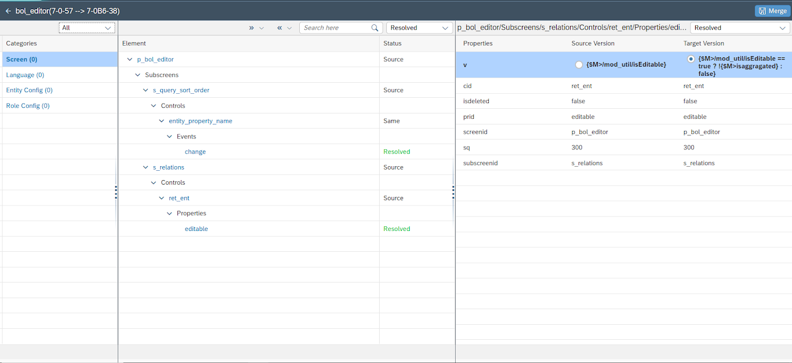

### 1.5.2. Conflict

Conflicts exist between Source and Target versions and User intervention is required.

**Behavior:**

- Automatically shown by default when entering conflict resolution screen

- Requires user to choose between:

  - Source version

  - Target version

  - Or edit manually to merge the two

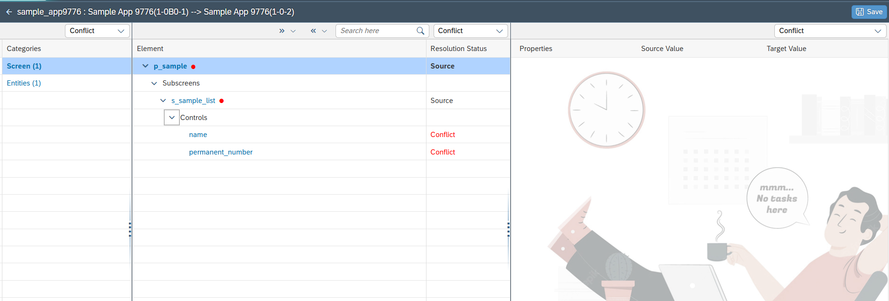

### 1.5.3. All

Shows **every item** involved in the merge process:

- Auto-merged

- Manually resolved

- Still unresolved

**Behavior:**

- Provides a full audit of what’s happening in the merge

- Useful for developers or reviewers on the changes done

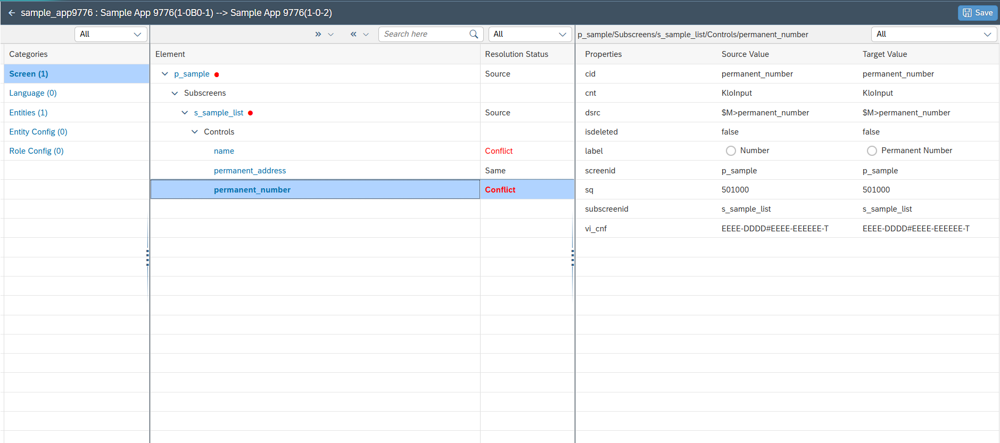

## 1.6. App Merge logs Screen

**Merge History screen:** This screen displays records of previously completed merges, allowing users to review the details of past merge activities.

**Navigation to the Screen:**

1.  Select Design Studio and navigate to Merge History

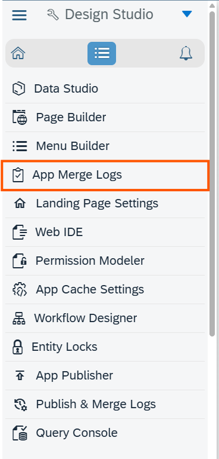

- Below is the image of the **Merge History** Screen.

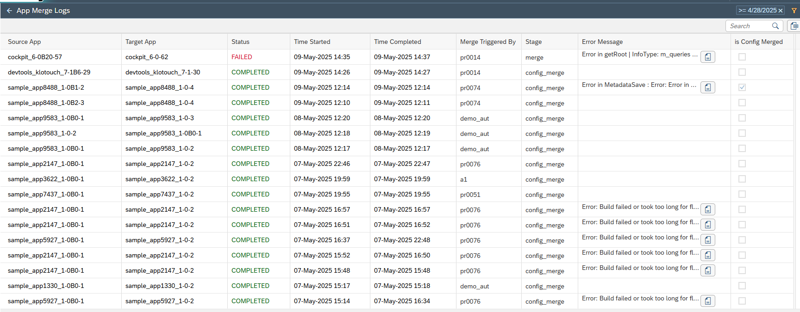

- Users can search the Merge History based on the data entered in the advanced search.

- The **'Target App'** in Advanced Search will display only the manager access app.

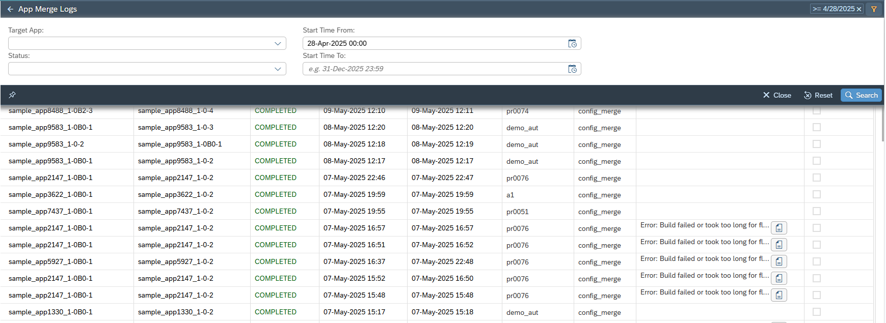

**Error message:**

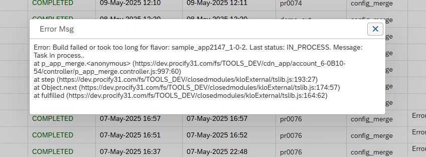

## 1.6. Upcoming Updates in App Merge;

| <h3 id="app-merge-roadmap">App Merge roadmap</h3> |  |  |
|---|---|---|
| Task |  Status | Description |
| <a href="https://procifynow.atlassian.net/browse/PROC-17121"><u>PROC-17121</u></a> | To do | Graphical representation will be given for branches. create a Branch, provide an option of user assignment from source branch. |
| <a href="https://procifynow.atlassian.net/browse/PROC-16893"><u>PROC-16893</u></a> | Upcoming | History of app merge |
| <a href="https://procifynow.atlassian.net/browse/PROC-17162"><u>PROC-17162</u></a> | Launched | Merge button change to save |
| <a href="https://procifynow.atlassian.net/browse/PROC-17154"><u>PROC-17154</u></a> | Launched | Source version , target version will change to Source value target,value |

## 1.7. FAQs

### **❓**:What happens if the build fails or the page is refreshed during the process?

**A**:If the build fails or the user refreshes the screen, the process will resume from the build stage, not from the merge stage.

Similarly, if the first two stages (e.g., schema validation and merge) are completed during the merge process but the process is interrupted midway, the system will resume from the update schema stage, not from the beginning.

### **❓:**What happens if there is a conflict during the process?

**A:**If there is a conflict — such as an app merge issue or a failure in two processes — a conflict screen will appear. This screen allows the user to resolve the conflicts before continuing with the merge.

Additionally, if config data is present in the flavor, and the buildconfig, or any other process fails, the conflict screen will also appear to let the user address the issue before proceeding.

### **❓**:What happens if the process is interrupted or canceled?

**A:**If the process is canceled or the screen is refreshed or the browser is changed, or an error occurs, the conflict screen will not reappear if the app merge has already been completed.

In this case, the process will resume from where it left off — except when copying config data. If the interruption happens during the config copy stage, the process will restart from getting the app details.
