# App Dependencies — Steps for usage

1.  To display the overridden data;

- **Step 1:** Go to the menu options and select **App Lifecycle** and then **App Dependencies.**

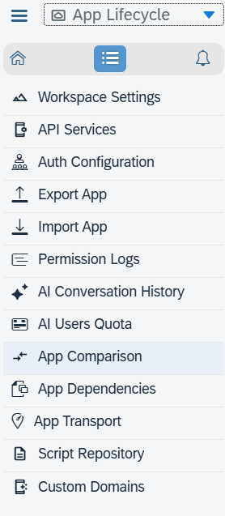

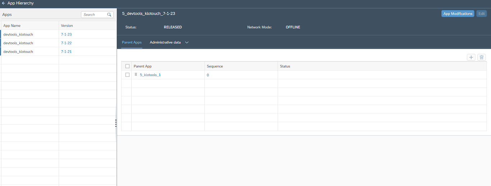

- App modification screen will display as shown below;

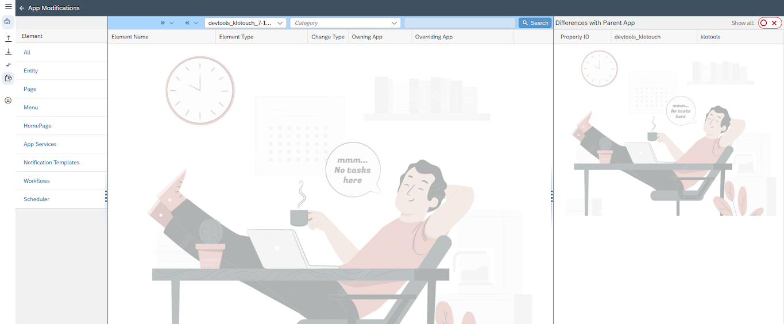

- Select the name of the child flavor from the flavor dropdown in the toolbar as shown below;

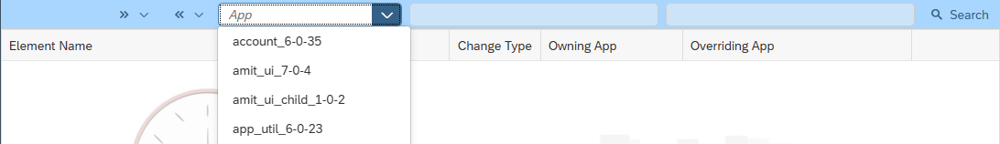

- Select the element types which need to be displayed.

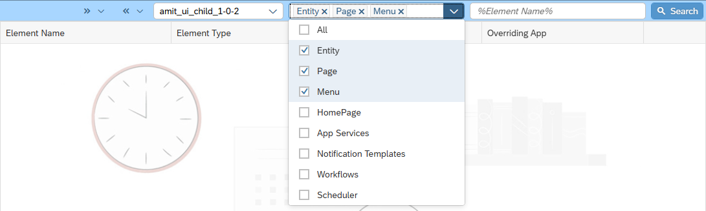

- Enter the text based on which the results must be filtered (if needed) and click on the search icon.

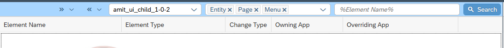

- The following table of the overridden elements will be displayed as shown below;

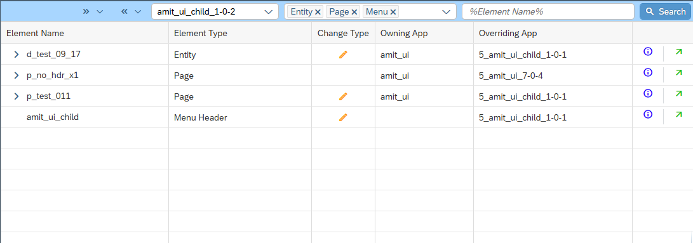

- The above displayed screenshot contains the following fields;

[TABLE]

2.  To categorize the displayed data;

- Select the Element which needs to be filtered from the category table.

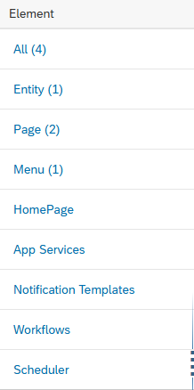

- Filtered table for the selected category will be displayed as shown below,

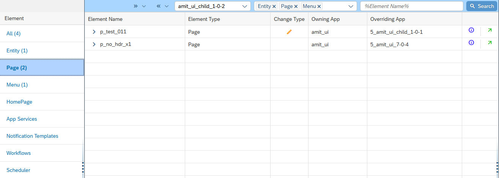

- Filter options are added for the "Element Name," "Owning app," and "Overriding app" columns in the App Modifications screen, allowing filtering by entering values

3.  To compare the properties of any element in the tree

- Click anywhere in the row of the element whose properties need to be compared.

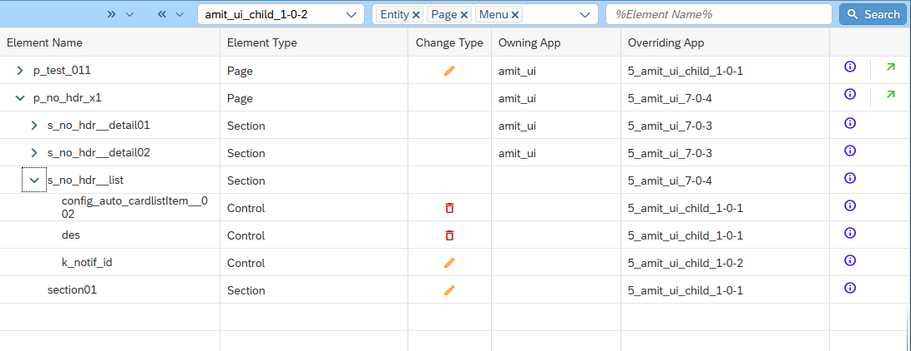

- A difference table comparing the modified properties of the element in the child app and parent app will be displayed as highlighted.

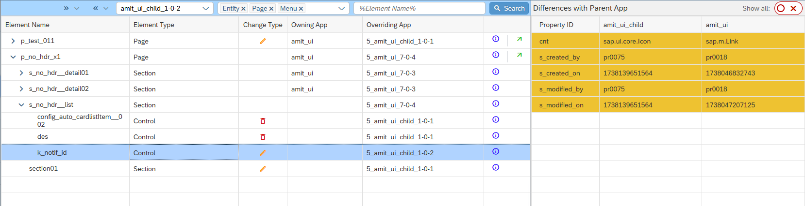

- If all the modified properties are required, enable the switch in the top right corner of the difference table. It will display all the properties highlighting the modified properties.

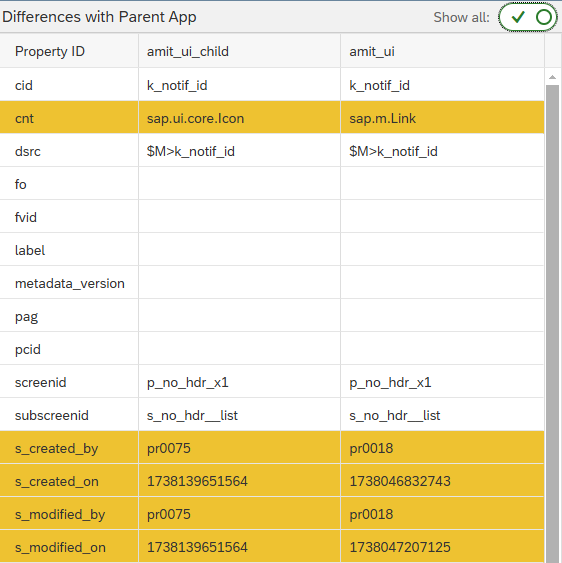

4.  To view the flavor versions and compare their properties

- Select the detail icon to compare the element in various flavor versions.

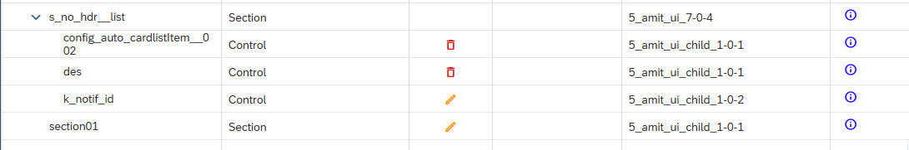

- Select any two flavors which need to be compared and click on the **compare** button.

Note : The detail section will display only the versions of the flavor where the particular element is being modified.

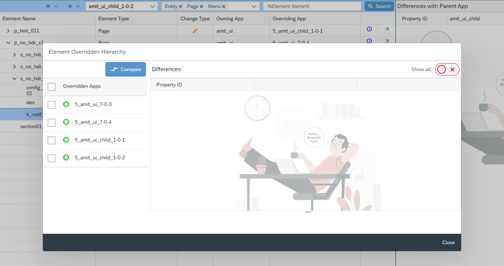

- A comparison table of the modified properties of the selected flavors will be displayed as shown below;

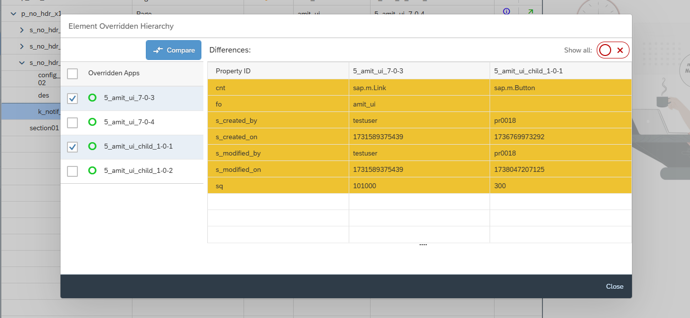

- Enabling the switch will display all the properties of the selected flavors.

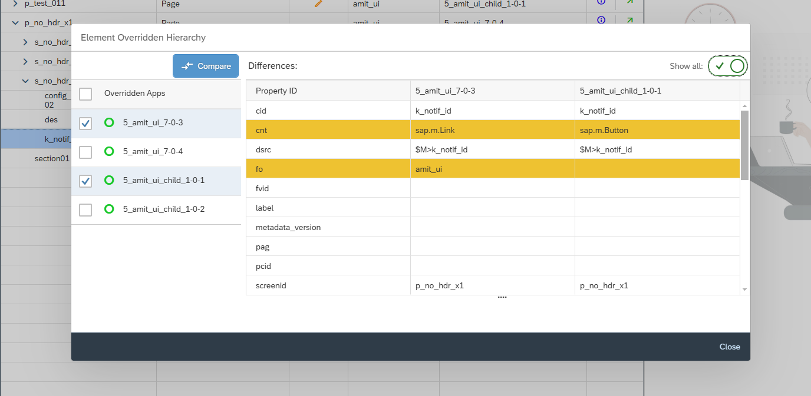

5.  To navigate to the selected screen;

- Select the navigation icon next to the detail icon to navigate to the respective screen.

> **Note :** Navigation icon will only be displayed for the root elements.

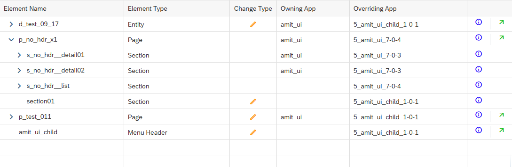

- The page will be navigated to the selected element's screen.

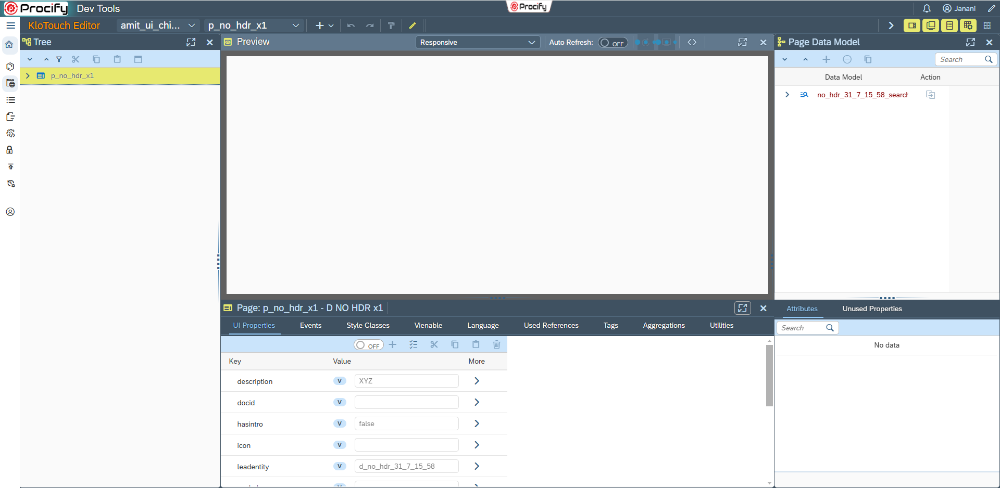
