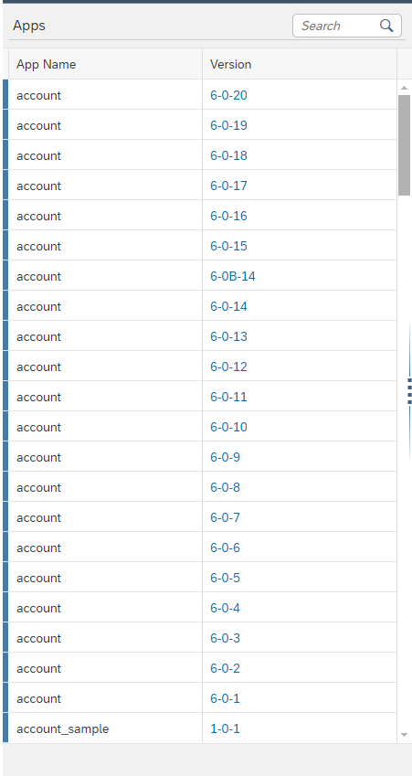
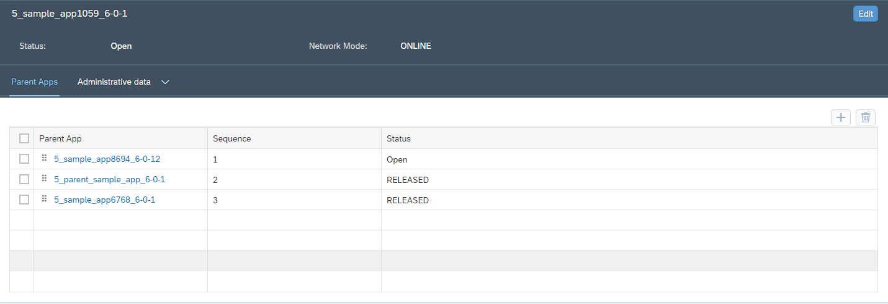
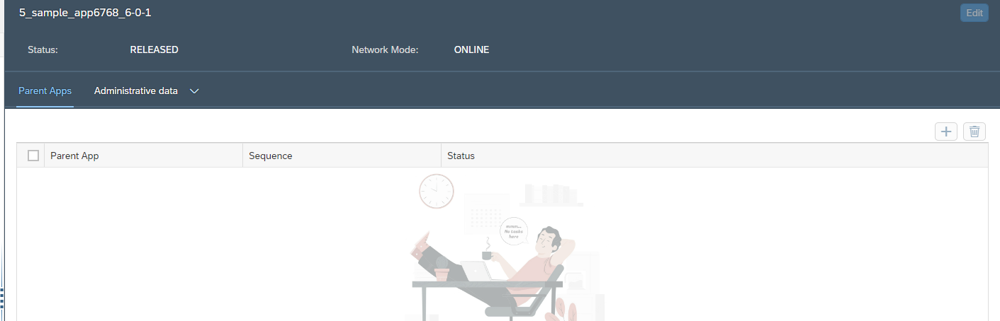
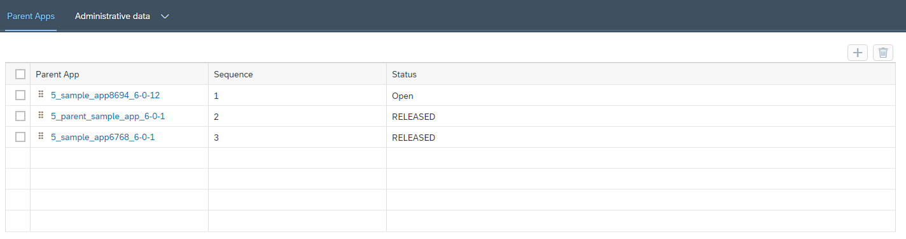
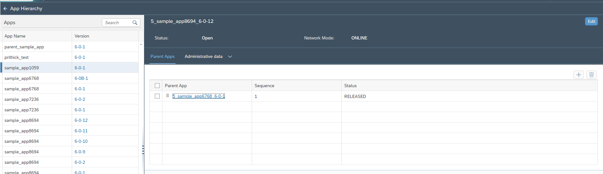
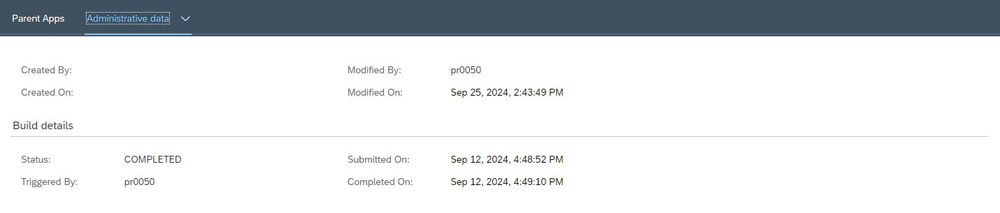
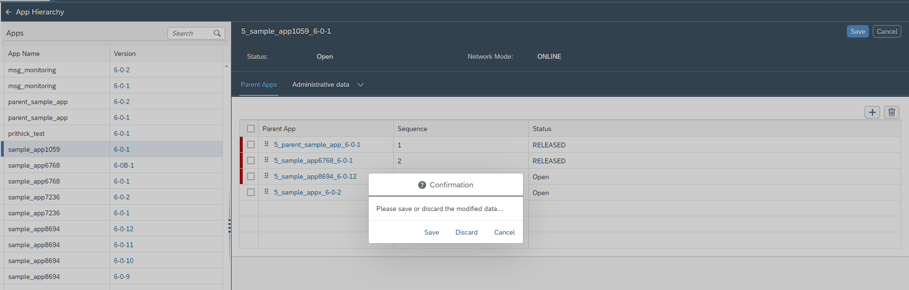
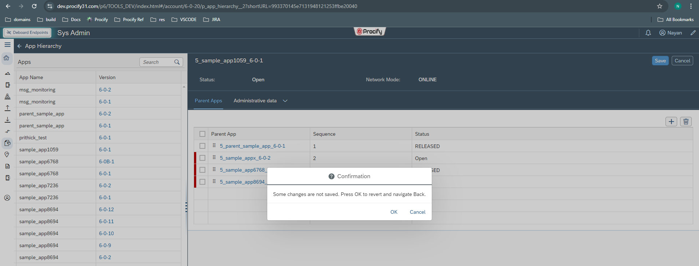

# App Dependencies — App Features

### App List : 

App List consists of all the internal Apps with Manager Access.

### App Detail :

Click on any app version to open its details. App detail section allows the users to see the App status, App Network Mode, and modify the list of Parent Apps.

**\*Only Active/Open Apps are Editable.**  

### 

**Note**: If a flavor version is deleted and a new version of the same flavor is assigned immediately, it won't work. The user must save changes before adding the new version.

### 

### Parent Apps:

Section where users can add, remove, and change the sequence of apps (by drag and drop) as parents to the current app.

Clicking on the parent app activates it, if it's assigned.  

### 

### 

### Administrative Data:

Shows Created and Modified fields along with the last Dev Build details.

### Selecting different App without saving:

Shows a popup with the options:

Cancel: Stays in the Current App.

Discard: Discards the changes made and sets the selected app as active.

Save: Opens a dialog with saving options and keeps the user in the current app. Refer to *Step 4* for the saving process.

### Navigating back without saving:

Cancel: Doesn’t navigate.  
OK: Doesn’t Save the changes made and navigates back.
