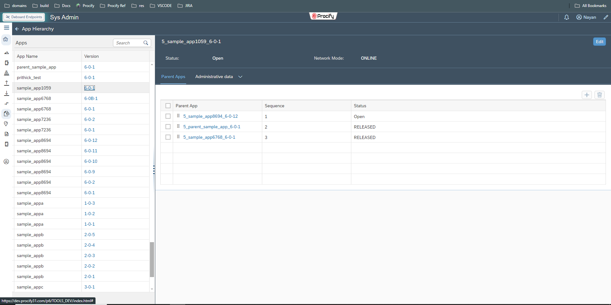
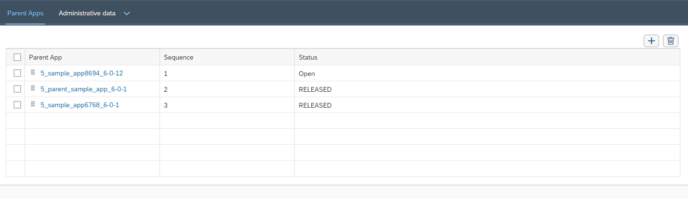
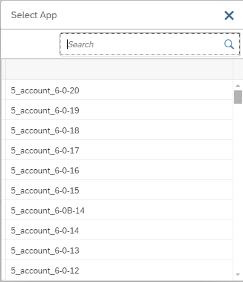
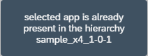
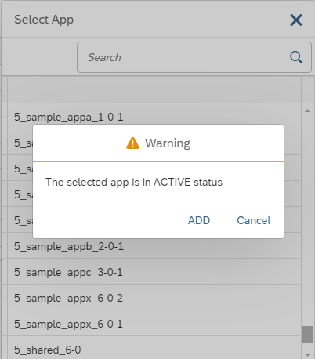
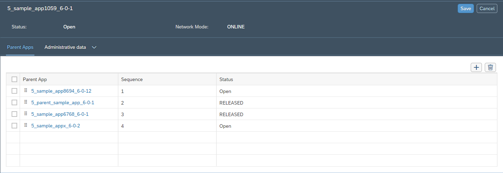
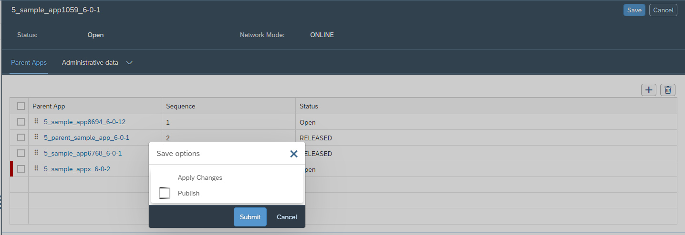
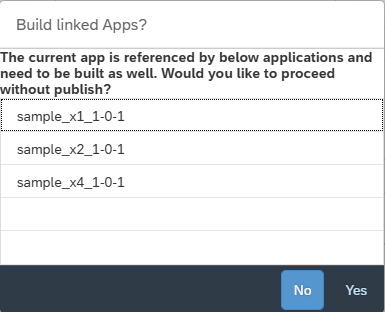
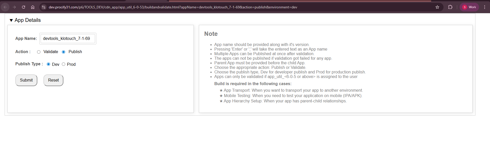
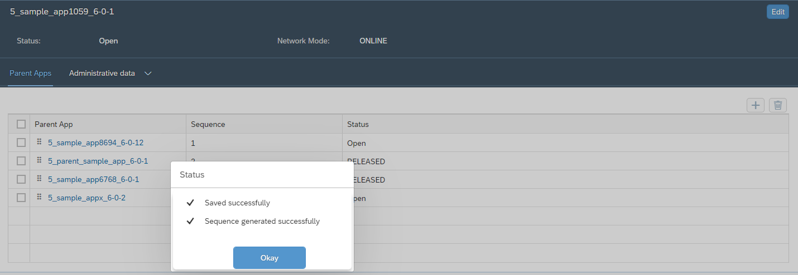

# App Dependencies — Process to Inherit Application

### **Step 1:** 

Select the version of the app you wish to inherit and click the edit button.

### 

### **Step 2**: 

Click on the “+” button and a popup will appear.

### 

### 

### **Step 3**: 

Select App from the dialog and it will be added in Parent Apps.

**NOTE**: DEPRECATED or DISCARDED Apps won’t be shown in the list.

If the selected flavor is already present in the hierarchy, addition will not be allowed, and a message toast will be displayed. Otherwise, the process will proceed as usual.

Popup will be shown if an App with status other than RELEASED is selected.  

Press on the ADD button to add the App to the parent List (If the App is not RELEASED).

### **Step 4:** 

Click on the save button after making changes.

A Popup will be shown for choosing the options that needs to be done after Save  

Select the Options provided;  
*Apply Changes*: Overridden things in the child App will revert back to the original as parent App.(Currently Blocked as it is having some issues)

*Publish*: It will navigate to the Validate and Build Page(if Assigned/present) with the current App selected.

**Note:** When adding or removing parent apps from the current apps, all child apps of the current ones must be updated. To ensure that all flavors are published, the **"Publish"** option needs to be selected. If the user does not select **"Publish,"** a dialog will appear as shown below.

If the user intends to publish, they should click **"No,"** which will return to the previous dialog. If they prefer not to publish, they should click **"Yes,"** and the process will proceed with generateSequence without publishing.

  
Sequence generation is done on every save.

**Note:** After generating sequence , build is required for the app to see the changes.

##
