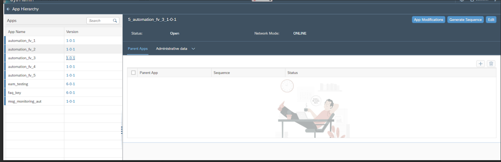

# App Dependencies — TERMS

#### Apply Changes:

Overridden things in the child App will revert back to the original as parent App.

#### Generate Sequence: 

Sequence is generated in the DB according to the parent Apps in the used Fvs.

When clicking 'Save’, the sequence is generated automatically.The **Generate sequence** button will generate the sequence in db, if the user is unsure of the sequence generated.
