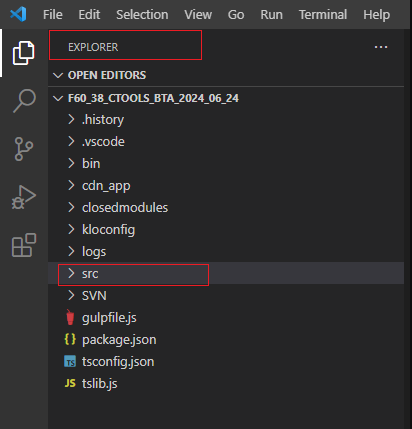
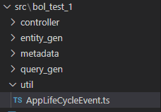
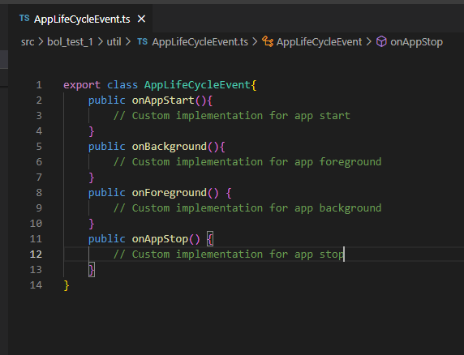

# How to use the feature

<table>
<colgroup>
<col style="width: 6%" />
<col style="width: 93%" />
</colgroup>
<thead>
<tr class="header">
<th><strong>SN</strong></th>
<th><strong>Steps</strong></th>
</tr>
<tr class="odd">
<th>1</th>
<th>Open <strong>VS Code.</strong> <a href="https://docs.google.com/document/d/1clcrzrDYxol9CEZAzVlbwoscosjGwzo3uwGd1GEij6M/edit?usp=sharing"><u>Setup a Private Node</u></a> , if it's not existing.</th>
</tr>
<tr class="header">
<th>2</th>
<th>
Select the <strong>src</strong> folder from the <strong>Explorer panel</strong> of VS Code.

</th>
</tr>
<tr class="odd">
<th>3</th>
<th>
Inside the <strong>src folder,</strong> choose a <strong>flavor</strong> (ex: bol_test_1) and create a file called <strong>AppLifeCycleEvent.ts</strong> in the <strong>util</strong> folder of flavor.

<strong>Note: AppLifeCycleEvent.ts</strong> is Case-Sensitive. Please make sure the file name is typed exactly as shown here.

</th>
</tr>
<tr class="header">
<th>4</th>
<th>
Create public methods.

(name them as <strong>onAppStart, onBackground, onForeground,</strong> and <strong>onAppStop</strong>)

</th>
</tr>
<tr class="odd">
<th>5</th>
<th>Implement the required logic inside the class based on the application requirement.</th>
</tr>
</thead>
<tbody>
</tbody>
</table>

### Important Note:

After the required application has been installed, whenever a **new method** is added to the AppLifeCycleEvent class, **the application must be re-registered to recognize and call these new methods**. This ensures that the framework is aware of all lifecycle methods and can trigger them appropriately.
