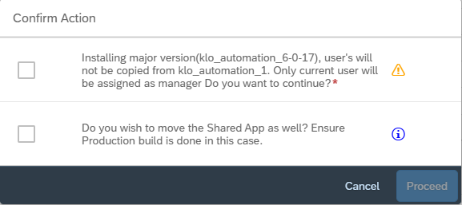

# Installing Shared flavor along with any app

**Step 1**:Try to Install any app as mentioned in the above process. During Installation a Dialog box will appear for asking permission to move shared flavor

**Step 2**: Select shared column and proceed to get shared flavor as well.
