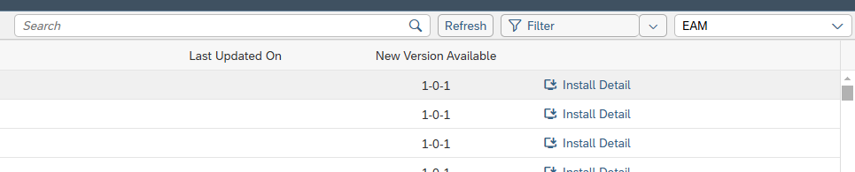
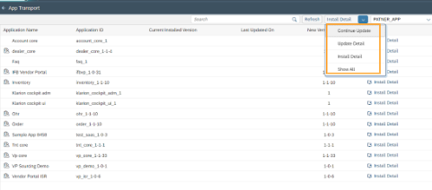
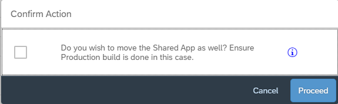
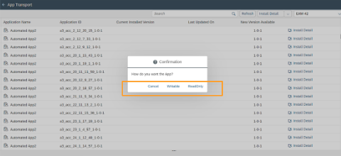
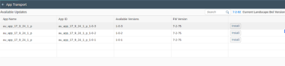
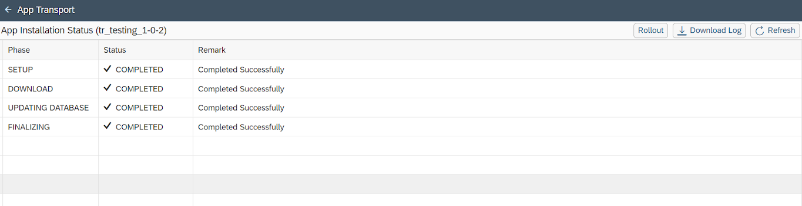

# Install a readable app from the Source

Movement via readable apps refers to zip movement from one system to another. If an app is moved as readable then it can’t be developed in the target system.

**Step 1: User screendev details**

By default the list will consist of the flavors which are having updates or if it is a new flavor which is not present in the landscape. One can view all apps by clicking on the show all toggle button highlighted in the below image. Using fuzzy search one can filter flavors based on upgrade details, install details and Installed.

A **new detail page** will appear as shown below:

Here, it will show the list of available updates in the first section and installed versions of the app in the other section.

**Step 2: Click on Update**

Click on one of the available updates to install.

If the current landscape is not **DEV** a dialog will open asking permissions for shared flavor movement.

Click on Proceed to continue. If shared flavor is needed select the checkbox.

If the current landscape is **DEV** a message box will appear asking to install the app as Readable or Writable.

**ReadOnly:** This implies that the app will be downloaded as readable, you will not be able to edit or make any changes in the app.

**Writable:** This gives you access to make required changes in the app configuration.

**The above process is the same for writable flavor as well.**

**Step 3:** **Install the Readable app**

Click on the **As Readable** button to install the app as a readable app only.

**Step 4:** **Click on the Rollout button**

Once every step is completed click on the **Rollout** button.

