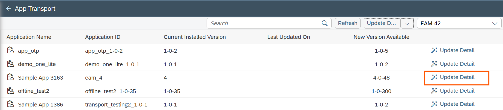
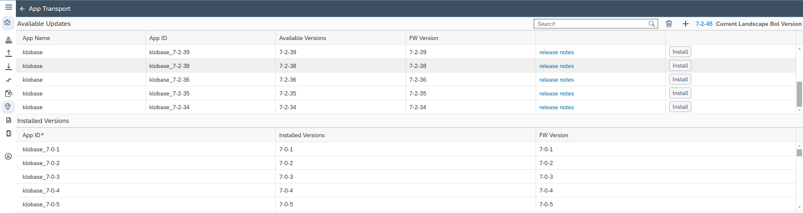
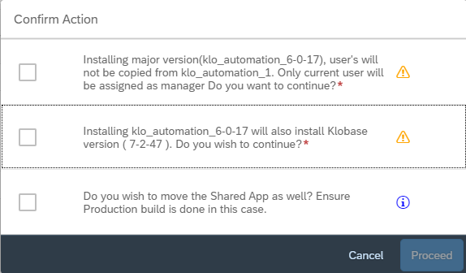

# Install a readable application with a different kloBase version

**Step 1:** click on update detail of the particular app which needs to be moved.

**Step 2:** After navigating to the detail section click on install button of the respective app version as shown below.

**Step 3:** provide acceptance for the mandatory conditions(warning icon will be present ) and click on proceed.

Note: providing permission for installing klobase is mandatory to proceed.

> Shared update approval will be shown in QA or PRD systems only. If needed, select the checkbox
>
> In case of App Major/minor version movement one more approval needs to be provided.

**Result:** Shared flavor update happened along with klobase update.
