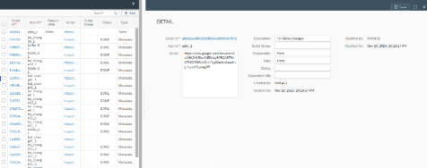
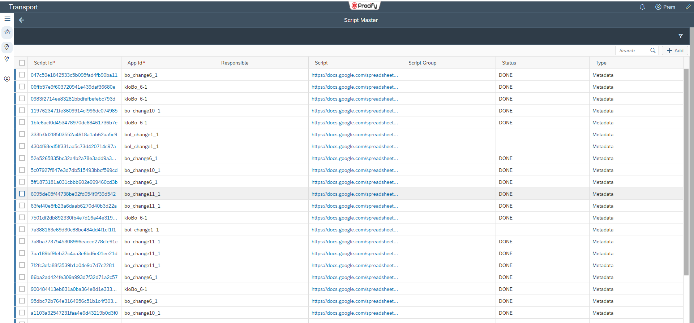
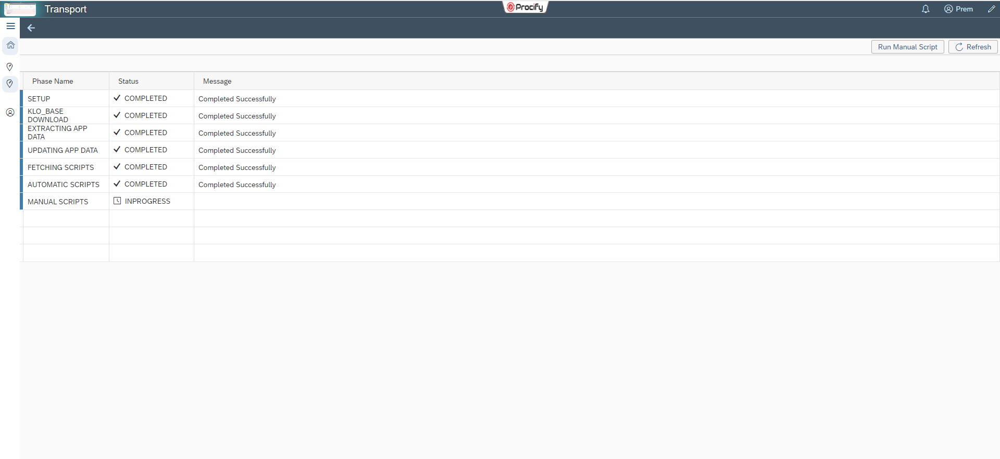
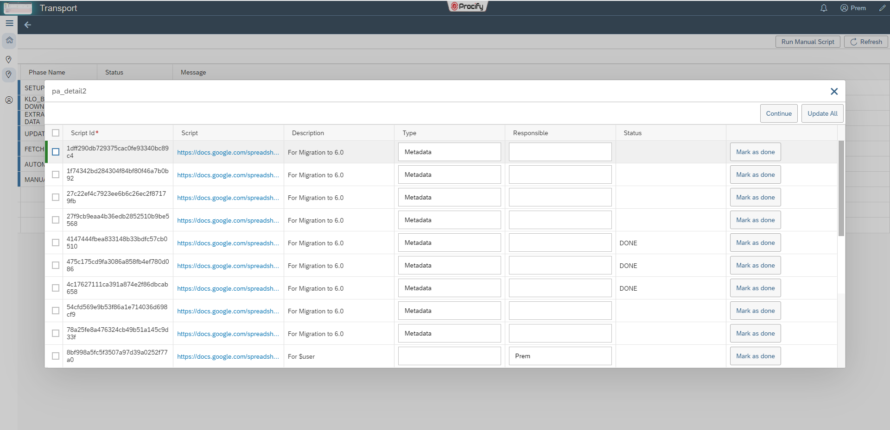
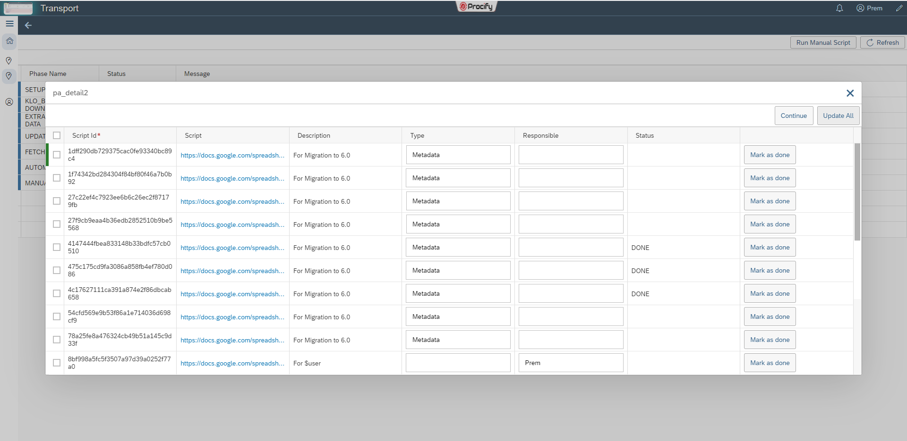

# Install a writable application with a different kloBase version

For installing a writable application with a different KloBase Version we need to use the Script Repository.

**Maintain script for the particular app in the source system**

**Step 1:** Go to the Script Repository page of the source.

**Step 2:** Click on the add button to create a new script.

**Step 3:** After filling in all the required fields, click the **Save** button.

