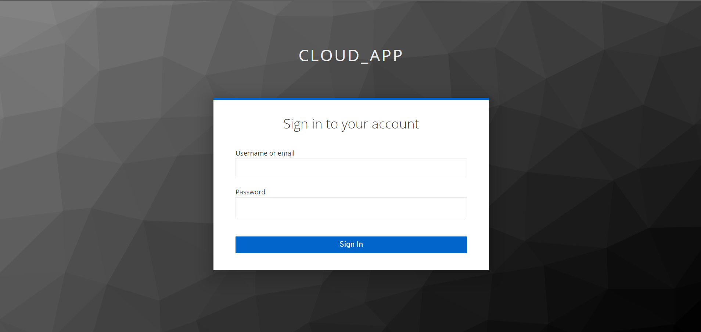
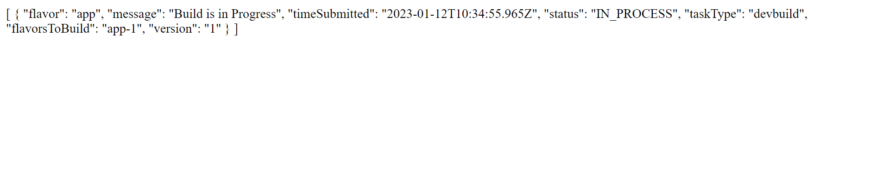
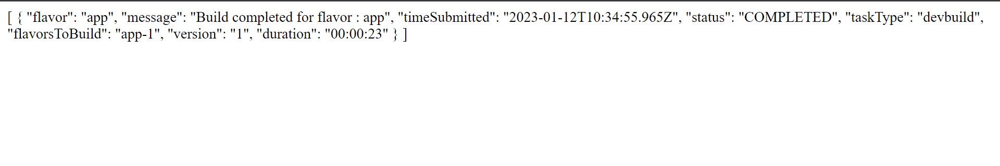

# Steps to build flavor

**Step 1 - Trigger Build URL**

Trigger the build URL in the browser.

**URL:**

https://maven63.com/node/mytrunk/core_fw_6-0/generateBuild?fv=eam_1&buildtype=devBuild

Provide the user credentials and click on sign in.

Once triggered it will show you the flavor that is being used, the time, the task type, the status version, etc. The status will be **IN_PROCESS**.

**Step 2 - Check the flavor creation status**

Change the buildetype to checkstatus and trigger the URL in the browser.

In order to change buildType to checkstatus we need to mention buildType=checkstatus in the url.

**Url:** [https://maven63.com/node/mytrunk/core_fw_6-0/generateBuild?fv=app_1&buildType=checkstatus](https://maven63.com/node/mytrunk/core_fw_6-0/generateBuild?fv=app_1&buildtype=checkstatus)

If Status is

- **In Queue**: This status indicates that your build request is waiting to be processed. The reason for the delay could be that another flavor build is currently being processed on the server. Once the server finishes the other build, your build will be processed next.

- **In Process**: This status means that your flavor build is currently being processed on the server. It’s in progress, and the system is actively working on your build.

- **Completed**: This status signifies that your flavor build has been successfully completed. At this point, you can proceed with further actions or processes related to this build.
