# App Settings — Steps To Use Settings Definition

1)  Go to the menu **App Settings**.

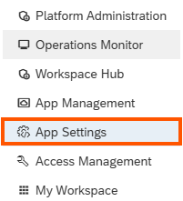

2)  Click on the sub-menu named **Settings Definition** to open it.

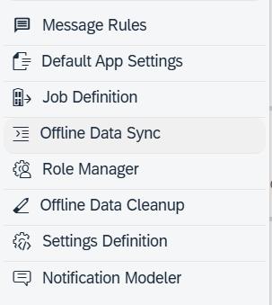

3)  The Screen will be loaded initially with all the settings inside their respective Settings Group in a tree in ascending order based on their sequence value. Settings Group will also be in ascending order of their sequence values.

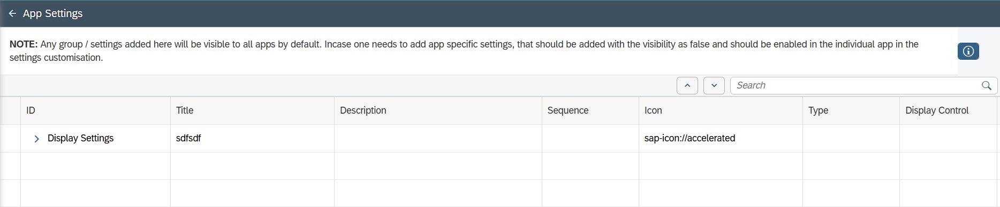

4)  Click on the **Edit** option in the upper right corner of the screen.

> 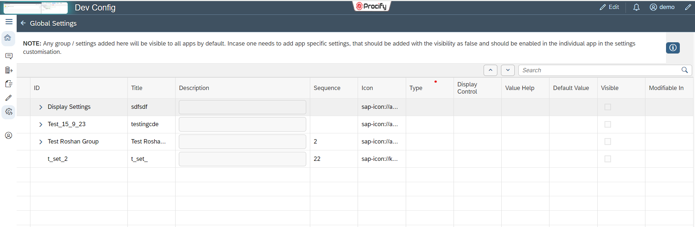

5)  On the toolbar of the screen, you will find the **Create Group, Create Settings, Save, Delete** and **Cancel** buttons.

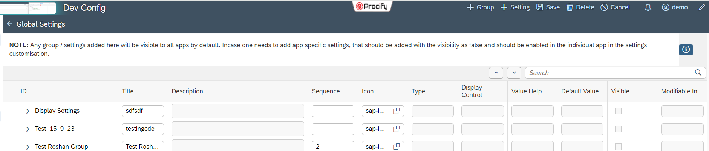

6)  You can create the settings group by clicking the **+Group** button on the top right of the screen. It will ask the developer to provide the Settings Group ID in an input dialog. Click on the **Create** button in the input dialog.

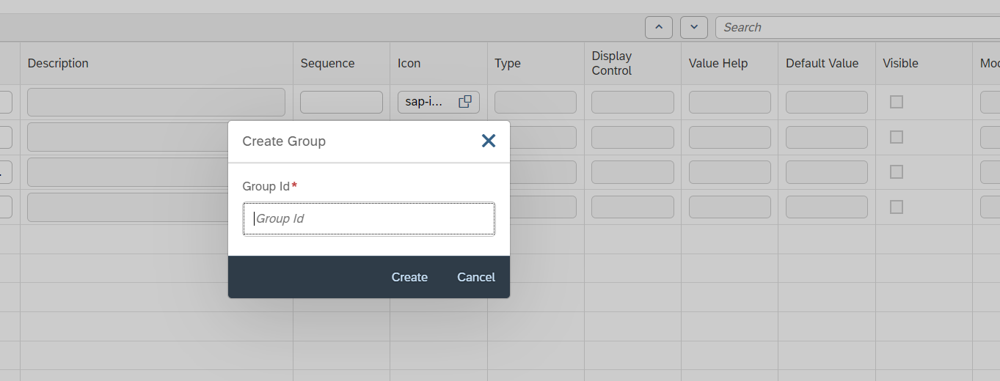

7)  After creating a new Settings Group, users can see it updated in the Table Tree below. Users need to fill in the **Sequence number, Title** and **Icon** of that settings group and then click on the **Save** button to save the newly created settings group. All the settings groups will now be shown in ascending order of their sequence value.

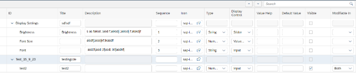

8)  The developer then needs to create **Settings** inside the newly created settings group. To do that the user needs to select that settings group on the tree and then click on **+Setting** Button.

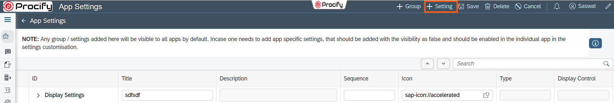

9)  It will ask for the **Settings ID** under **Create Setting** and the developer needs to provide the ID and click on the **Create** button.

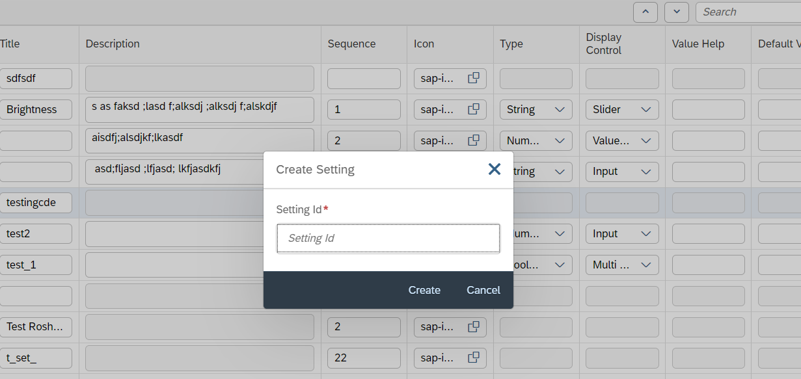

10) A new setting will be created inside the selected settings group. The developer needs to fill in the **Title, Description, Sequence Number, Icon, Data Type, UI type, Vh ID, Default value, visible** and **modifiable_in** and then click on **Save** to save all the changes. After successful save, all the settings in their respective groups will be in ascending order of their sequence value.

| **Components**  | **Descriptions**                                                                                                                                                      |
|-----------------|-----------------------------------------------------------------------------------------------------------------------------------------------------------------------|
| Title           | It's the name you want to put to identify the setting control.                                                                                                        |
| Description     | A short description of the setting element.                                                                                                                           |
| Sequence Number | This will put the setting elements according to the order of its sequence.                                                                                            |
| Icon            | This implies an individual settings icon.                                                                                                                             |
| Data Type       | It's the type of the setting, whether it's a number, an integer or a string etc.                                                                                      |
| UI Type         | It is the type of Control that you want to render in the UI for those Settings such as Input, Slider, value Help, etc.                                                |
| Vh ID           | It is the value help ID created from bol editor on application flavor and it will be shown to the user as value help items in case the user has chosen UI type as VH. |
| Default Value   | It's a pre-value that has been set for some particular setting. This is changeable according to your requirements.                                                    |
| visible         | This implies who will be able to see the particular setting item.                                                                                                     |
| modifiable in   | This puts down conditions on who can see the setting items and so on.                                                                                                 |

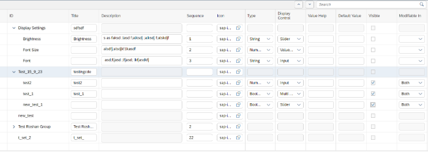

11) To update any details click on the **edit** button in the toolbar and after updating the details click on **save** to commit the changes.

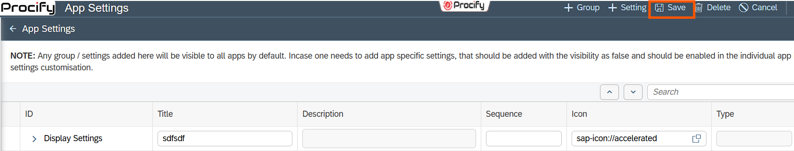

12) If you have updated any details and do not want it to commit then you can click on the **reset** button in the toolbar to set the details to the original state.

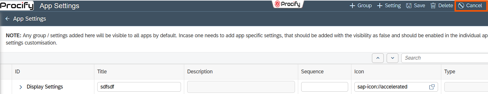
