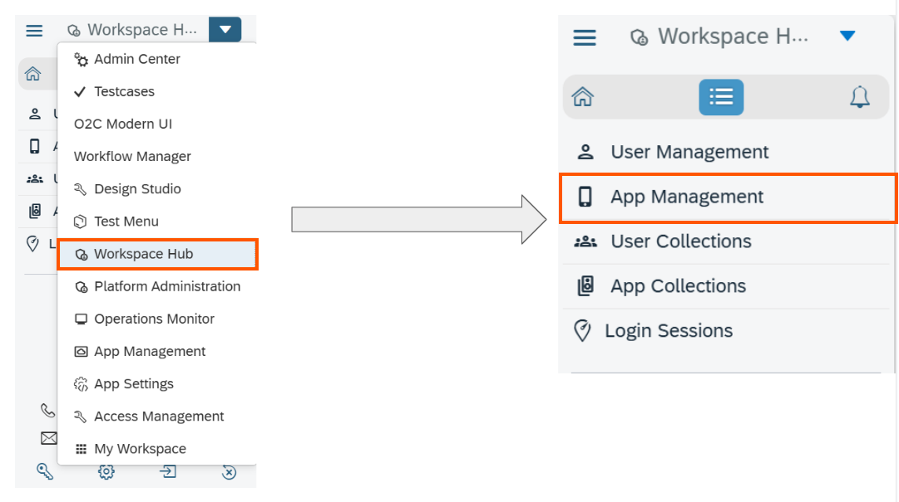
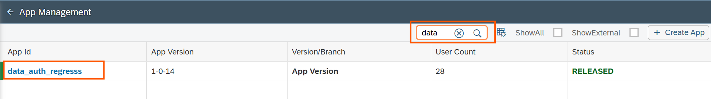
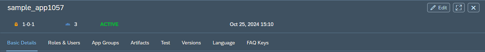
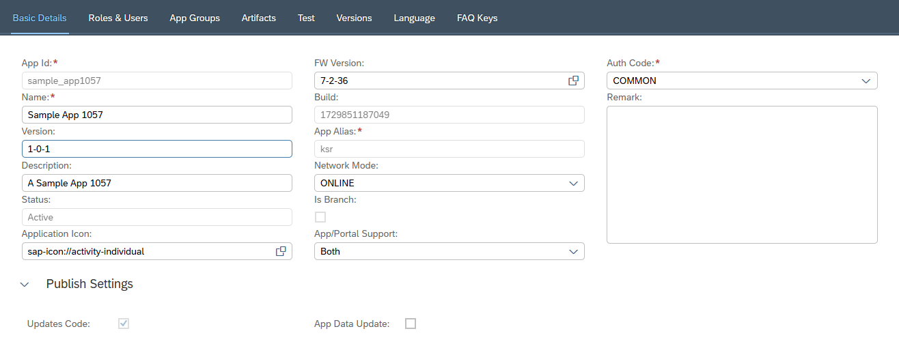
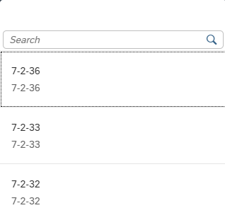

# How to Change the Framework version for apps?

To update the FW version, please follow the steps outlined below.

## Step 1: Navigate to theApp Management page

- SelectWorkspace Hub from menu group and underWorkspace Hub, selectApp Management menu.

- Search for the app in the search bar and click on the app to get the details.

## Step 2: Change FW version of App

- Upon selection of App, Apps detail page will be displayed .

- Click on the edit button to make the changes /editable format.

- When selecting the App details, go to the FW version section and choose the desired version from the dropdown list.

> Note: Framework versions listed in the **popup** will be the latest three FW versions present in the current landscape.

- Select desiredFramework version and click on save. Please read the FW version release note before choosing the same.

<!-- -->

- On clicking save button, the App FW version will be updated with the respective version selected.

> **Note**: App should be published upon changing FW version change.
