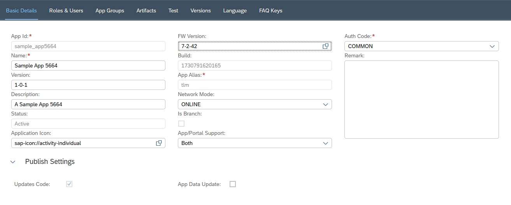
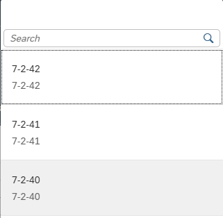
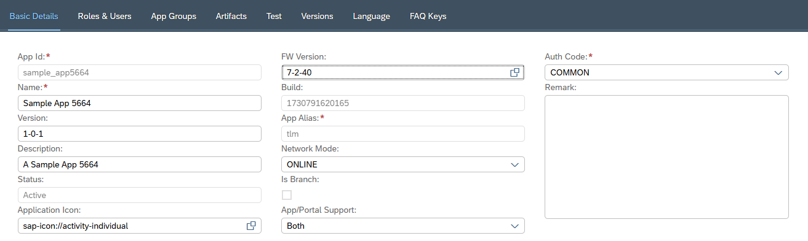

# Downgrading Platform Update (Rollback Process)

If an issue occurs after a FW update (such as bugs, crashes, or performance degradation), you may need to roll back(downgrade) the update to maintain the app's smooth functionality.

In this case we will downgrade the latest version of FW and work with the older released FW version that's working fine. For production environments, we need to revert the platform update on affected applications.

## Steps to downgrade FW version of App

Follow the [<u>step1</u>](#step-1-navigate-to-theapp-management-page) as mentioned above

- Upon selection of App, Apps detail page will be displayed .

- Click on the edit button to make the changes /editable format.

- When selecting the App details, go to the FW version section and choose the desired version from the dropdown list.

> Note: Framework versions listed in the **popup** will be the latest three FW versions present in the current landscape.

- So to downgrade the FW version, select the desired running version of FW for the app.

> 
>
> 

- On clicking save button, the App FW version will be updated with the respective version selected.

> **Note**: App should be published upon changing FW version change
