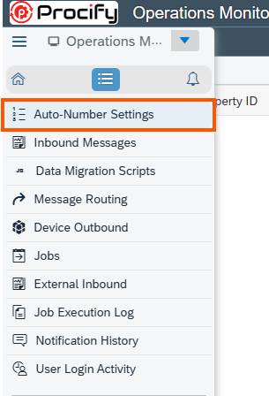
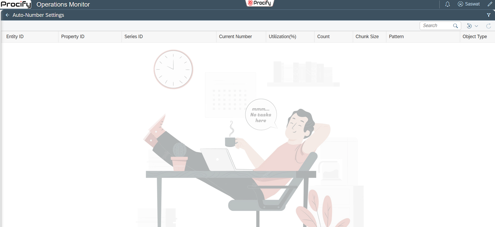
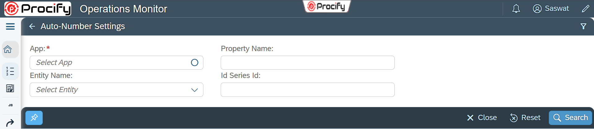
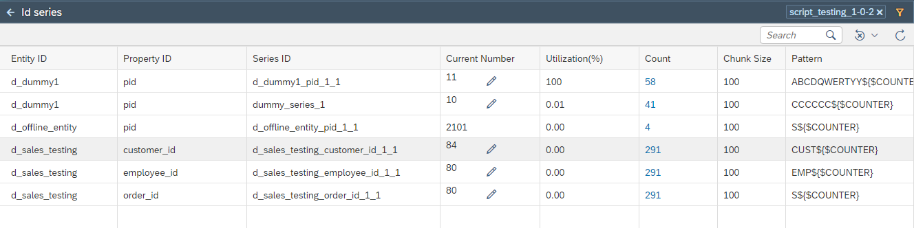
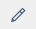
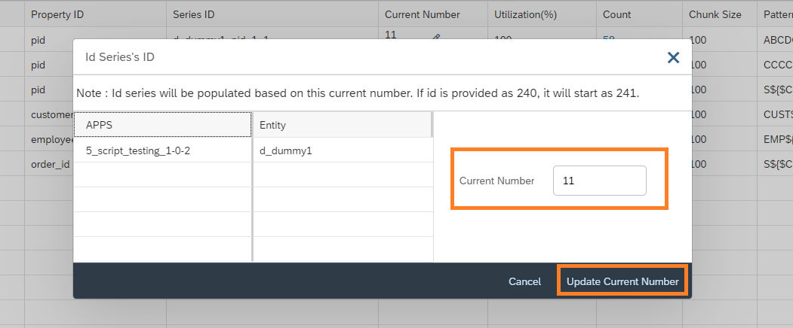
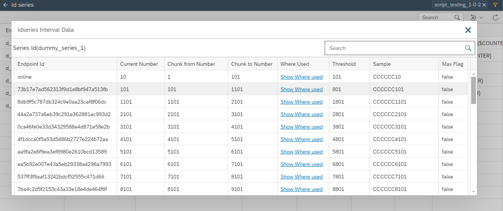
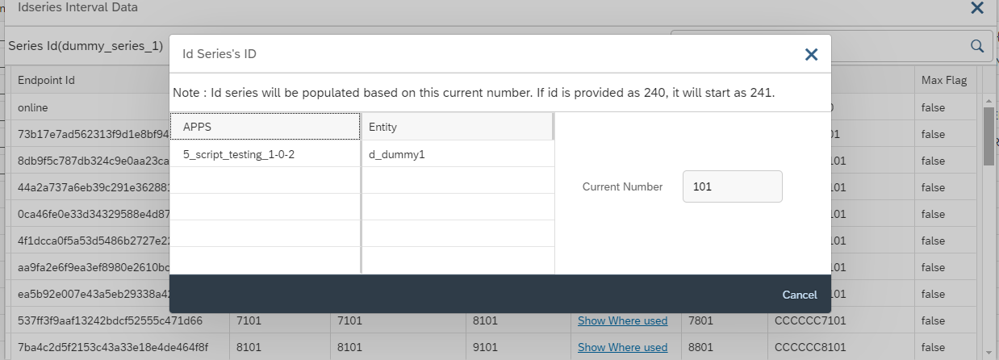

# Navigate to Auto-Number Settings Screen

**Step 1:** Go to the menu options and select **Operations Monitor.**

**Step 2 : Auto-Number Settings Screen**

**Step 3 : Advanced Search**

Click on **Advanced search**, and fill **App id**, **entity name**, **property name** and **id series id** and click on **search**.

**NOTE** : In Advanced search, selecting the app is mandatory.

**Step 4: Update ID Sequences current number**

After firing advanced search, ID Sequences definition data will render based on filter data.

To Update ID Sequences current number, click on the **edit icon(****)** on the current number column. It will open a popup to reset the current number.

Reset the current number and click on the Update **Current Number** button.

**Note** : On click of Update current Number, it will ask for confirmation. Based on the response, it will either update the current number or close the dialog.

**Step 5 : Navigate to the ID series interval data**

On click on count link, it will open a dialog with all the intervals related to the selected definition.

Step 6: **Show which apps are using ID Sequences**

Click the "show_where_used" link to view which apps use the ID series.

