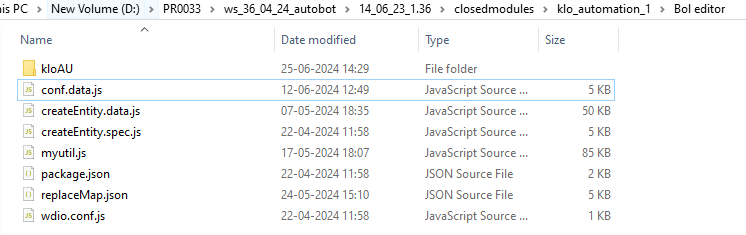
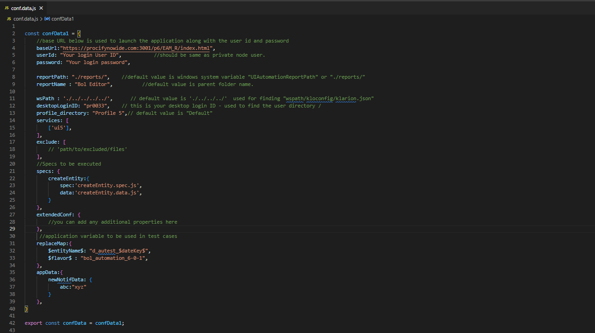
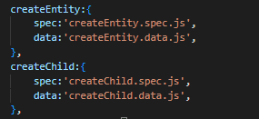
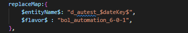
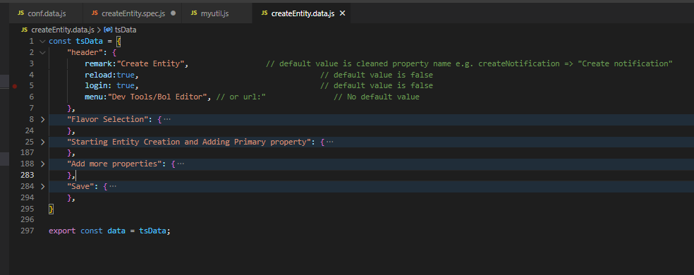
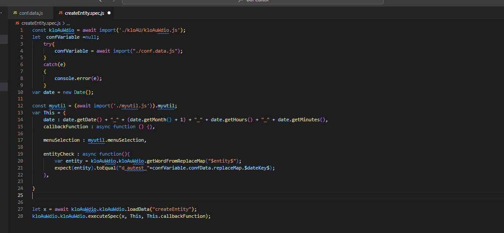
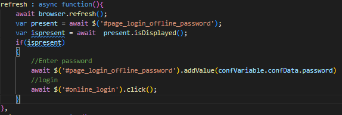
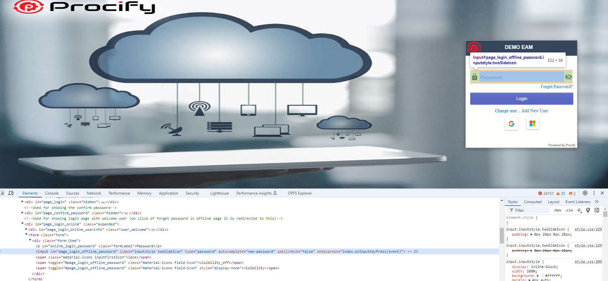
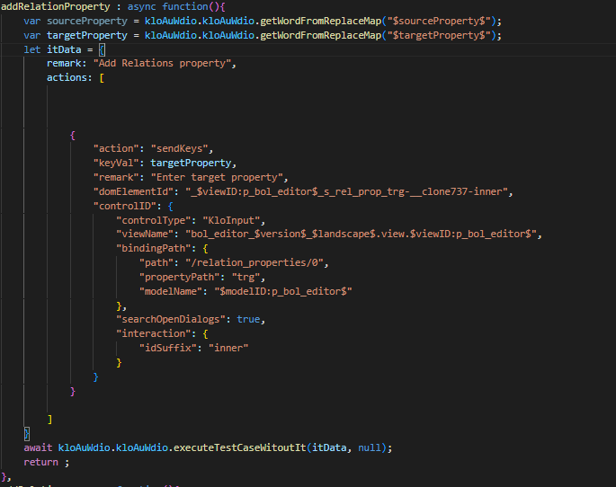

# File Structure

Within the closedmodules directory, establish a new folder titled klo_automation_1. Within this, create another folder dedicated to your automation, housing all requisite files needed to execute the automation.

**Note :- Adhering to this specific structure is crucial for the successful execution of the automation. The automation process attempts to access certain files, notably the klarion.json file located within the kloconfig folder, from your private node. Therefore, maintaining this structure ensures that the automation can correctly locate and utilize these files from their designated locations. Should you deviate from this structure, you will need to adjust the paths in conf.data.js accordingly to reflect the correct locations of your files.**

The files mentioned above are essential for running the automation. Let's examine each of these files individually.

### **kloAuWdio.js**

Located within the kloAu directory, this file stands as the core component of the automation suite. It houses all necessary functions tasked with transforming array-formatted code into a conventional format. Since WDIO cannot interpret array formats directly, this conversion is imperative for compatibility.

### **conf.data.js**

This file will house all fundamental configurations necessary for the automation to operate, including user credentials, URLs, and the specific Chrome directory in which the execution should occur.

1.  baseUrl: Users must specify the URL to be accessed at the beginning of the automation process.

2.  userId: The User ID associated with the login or registration conducted on the previously mentioned URL.

3.  Password: The user's password, if applicable.

4.  desktopLoginID: For the desktop login ID, users need to supply the User ID used for logging in on their desktop.

5.  Profile_directory: Users must indicate the Chrome profile directory where they intend to run the automation.

6.  Specs: Within the Specs object, users must list the names of the specs they wish to execute, adhering to a sequential order. It's important to note that the names provided are case-sensitive. Ensure consistency in naming across all references to avoid discrepancies.

> **NOTE :- The Spec and Data file names should be entered exactly as demonstrated in the preceding example. Additionally, the object name must remain consistent. Please remember that the names provided are case-sensitive.**

7.  ReplaceMap :-This file includes all the application variables required for test cases. Variables must be declared within double dollar signs, like \$variable_name\$

##### **How replaceMap Operates in Automation:**

> In the array format data file, replaceMap searches for all variables declared either in conf.data.js or at runtime within the data file itself. Whenever it encounters a match, it substitutes the matched variable with the corresponding value from the object's key-value pair.
>
> **Note**: By default, two variables, \$dateKey\$ and \$landscape\$, are automatically created within replaceMap at runtime. These variables can also be utilized within your data file.

- **\$dateKey\$**: This variable holds the current date and time. It's particularly useful for generating unique names for entities and screens each time the automation runs. For instance, in the example provided, the \$entityName\$ variable is set to "d_autest\_\$dateKey\$". During execution, %dateKey% is replaced with the current date and time, resulting in a unique identifier like d_autest_25_06_12_11.

- **\$landscape\$**: Contains the name of the landscape for which the private node was created. This value is derived from the klarion.json file, indicating the landscape's name.

### **spec_name.data.js**

This file encompasses all the scripts generated by the test recorder. Essentially, it stores the test script or code in array format that was produced.

Observing the header section of the tsData variable, we find an object containing several key-value pairs. Let's explore these details further.

- Remark: This field allows you to summarize what the entire specs entails or outlines the actions performed by the specs. A point to remember is that this summary will also appear as the specs name in the HTML report.

- Reload and Login: These should always be set to true to ensure that the login process occurs every time the automation starts.

- Menu: Used to specify the navigation path to the desired menu. The structure follows the pattern of the menu group name, preceded by a forward slash, and then the menu name. For instance, to open the Procify Data Studio inside App Builder, the menu entry would be “App Builder/Procify Data Studio”. It's important to note that both the menu group and menu name are case-sensitive.

**Note: Test Spec/Data files generated from the Test Recorder will not include the menu key-value pair in the header object. Developers must manually add this information.**

### **spec_name.spec.js**

This file encompasses all the function declarations originally listed or created in the myUtil.js file. Additionally, it provides a designated space for declaring any function that is intended to be utilized exclusively within its corresponding data file.

**NOTE :- In the spec_name.spec.js file, towards the end, there's a highlighted segment shown in the accompanying image. Within the loadData function located at the bottom of this file, you must include your spec's name as a parameter. This name should precisely match the one listed under the specs section in the conf.data.js file. To ensure consistency across your files and facilitate the automation process, it's crucial to maintain identical naming conventions. Any discrepancy in naming, including variations in capitalization, will prevent the automation from initiating.**

### **myUtil.js**

This file will contain all the functions that you want to use throughout your entire automation. We can create function in two formats here :-

#### Normal Function

> Standard functions will adhere to the conventional coding practices of WDIO. We cannot incorporate any code snippets formatted as arrays in this context.These functions prove beneficial when dealing with non-UI5 pages, such as the registration or login pages of our servers. These functions are utilized in scenarios where there is no requirement for using replaceMap or variable replacement from a replaceMap.json file, as the standard functions do not support the replacement of variables denoted by \$variable_name\$ for ui5 pages. As demonstrated in the following example, neither replaceMap variables nor code formatted as arrays are employed, eliminating the need for runtime replacements.
>
> 
>
> To grasp how we can manage non-UI5 pages or write code in a standard format, let's delve into the following:

- The \$ command serves as a concise method to retrieve a single element from a webpage.

- addValue: This function allows adding a value to an input or textarea element identified by a specific selector.

- click: Executes a WebDriver click action on the chosen element. By default, this action involves scrolling to and clicking the targeted element unless otherwise specified.

> In the subsequent example, we demonstrate the process of selecting a password field element and verifying its presence on the screen using the isDisplayed() API. If the element is visible, we proceed to insert the user's password using addValue and subsequently click the login button.
>
> 

#### Array Format Function

> Array format functions in the context of writing code snippets in spec_name.data.js allow for the creation of reusable functions that can be called multiple times within the file. These functions are particularly useful for performing repetitive actions, especially when those actions need to be executed in a recursive manner. In such cases, defining a function within myUtil enables you to easily invoke it as many times as needed without duplicating code. Using new test recorder that generates actions in an array format, you would parse these actions and pass them to your function.By structuring your code in this way, you can efficiently manage complex sequences of actions, especially when dealing with arrays of elements or actions generated from automated tools like a test recorder. This approach promotes code reuse and simplifies the management of repetitive tasks within your tests.
>
> 
>
> Understanding functions, we recognize that they can be invoked repeatedly, each time with varying parameters. Following this principle, we too employ a similar strategy. To explore how we pass parameters, we'll initially focus on utilizing these parameters within our array format code. Specifically, we leverage the replaceMap.json file, which stores the values of parameters passed to functions at runtime. Essentially, we're retrieving these parameter values stored in replaceMap.json through a function designed for our array format code.
>
> Our methodology involves declaring a variable and importing a utility function named getWordFromReplaceMap from the kloAuWdio file into our myUtil file. This function accepts a variable name (such as \$entity\$, which is declared in spec_name.data.js) as its parameter and returns the corresponding value from replaceMap.json at runtime.

### **Package.json**

For Node.js projects, the package.json file provides a simplified way to manage a project's metadata and dependencies.

The file ensures a project always has current information about the libraries and tools it needs to work correctly.Every npm package and Node.js project has a package.json file with metadata for a project. The file resides in the root directory of every Node.js package

.The package.json file contains descriptive and functional metadata about a project, such as a name, version, and dependencies. The file provides the npm package manager with various information to help identify the project and handle dependencies. **To install the dependencies, transfer your most recent package.json file to your automation directory. Afterward, navigate to this directory using the command prompt and execute npm install.**

### **wdio.conf.js**

The configuration file contains all necessary information to run your test suite. It’s a NodeJS module that exports a JSON. No changes should be made in that file by the developer.
