# Different Actions For Data file in Array Format

**Important Note: All the key-value pairs listed below are case-sensitive. Any typo in the spelling will prevent the corresponding action block from being invoked.**

From the TestRecorder, only actions such as "click" and "sendKeys" can be automatically generated; users must manually adjust other actions to fit their requirements.

## “action” : “click”

Essentially, this action is set up to perform a click on an element. It executes a WebDriver click command for the chosen element, typically scrolling to and then clicking the element when no additional options are specified.Please refer to the screenshot provided below for clarity.

This action uses the “**.press()**” API of WDI5.

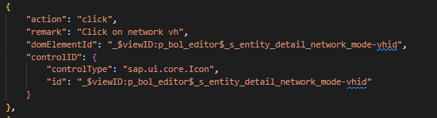

## “action” : “sendKeys”

Add a value to an input or textarea element found by the given selector.Send a sequence of keystrokes to an element after the input has been cleared before. Please refer to the screenshot provided below for clarity.

This action uses the “**.enterText(**)” API of WDI5.

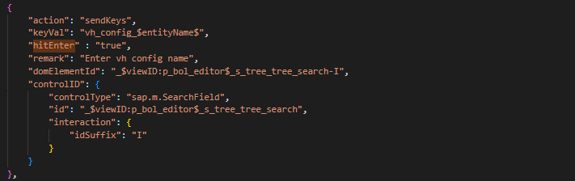

**Note: For the "sendKeys" action, an additional key-value pair, "keyVal", must be included in the object. This "keyVal" will hold the text you wish to input into the selected control. You can also incorporate variables (e.g., \$variable_name\$) within the "keyVal" of "sendKeys". This allows for entering values stored in variables, enhancing flexibility. Please refer to the screenshot provided above for further clarification. An additional key-value pair can be included in the "sendKeys" action, namely "hitEnter": true. This will simulate pressing the Enter key from the keyboard after typing text into an input or textarea field. This feature is particularly useful in scenarios where, for instance, after filling out a search field, the Enter key needs to be pressed to initiate the search.**

## “action” : “clear”

Clear the value of an input or textarea element. Make sure you can interact with the element before using this command. You can't clear an input element that is disabled or in read only mode. Please refer to the screenshot provided below for clarity.

This action uses the “**.setValue()**” API of WDIO.

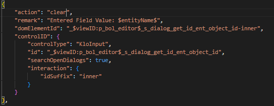

## “action” : “function”

The "Function" action is utilized to execute any function that has been declared within its corresponding spec_name.spec.js file or the myUtil.js file.

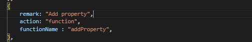

**Note: For the "function" action, an additional key-value pair, "functionName", must be included in the object. This "functionName" will hold the name of a function declared or initialized in respective spec_name.spec.js. It's important to ensure that if a function is created in the myUtil.js file, it must be initialized in its relevant spec_name.spec.js file; otherwise, the function will not be invoked.**

## “action” : “replaceMap”

The "replaceMap" action is utilized for incorporating additional variables that can be utilized across all files during runtime. This method proves beneficial for transmitting parameters within our functions, given that direct argument passing isn't feasible in array format. By employing this workaround, we simulate the behavior of passing arguments as done conventionally in regular functions.

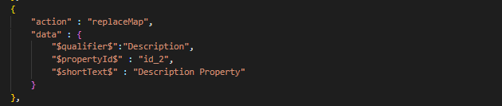

**Note :- For the "replaceMap" action, an additional key-value pair, "data", must be included in the object. The "data" attribute is designed to store an array of objects, each representing a variable and its value that you wish to declare or store within the replaceMap. Upon repeated use of the same variables within replaceMap, it will overwrite the older values with the newly assigned ones.**

**In the provided example, you'll notice the absence of "controlID" or "domElementId". This is because no actions were performed on any specific element; hence, the user needs to craft this function manually instead of generating it through a test recorder. Same will happen with many actions that are not performed on any elements.**

## “action” : “takeScreenshot”

Save a screenshot of the current browsing context to a PNG file on your OS. Be aware that some browser drivers take screenshots of the whole document (e.g. Geckodriver with Firefox) and others only of the current viewport (e.g. Chromedriver with Chrome).

This action uses the “**browser.takeScreenshot()**” API of WDIO.

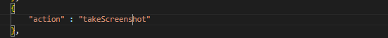

## “action” : “getText”

Get the text content from a DOM-element. Make sure the element you want to request the text from is interactable otherwise you will get an empty string as return value. If the element is disabled or not visible and you still want to receive the text content use getHTML as a workaround.

This action uses the “**.getText()**” API of WDIO. For more reference [<u>click here</u>](https://webdriver.io/docs/api/element/getText).

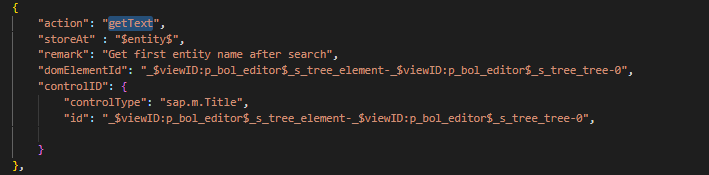

**Note: For the "getText" action, an additional key-value pair, "storeAt", must be included in the object.The "storeAt" parameter will contain the name of the variable(\$variable_name\$), where you intend to save the retrieved value from the chosen control element. getText action is only used in the places where there is only text field like sap.m.text,sap.m.label etc it will not work on input fields like klarion’s kloInput or sap.m.input.**

## “action” : “getValue”

Get the value of a \<textarea\>, \<select\> or text \<input\> found by a given selector. If multiple elements are found via the given selector, an array of values is returned instead. For input with checkbox or radio type use isSelected.

This action uses the “**.getvalue()**” API of WDIO. For more reference [<u>click here</u>](https://webdriver.io/docs/api/element/getValue)

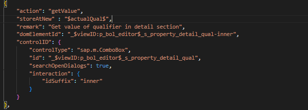

**Note: For the "getValue" action, an additional key-value pair, "storeAtNew", must be included in the object.The "storeAtNew" parameter will contain the name of the variable(\$variable_name\$), where you intend to save the retrieved value from the chosen control element. getValue action is only used in the places where there is only Input field like klarion’s kloInput or sap.m.input.**

## “action” : “ifPresent”

The "ifPresent" action serves as a mechanism for verifying certain operations executed during automation. Specifically, it checks if a selected control element is indeed displayed on the screen. By utilizing its domElementId, it searches for the presence of the DOM element on the screen.

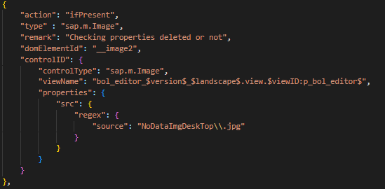

**Note: For the "ifPresent" action, an extra key-value pair named "type" needs to be added to the object. The "type" parameter specifies the kind of control that the action targets. This "type" should match the "controlType" found within the controlID.**

## “action” : “ifNotPresent”

The "ifNotPresent" action functions as a counterpart to "ifPresent," serving to verify specific actions carried out during automation but in reverse. It specifically verifies whether a chosen control element is absent from the screen. Utilizing its domElementId, it searches to confirm the absence of the DOM element on the screen.

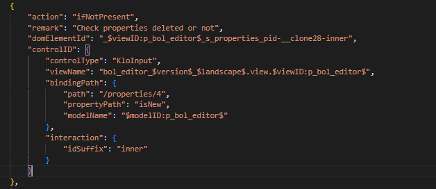

## “action” : “Keys”

Dispatch a series of keystrokes to the **currently focused ("active") element**. Activating an input element can be achieved simply by clicking on it. This approach is utilized in scenarios where the "sendKeys" action proves ineffective. Occasionally, when using "sendKeys" in an input field, the entered text may disappear immediately after being inserted, such as when specifying the control type in the UI editor while adding action. To address these issues or any other instances where "sendKeys" fails, the "Keys" action is employed.

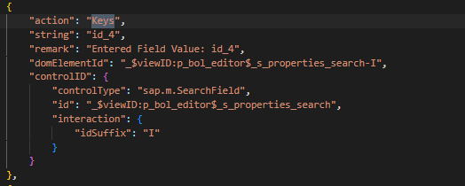

**Note: For the "Keys" action, an additional key-value pair, "string", must be included in the object. This "string" will hold the text you wish to input into the selected control. You can also incorporate variables (e.g., \$variable_name\$) within the "string" of "Keys". This allows for entering values stored in variables, enhancing flexibility. Please refer to the screenshot provided above for further clarification. Element should be made active before using this action.**

## “action” : “keys”

The "keys" action is utilized to execute a range of keyboard actions within our automation processes.

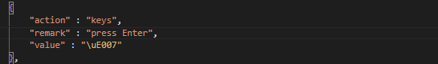

**Note: When using the "keys" action, an extra key-value pair titled "value" must be incorporated into the object. This "value" will store the standardized key value for keyboard keys. For information on the standardized key values for specific keyboard actions, please refer to the provided link :-[<u>WebDriver Standardized Key Value</u>](https://w3c.github.io/webdriver/#keyboard-actions) .**
