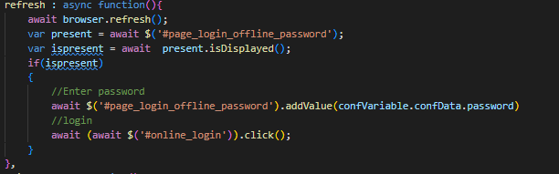
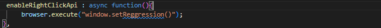
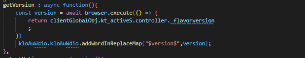
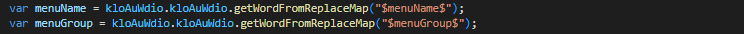
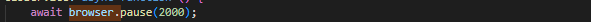
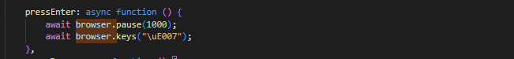

# More API’s Used in functions

## browser.refresh();

Refresh the current page.

## browser.execute();

Inject a snippet of JavaScript into the page for execution in the context of the currently selected frame. The executed script is assumed to be synchronous and the result of evaluating the script is returned to the client.

The script argument defines the script to execute in the form of a function body. The value returned by that function will be returned to the client. The function will be invoked with the provided args array and the values may be accessed via the arguments object in the order specified.

For executing only refer to below screenshot :-

Upon script execution completion,if the output needs to be returned to the client, then refer to the below screenshot :-

**Note :- In the given example, using browser.execute(), we inject a piece of JavaScript into the webpage for execution. Simultaneously, we receive a value upon the completion of this script execution, which we then store in a variable named version. Following this, a function from the kloAuWdio file is invoked, taking two parameters: the variable name and the value intended to be stored in the variable. This function will encapsulate the task of storing both the variable and its corresponding value as a key-value pair within replaceMap. This “addWordinReplaceMap” function can be used in myUtil.js and spec_name.spec.js file to add variables in replaceMap.**

**Similarly, to retrieve the value of any variable from replaceMap, we can utilize the function “getWordFromReplaceMap '' available in kloAuWdio. This function accepts the variable name as an argument and returns the corresponding value from replaceMap. Similarly, this “getWordFromReplaceMap” function can be used in myUtil.js and spec_name.spec.js file to fetch variables values from replaceMap.**

## .isDisplayed()

Return true if the selected DOM-element is displayed (even when the element is outside the viewport).

## browser.pause(milliseconds);

Pauses execution for a specific amount of time.

## browser.keys(value);

It is utilized to execute a range of keyboard actions within our automation processes. Similar to the “keys” action it can be written inside the function also.

