# Important Points

## UI5 service

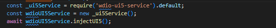

WebdriverIO-plugin for wdi5.

It provides the ui5-service to WebdriverIO, running tests in the browser.In case the very first called page is non-UI5 (think SAP CP CloudFoundry login), the config option skipInjectUI5OnStart can be set to true to postpone injecting wdi5 into the browser context. Consequently you have to do it later, as soon as the UI5 page to test is available. This can be done by calling injectUI5() on the wdio-ui5-service.

So, the UI5 service will prove beneficial when encountering a stale element reference error during automation, preventing the automation from halting or performing unexpectedly.

The stale element reference error is a WebDriver error that occurs because the referenced web element is no longer attached to the DOM.Every DOM element is represented in WebDriver by a unique identifying reference, known as a web element. The web element reference is a UUID used to execute commands targeting specific elements, such as getting an element's tag name and retrieving a property off an element.

When an element is no longer attached to the DOM, i.e. it has been removed from the document or the document has changed, it is said to be stale. Staleness occurs for example when you have a web element reference and Upon navigation, all web element references to the previous document will be discarded along with the document. This will cause any subsequent interaction with the web element to fail with the stale element reference error.

To overcome this ui5 service needs to be injected again in the page again. Refer to the screenshot above for more details.

## \$dateKey\$ variable in spec_name.specs.js and myUtil.js file

To utilize the \$dateKey\$ variable from conf.data.js in myUtil.js or spec_name.spec.js, the conf.data.js file must be imported into the relevant file and used appropriately since replaceMap does not operate directly within normal functions; it works only in array format code snippets. Additionally, it's crucial to note that if the \$dateKey\$ variable is required in the first spec_name.spec.js file, it must be imported from conf.data.js.

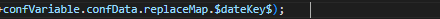

However, if it needs to be used starting from the second spec onwards, it should be imported from replaceMap.json.

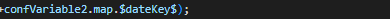

## Variables values stored using getValue() and getText()

When using variable names in getText() and getValue() actions, they should not be reused. Although it operates similarly to replaceMap, where initializing the same variable with a different value results in replacement, this principle does not apply when storing values from the screen using getText() and getValue() actions. In these cases, repeating variable names is not allowed.

## Empty replaceMap.json file

Occasionally, due to failed automation execution or termination mid-execution, the replaceMap.json file may become empty. Consequently, attempting to run automation afterward will fail to start. To mitigate this problem, an empty object must be explicitly declared within the replaceMap.json file.

## Checkbox Issue

For checkboxes within a grid, the necessary wdio code is not automatically generated. To resolve this challenge, the browser.keys() APIs should be employed as a temporary fix. Leveraging keyboard actions can also help address this issue.

## Validation for screen created in UI

If users are conducting validations on a UI-created screen following a full preview, certain codes need to be made dynamic. Otherwise, the automation will not execute correctly if triggered again or under different conditions.

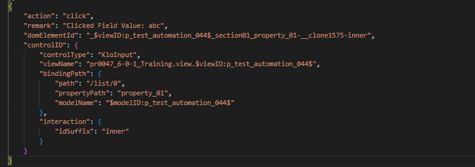

As illustrated in the preceding image, there are several areas (e.g., 2-3 spots) where the code requires modification to ensure successful execution each time the automation runs. For instance, consider the scenario where the automation's flavor changes; without making the code dynamic, the automation would fail. Additionally, the page name appears in both the view ID and model ID sections of the code. If a new page is introduced with a different name, the automation will also fail unless the code is updated accordingly to reflect this change dynamically.

## replaceMap does not work after menu opening sometimes

Sometimes, as noticed, once the menu is opened during automation, the process halts in the browser and begins displaying errors in the console. The primary issue here is that the replaceMap, which is intended to substitute variables for viewID and modelID at runtime, fails to do so; instead, it retains the original values provided in the spec_name.data.js file.

To update the page's viewID and modelID with the current ones, since these identifiers change with every screen navigation, the automation executes the getModelViewNamesForAutomation() function in the console. This function retrieves the current page's viewID and modelID, which are then stored in replaceMap. If a match is found, the existing viewID and modelID in the code, formatted as an array, are replaced with the current ones.

After the menu is opened in automation, the code proceeds to the next segment. Occasionally, the screen remains partially open, still showing the loading state. At this point, even though the code execution has moved forward, the screen is not fully loaded. Consequently, when the automation runs the getModelViewNamesForAutomation() function in the console, it returns the modelID and viewID of the previously viewed page, not the current one, because the page is still in the process of rendering and is not yet fully visible. Because of this, replaceMap does not work in this case.

To address this issue, after the menu is opened, we need to insert a code block that does not involve viewID or modelID. The only element on the screen that lacks either viewID or modelID in its code block is the Procify logo at the top.

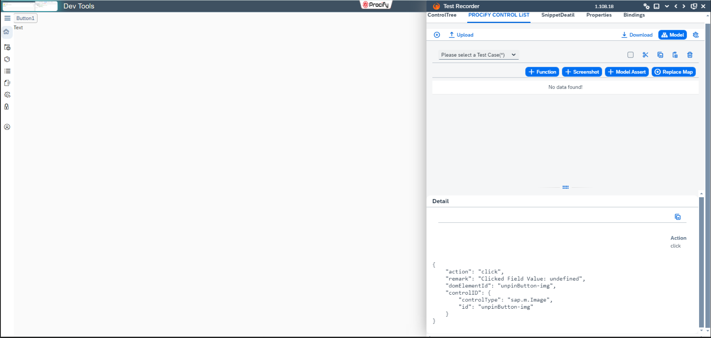

## Binding with properties values

There may be instances where a list of elements exists, and a specific item needs to be selected from it. For example, choosing the screen type of a section from a VH list.

As depicted in the image below, we generate code for selecting the search screen type from the VH list. However, within the code block, no mention of 'search' is made; instead, it merely indicates the specific path or index where the search type screen resides. If the path or index of the search were to change, the automation would encounter issues at this stage.

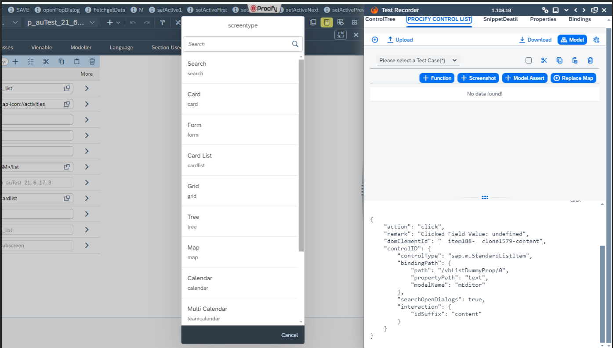

To address this issue , we've linked it with "search" such that it consistently selects the “search” screen type from the VH list, regardless of the index. Let’s see how we will do that.

Upon generating the code in procify control list section , navigate to the properties tab of test recorder. There we will be able to see different properties from which we will be able to bind this element.

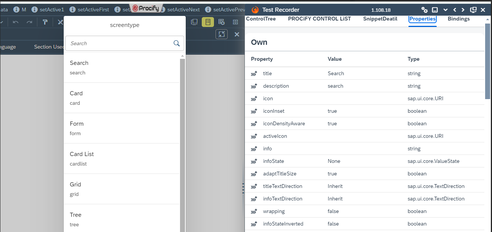

Therefore, among the highlighted attributes, we choose the ones that can uniquely identify this element. Specifically, for this element, both the title and description can serve as distinguishing features. Lets see how we can do the binding in the code block :-

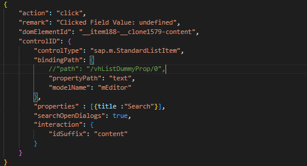

In this scenario, the path within the binding path must be commented, and a new key-value pair should be introduced, specifically 'properties'. Within the value of 'properties', there should be another key-value pair, which includes the attributes derived from the properties section of the test recorder, which we are utilizing for binding. Here we are using title as attribute for search property and providing its value as “search” .

## Right Click in Procify Page Builder and Procify Data Studio

Currently, rights management is not automated. It's not possible to directly invoke an API and simulate a right-click on any element to address this problem. Instead, the framework offers a single function that must be called in the console while either the Procify Data Studio or Procify Page Builder is active. This function activates a button within both editors, enabling users to perform actions akin to a right-click. To utilize this function, it must be executed in the console through the browser.execute() API.

Function that needs to be invoked in console :- window.setReggression()

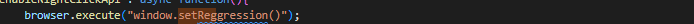

After running this function, a button will become available in both the Procify Data Studio and the Procify Page Builder. First, choose the element you wish to right-click on. Then, click the button that appears following the execution of the set regression function.

In Procify Page Builder :-

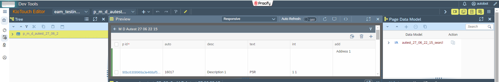

In Procify Data Studio :-

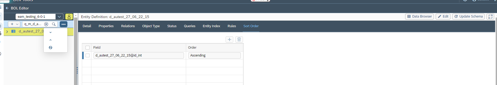
