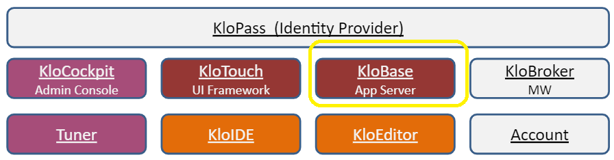
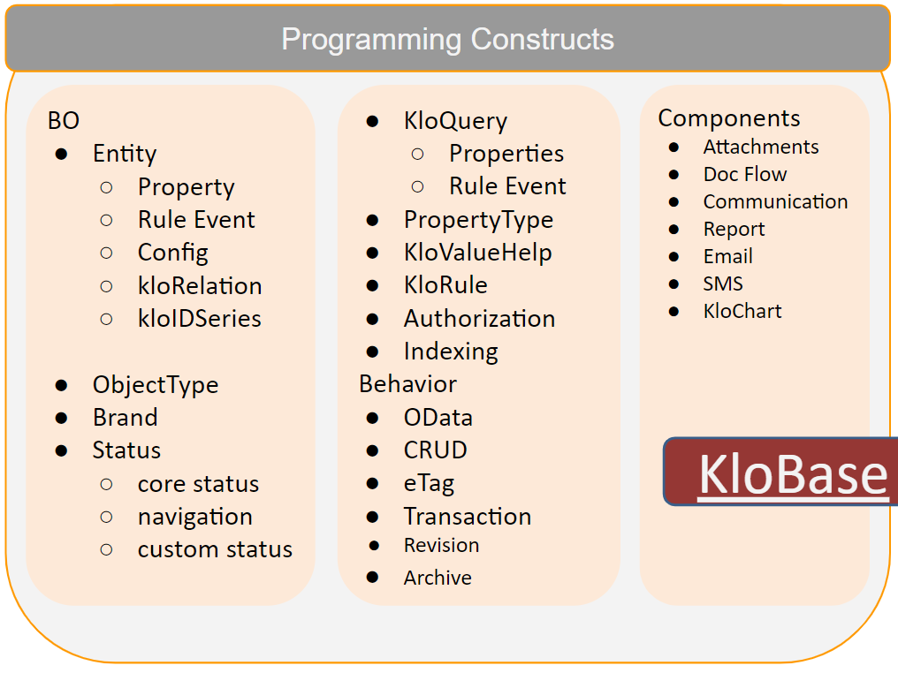

# Overview

KloBase(kloudBase) is an extremely comprehensive, enterprise-class low-code (or no-code) platform. kloBO (kloud Business *Object*) is one of the most important pillars of kloBase. It is a mid-tier in the KloBase architecture that is based on a *meta-model*.

*Features of kloBO:*

1.  kloBO immensely simplifies the process of application development.

2.  It ensures the application's best performance by applying many standard tricks by itself and also provides a low-coding option for modelling and gives independence for choosing database vendors.

3.  It accelerates the application development by providing reconfigurability, compatibility (browser, android app, IOS app, windows mobile app) and full *abstraction* for the *multi-tenant cloud*.

4.  Developers can write the *business rules* in JavaScript and based on the deployment model, kloBO runs it.

KloBase promotes microservice with *stateless models* that give immense portability and infinite scalability to meet business requirements. Data exchange with multiple users within the network becomes easy with the help of in-built *klobroker*.

KloBO can be visualised as *Object Relational Mapping*. Each *entity*(table) represents a *class* that is capable of saving its data; entity properties acting as class members and rules acting as *methods*.

The behaviour of kloBO varies as per the environment. Given the same model (meta-model for application), the behaviour of the *query*, when it is executed on a UI (device or browser), is different compared to when it is executed by kloRule as *Business Logic*.

Let’s see the working example for Order Object:

| A simple example of reading and writing Data                                                                                                                                                     |     |     |     |
|--------------------------------------------------------------------------------------------------------------------------------------------------------------------------------------------------|-----|-----|-----|
| let q = kloQuery.getQuery(“d_order”);q.orderid = “1234”;;let es = await q.executeP();If (es.count \>0)\{let ord = es\[0\];ord.qty = Ord.qty +1;await Tr. commit(); |     |     |     |
