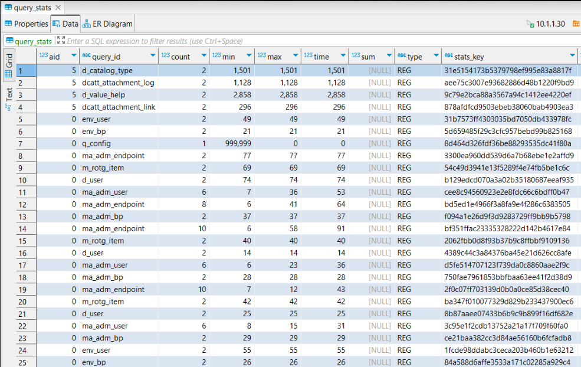

# Query Statistics

Query statistics helps the developer boost the application performance by providing useful information of queries to be executed on the server.

Query statistics contains a list of queries and the number of times they are executed on the server within a given period. It also provides the information like max/min time taken by the queries.

Application developers can find the query statistics data in the **“query_stats”** table in the transaction DB.

