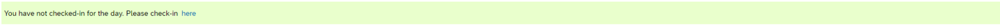
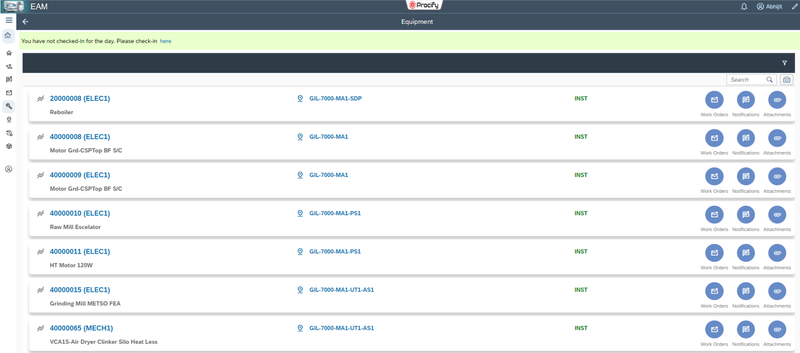

# Usage

A sticky or floating notification can be placed at the top or bottom of the page to display important reminder-type information.

**Banner Registration:**

In any controller., (ex: p_screen1.controller.ts) follow below steps for:

1\. import BannerManager:

import \{ BannerManager \} from 'kloTouch/util/BannerManager';

2\. Get the instance of BannerManager by passing flavor and register Banner by passing \<screenid\>, \<flavor\>, and \<position\>

BannerManager.getInstance(this.getFlavor()).registerBanner("p_abhi2", "eam", "top_sticky");

**Note**: Possible values for position: top_sticky, top, bottom_sticky, bottom

**Result:**

In that particular screen., (p_screen1), during runtime, p_screen2 should display based on position:

a\. top_sticky: p_screen2 in top and sticky even if p_screen1 is scrolled

b\. top: p_screen2 in top and if p_screen1 is scrolled, p_screen2 also should scroll

c\. bottom_sticky: p_screen2 in bottom and sticky even if p_screen1 is scrolled

d\. bottom: p_screen2 in bottom and if p_screen1 is scrolled, p_screen2 also should scroll

**Banner De-Registration:**

In any controller., (ex: p_screen4.controller.ts)

1\. import BannerManager:

import \{ BannerManager \} from 'kloTouch/util/BannerManager';

2\. Get the instance of BannerManager by passing flavor and register Banner by passing \<screenid\>, \<flavor\>

BannerManager.getInstance(this.getFlavor()).deRegisterBanner("p_abhi2", "eam");

**Result:**

In that particular screen., (p_screen4), during runtime, p_screen2 should not display

a\. If user is navigating from menu to

\- Banner should display

b\. If user is navigating from p_screen1 to p_screen2 - Banner should display

b\. If user is navigating from p_screen2 to p_screen3 - Banner should display

b\. If user is navigating from p_screen3 to p_screen4 - Banner should not display (because banner is de-registered here)

b\. If user is navigating from p_screen4 to p_screen3 - Banner should display again

**Preview of screen which is used as Banner:**

**Preview of target screen with Banner:**

**Things to be avoided in screen which is used as banner:**

- Toolbar should not the there

- Heavy controls like Flexible Column Layout/Object Page should not be used

- Banner is intended to display simple text. So recommended to use simple design

  - (Example: “You have 5 leave request to approve”)

  - (Example: “You got 4 new notifications”)
