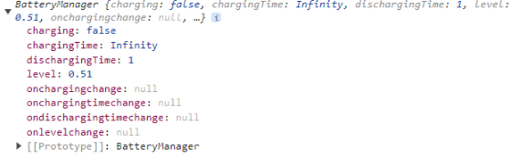

# Battery

**Class**: KloController

## Overview

This API can be used by the application developer to get the current status of the device’s battery.

## Framework Version Information

6.0

## Usage

This API can be used by the application developer when he wishes to apply some logic based on the current battery status of the device.

It returns an object of type Battery Manager containing the following properties :

| **Property**    | **Description**                                                                                                                       |
|-----------------|---------------------------------------------------------------------------------------------------------------------------------------|
| charging        | A Boolean value indicating whether the battery is currently being charged.                                                            |
| chargingTime    | A number representing the remaining time in seconds until the battery is fully charged, or 0 if the battery is already fully charged. |
| dischargingTime | A number representing the remaining time in seconds until the battery is completely discharged and the system suspends.               |
| level           | A number representing the system's battery charge level scaled to a value between 0.0 and 1.0.                                        |

and following events :

| **Events**            | **Description**                                                                    |
|-----------------------|------------------------------------------------------------------------------------|
| chargingchange        | Fired when the battery charging state (the charging property) is updated.          |
| chargingtimechange    | Fired when the battery charging time (the chargingTime property) is updated.       |
| dischargingtimechange | Fired when the battery discharging time (the dischargingTime property) is updated. |
| levelchange           | Fired when the battery level (the level property) is updated.                      |

## Code Example

public async battery() \{

let res = await this.getBatteryDetail();

console.log(res);

\}

## Result

