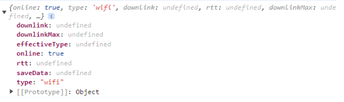

# Network

**Class**: KloController

## Overview

This API can be used by the developer to get the current network connection details of the device.

## Framework Version Information

6.0

## Usage

This API can be used by the application developer when he wishes to apply logic based on the network connection details of the device.

It returns an object containing the following properties :

| **Property**  | **Description**                                                                                                                                                                                    |
|---------------|----------------------------------------------------------------------------------------------------------------------------------------------------------------------------------------------------|
| downlink      | Returns the effective bandwidth estimate in megabits per second, rounded to the nearest multiple of 25 kilobits per seconds.                                                                       |
| downlinkMax   | Returns the maximum downlink speed, in megabits per second (Mbps), for the underlying connection technology.                                                                                       |
| effectiveType | Returns the effective type of the connection meaning one of 'slow-2g', '2g', '3g', or '4g'. This value is determined using a combination of recently observed round-trip time and downlink values. |
| rtt           | Returns the estimated effective round-trip time of the current connection, rounded to the nearest multiple of 25 milliseconds.                                                                     |
| saveData      | Returns true if the user has set a reduced data usage option on the user agent.                                                                                                                    |
| type          | Returns the type of connection a device is using to communicate with the network. It will be one of the following values:bluetoothcellularethernetnonewifiwimaxotherunknown                        |

## Code Example

public network() \{

let res = this.getNetworkDetail();

console.log(res);

\}

## Result

