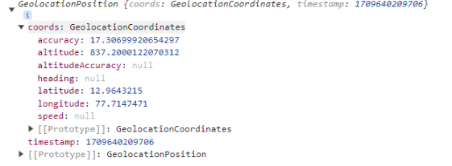

# Location

**Class**: KloController

## Overview

This API can be used by the application developer to get the details about the current location of the device.

## Framework Version Information

6.0

## Usage

This API can be used by the application developer to get the details about the current location of the device.
It accepts an object as a parameter having the following properties :

| **Property** | **Type** | **Description** |
|---|---|---|
| maxWait | Integer | The maximum time the API can run in milliseconds. If unable to find an accurate reading based on the accuracy parameter given, it will return the last found position.  NOTE: Recommended maxWait time should be greater than 10 seconds so that API is able to fetch the location details |
| desiredAccuracy | Integer | Accuracy in meters under which the position is to be determined |

It returns an Object of type GeolocationPosition having the following properties :

| **Property**      | **Description**                                                                                                                                                                                                                                                                                                                                                                                               |
|-------------------|---------------------------------------------------------------------------------------------------------------------------------------------------------------------------------------------------------------------------------------------------------------------------------------------------------------------------------------------------------------------------------------------------------------|
| coords            | An object of type GeolocationCoordinates                                                                                                                                                                                                                                                                                                                                                                      |
| -accuracy         | Returns the accuracy of the latitude and longitude properties, expressed in meters.                                                                                                                                                                                                                                                                                                                           |
| -altitude         | Returns the position's altitude in meters, relative to nominal sea level. This value can be null if the implementation cannot provide the data.                                                                                                                                                                                                                                                               |
| -altitudeAccuracy | Returns the accuracy of the altitude expressed in meters. This value can be null if the implementation cannot provide the data.                                                                                                                                                                                                                                                                               |
| -heading          | Returns the direction towards which the device is facing. This value, specified in degrees, indicates how far off from heading true north the device is. 0 degrees represents true north, and the direction is determined clockwise (which means that east is 90 degrees and west is 270 degrees). If speed is 0, heading is NaN. If the device is unable to provide heading information, this value is null. |
| -latitude         | Returns the position's latitude.                                                                                                                                                                                                                                                                                                                                                                              |
| -longitude        | Returns the position's longitude.                                                                                                                                                                                                                                                                                                                                                                             |
| -speed            | Returns the speed of the device in meters per second. This value can be null.                                                                                                                                                                                                                                                                                                                                 |
| timetamp          | Time at which request was made.                                                                                                                                                                                                                                                                                                                                                                               |

## Code Example

public async position() \{

let res = await this.getLocationDetail(\{maxWait: 20000, desiredAccuracy: 50\});

console.log(res);

\}

## Result

