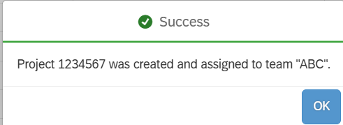
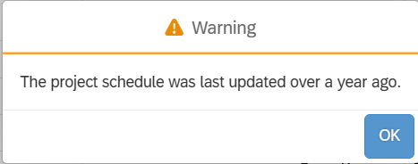
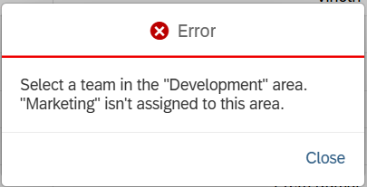
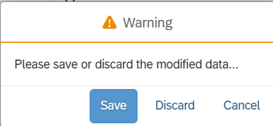
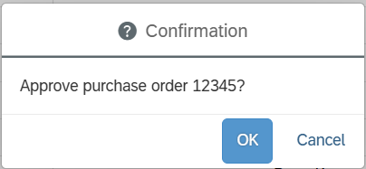
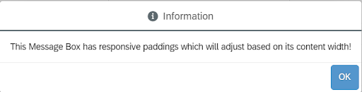
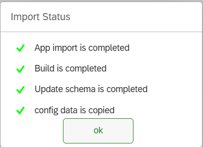
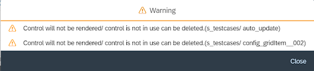
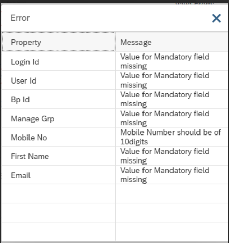

# UX Guidelines

A **UX (User Experience) guideline** refers to a set of best practices, principles, and rules designed to enhance the overall experience users have when interacting with a product or application. These guidelines help ensure that they are easy to use, intuitive, and meet the needs of the user.

In UX design, **CSS (Cascading Style Sheets)** plays a crucial role in shaping the visual presentation and overall design of a product or application. While **UX** focuses on the overall experience and usability, **CSS** ensures that the design is visually appealing, consistent, and easy to navigate, which directly affects how users interact with the product.

#### Message box is a dialog box or pop-up that displays important information to users.They often contain a title, a message, and buttons for users to acknowledge or take further action.Buttons will be of affirmative(primary button) and dismissive(secondary button).

#### AffirmativeButton(emphasized ) - Has white text on a blue background.

**Example**: "Yes," "Approve," "Confirm", etc.

#### Dismissive Button( negative)- Has Blue text on a white background.

**Example**: "No," "Reject," "Cancel", etc.

#### 1. Success Message:

- The "**Success**" message, displayed with a **green** color to indicate positive completion, provides users with immediate confirmation that their action was successful.

  - For example, **"Project 1234567 was created and assigned to team ABC."** This message reassures users that the action has been processed correctly, with the **green color** highlighting the positive outcome.

  - The primary button has **white** text on a **blue** background.

  - 

#### 2. Warning Message:

- The **"Warning"** message, displayed with an **orange** color, is designed to catch attention without indicating an error.

  - For example, **"The project schedule was last updated over a year ago."** This message alerts users to potential issues, such as outdated information, providing a gentle reminder to review or update without suggesting a critical failure. The **orange color** effectively signals caution while maintaining a non-critical tone.

  - The primary button has **white** text on a **blue** background.Secondary button has an inverted primary button.

  - 

#### 3. Standard Error Message:

- **Title: Error**, the "**Error**" message is displayed with a **red** color to indicate a problem.

- For example, **"Select a team in the 'Development' area. 'Marketing' isn't assigned to this area."**

- It will persist until the user takes action, such as clicking to dismiss or retrying the action. The red color signals an issue that requires attention and correction.

<!-- -->

- 

#### 4.Data loss Message:

- **Title: Save?** The "Data Loss" message box is displayed with an **orange** line to alert users about the potential loss of data.

  - For example, **"Please save or discard the modified data.."**

  - The message will persist until the user takes action, such as confirming or canceling the action. The color and message emphasize the importance of saving before proceeding to prevent losing valuable information.

#### 5. Standard Confirmation Message:

#### Title: Confirmation,the "Approve purchase order?" message is displayed with a grey color to indicate a neutral confirmation.

#### For example, "Approve purchase order 12345?" .

#### It will persist until the user takes action, such as clicking "OK" to confirm or "Cancel" to dismiss. The grey color signals a non-urgent action that requires the user's approval.

- 

6\. **Information Message:**

- The "**Information**" message is displayed with a **grey** color to indicate a neutral, non-urgent notification.

  - For example, **"This Message Box has responsive paddings which will adjust based on its content width!"**

  - It will persist until the user dismisses it. The grey color signals that this is an informational message without requiring immediate action.

**7. Sequential execution process**

- **Title:** “**Import status** ”

- **Line Color:** Grey/Light green (indicating a neutral confirmation)

- **Text Message:** Shown below;

  - **Description**: This message provides a visual representation of the sequential execution process. The status is displayed with a grey or light green line, indicating neutral confirmation. As each step of the process is completed, points are ticked off one by one, showing the progress of the import status.

- 

**8. Multiple warnings (Validation case)**

- The **"Validation Warning"** message is displayed with an orange color to indicate issues that need attention.

  - For example, **"Control will not be rendered/control is not in use…..)"**

  - This message will persist until the user addresses the validation issues, ensuring necessary corrections are made. The **orange** color highlights that the user must take action to proceed.

**9.Multiple Error Messages**

- **Multiple error messages** are displayed with a **white** background and **grey** text to indicate issues that need immediate attention.

  - For example, **"Value for Mandatory field missing"**

  - These messages persist until the user resolves the errors, with each issue clearly outlined.

### **Button Placement and Design:**

- **Position of Buttons:**

  - **Cancel Button:** Always placed on the **right side** of the dialog box or message popup to follow established UI conventions. This button should allow the user to exit or cancel the action.

  - **Affirmative Action Button(emphasized):** The action button (such as **Save**, **Yes**, or **Confirm**) should be **highlighted** (typically in a blue or green color) to make it prominent and easily accessible to the user. This button should be placed on the **left side**, preceding the **Cancel** button.

### **Color Coding for Status:**

<table>
<colgroup>
<col style="width: 33%" />
<col style="width: 33%" />
<col style="width: 33%" />
</colgroup>
<thead>
<tr class="header">
<th><strong>Color</strong></th>
<th><strong>Meaning</strong></th>
<th><strong>Example</strong></th>
</tr>
<tr class="odd">
<th><strong>Green</strong></th>
<th><strong>Success</strong></th>
<th><strong>“Project 1234567 was created and assigned to team ABC.”</strong></th>
</tr>
<tr class="header">
<th><strong>Red</strong></th>
<th><strong>Error</strong></th>
<th><strong>“Select a team in the “Development” area. “Marketing” isn't assigned to this area”</strong></th>
</tr>
<tr class="odd">
<th><strong>Orange</strong></th>
<th><strong>Warning</strong></th>
<th><strong>“The project schedule was last updated over a year ago.”</strong></th>
</tr>
<tr class="header">
<th><strong>Grey</strong></th>
<th><strong>Confirmation</strong></th>
<th><strong>“Approve purchase order 12345?”</strong></th>
</tr>
<tr class="odd">
<th><strong>Grey</strong></th>
<th><strong>Neutral/Information</strong></th>
<th><strong>“This Message Box has responsive paddings which will adjust based on its content width!”</strong></th>
</tr>
<tr class="header">
<th><strong>Grey/Light green</strong></th>
<th><strong>sequential execution process</strong></th>
<th>
<strong>"Import Status"</strong>

<strong>Text Message:</strong>

<strong>[✔] Step 1: Data Validation</strong>

<strong>[✔] Step 2: File Upload</strong>

<strong>[✔] Step 3: Data Processing</strong>

<strong>[✔] Step 4: Finalizing Import</strong>

<strong>[✔] Step 5: Import Complete</strong>
</th>
</tr>
</thead>
<tbody>
</tbody>
</table>
