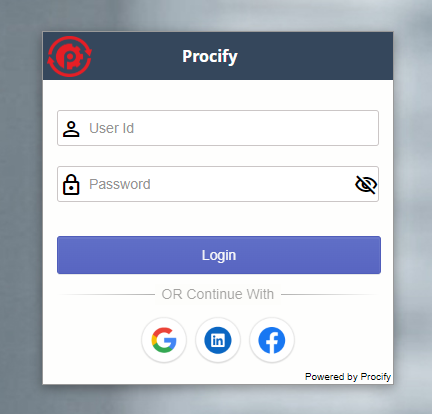
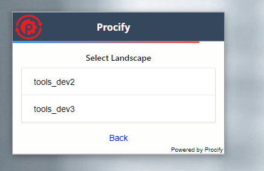
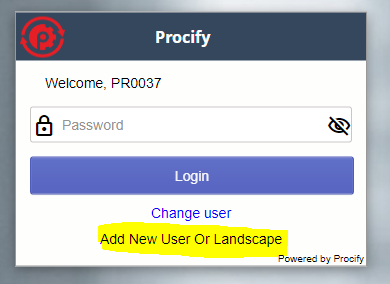

# Steps for using Common Login

**Note:** Common Landscape is used for registration only and not for sign-up.

**Step 1: Give user ID and password in the common landscape**

**Step 2: Select in which landscape you want to redirect**

- On clicking one of the landscapes automatic registration will begin in that landscape.

- The redirected landscape registration should begin automatically, there is no need to provide a user ID and password.

**Note:** If a single landscape is assigned to the user it will redirect directly to that landscape instead of showing any options.

**Step 3: After successful login**

- Users can add a new landscape to the same user or a new user in the same browser.

- After adding, the process would be the same as this Step

