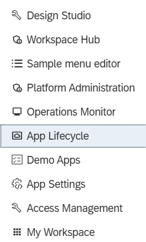
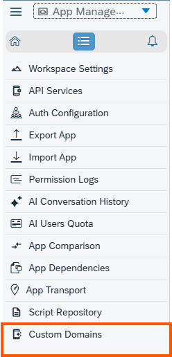
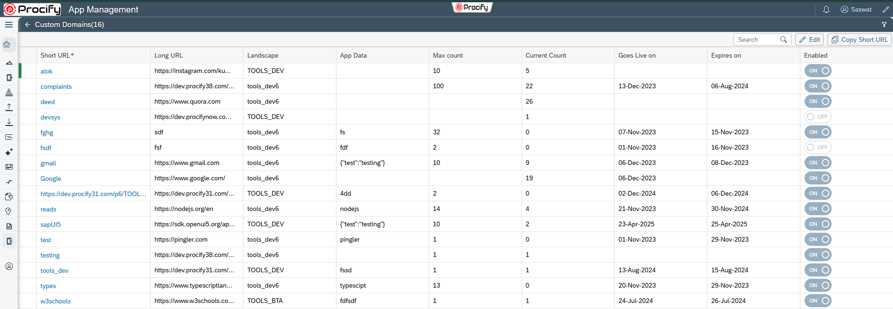

# Navigating to Custom Domains

**Step1: Go to App Lifecycle**

In the KloTouch app menu go to App Lifecycle

**Step 2: Select Custom Domains**

Under App Lifecycle there will be several options, click on Custom Domains.

The screen looks like the following:

