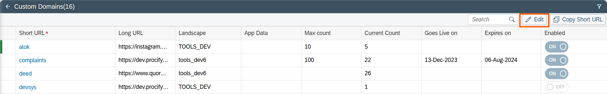
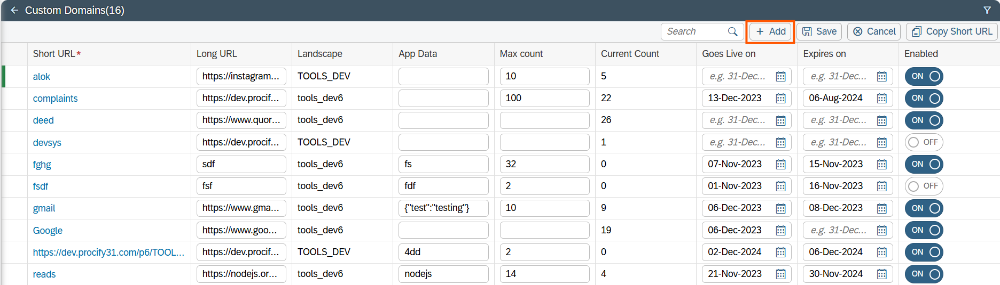
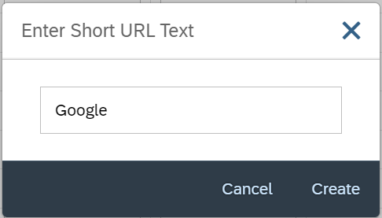
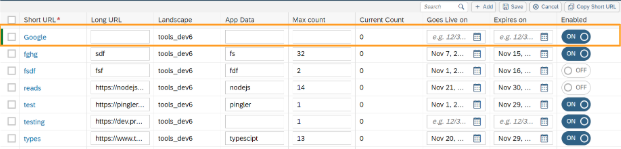
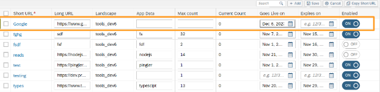
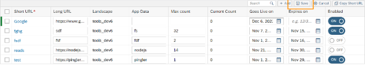
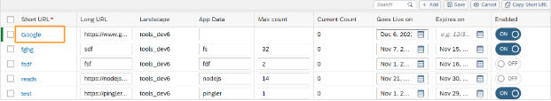
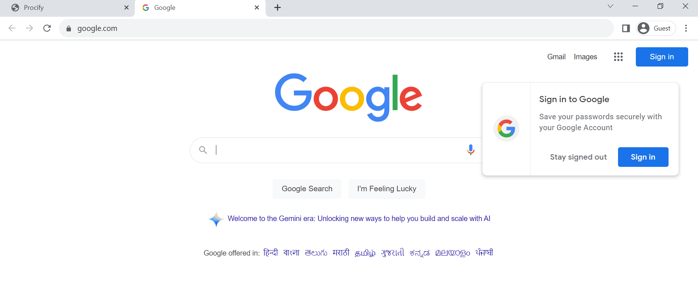
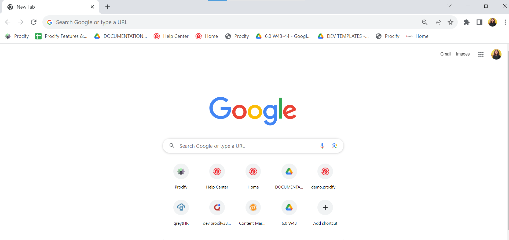
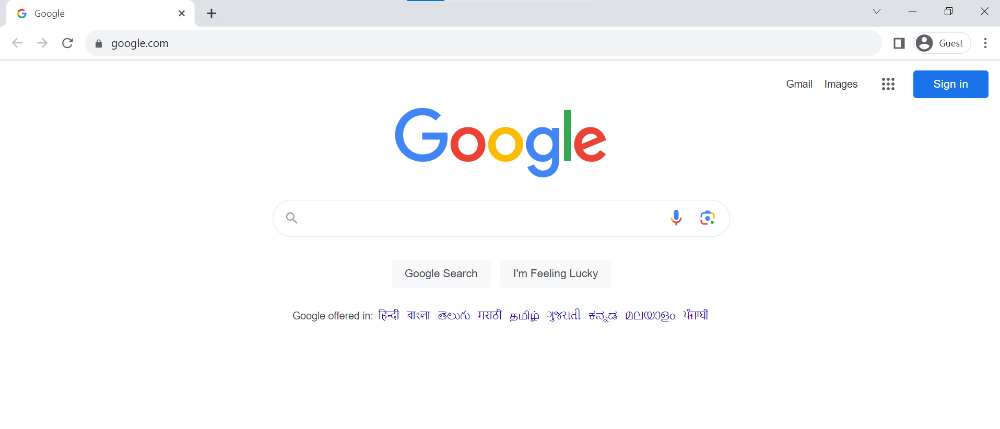

# Steps to use the Custom Domains

## Add a Short URL

To add a Short URL follow the steps below:

**Step 1: Click on Edit**

In the Custom Domains change the screen mode to **Edit**.

**Step 2: Select the Add Action button**

Once the screen is in edit mode, you can select the Add action button to add a new URL.

**Step 3: Enter the Short URL**

Once the Add button is selected, a dialog box will appear. Enter the Short URL ( it can be a short text ) and Create.

A short URL will be created.

**Step 4: Fill in other details**

Fill in the long URL and Goes live on. Keep the URL in Enabled state.

**Save** the process. Your Short URL will be published.

## Test the URL

To test the URL, click on the Short URL.

This will redirect to the original long URL and the screen will open in a new tab.

The short URL can also be typed into the browser. One needs to type the URL in the following manner

**\<domain\>/s/\<short url\>.**

Now we will test this in our windows:

**Step 1: Go to a new tab**

Go to a new Window and a new Tab

**Step 2: Type the URL**

In the search bar type the URL following the **\<domain\>/s/\<short url\>** pattern

For example, our URL will be **dev.procify38/s/Google**

It will redirect to the long url.

