# How to use the feature?

## 4.1. Find any site which has “MIT license” like

- [<u>https://fonts.google.com/icons</u>](https://fonts.google.com/icons)

  - Google Material Symbols can be used

  - Google Material Icons are already available in kloTouch, so no need to register again

- [<u>https://fontello.com/</u>](https://fontello.com/)

## 4.2. How to create a woff2 file?

**Step 1;**

- Using example of [<u>https://fontello.com/</u>](https://fontello.com/), go to above site,

- In tab **“Select Icons”**, select the required icons of your choice:

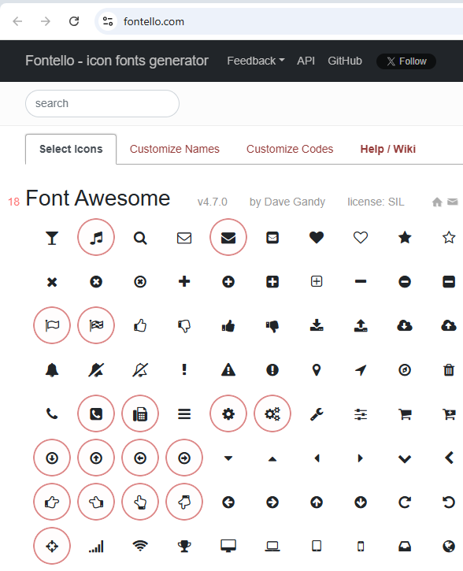

> **Step 2;**

- Select the next tab **“Customize Names”**, and change the icon names if required.

> 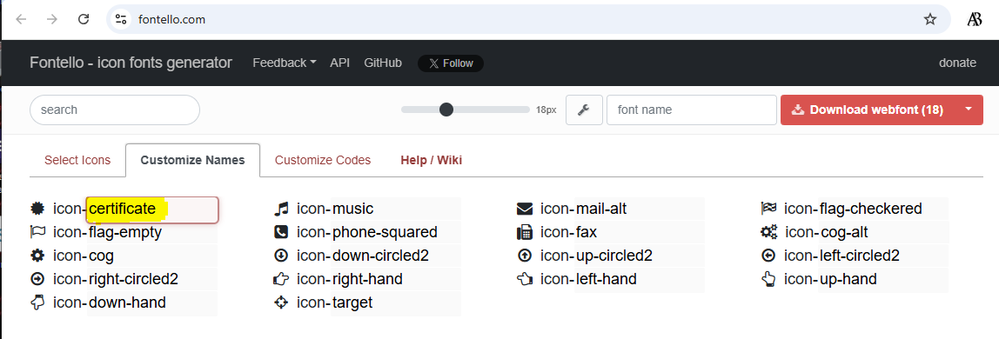

**Step 3;**

Select the next tab **“Customize Codes”**, and change the icon codes if required.

> 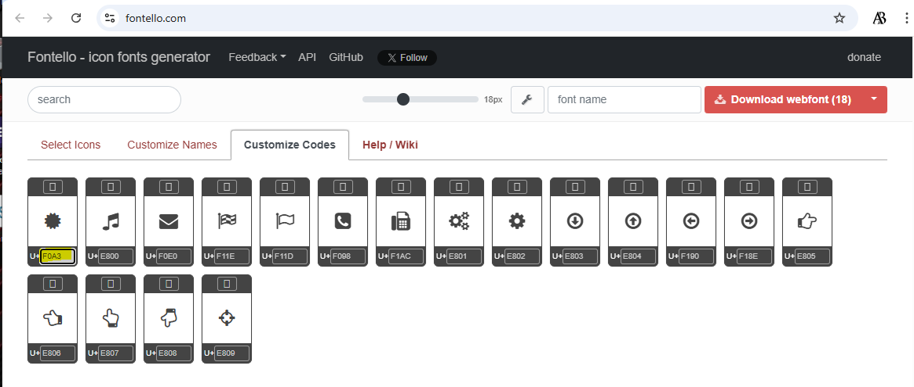
>
> **Step 4;**
>
> Click on the **“Download webfont”** button on the toolbar to download selected icons.
>
> 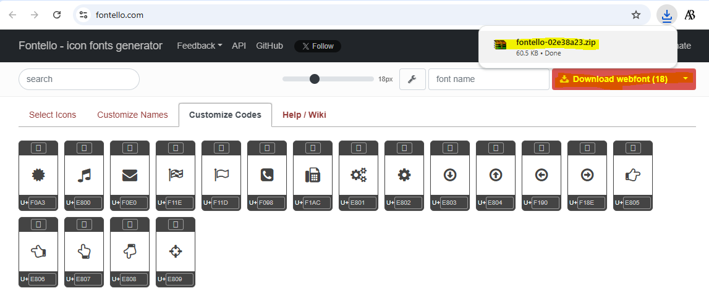
>
> **Step 5;**
>
> Extract the downloaded ZIP file. Inside the folder, you'll find a **.woff2** font file.
>
> 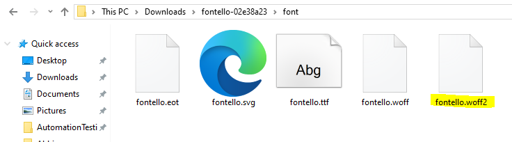
>
> **Step 6;**
>
> Rename it if needed, then copy it to the **resources** folder of your app's flavor.
>
> Kindly note: Maximum file size limit should be 19 MB.
>
> 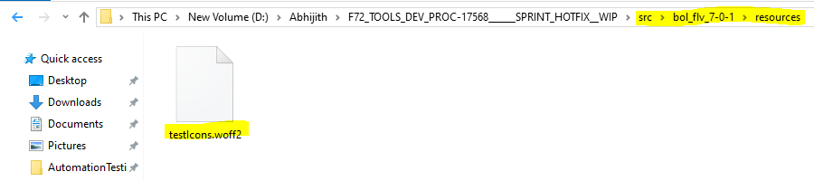

## 4.3. How to create a JSON file with Icon name and code points?

**Step 1;**

Create a json file. Kindly note, file name should be the same as the name of woff2 file.

> 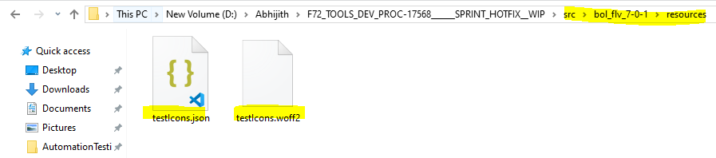
>
> **Step 2;**
>
> For JSON data:

- Key will be **Icon Name** given in **step 2** of creating a woff2 file.

- Value will be **Code** given in **step 3** of creating a woff2 file.

- So JSON file will be something like as shown below;

> 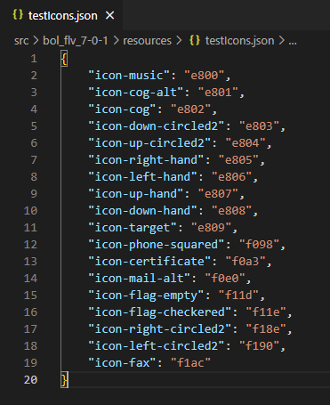

**Step 3;**

Save the files:

> 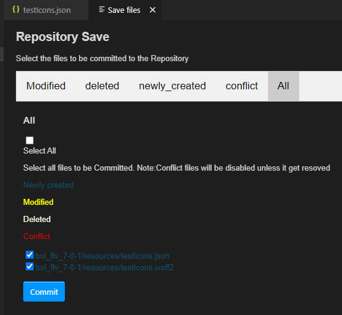

## 4.4. Register the Icon Pool.

**Step 1;**

Create an App Life Cycle Event file (Reference Document is [<u>here</u>](https://docs.google.com/document/d/1lQt_9dskGhal7ecH3SsUUau29zTCHN4uzPnd8gk0s1A/edit?usp=sharing)):

> 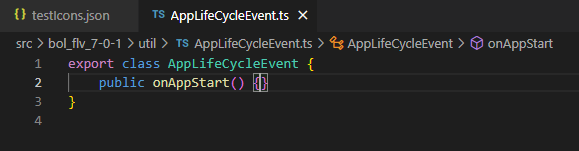

**Step 2;**

Use API **registerIconPool()** inside **clientGlobalObj** by passing below parameters:

| **Parameter** | **Description**                                             |
|---------------|-------------------------------------------------------------|
| flavor        | Name of flavor where woff2 file and codepoints is placed    |
| version       | Version of flavor where woff2 file and codepoints is placed |
| iconPool      | Name of woff2 file and codepoints (both must be same)       |

> 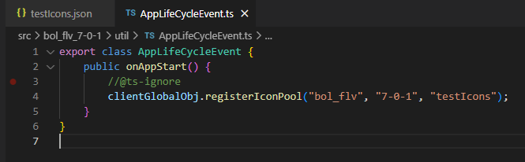

**Step 3;**

- Use register Icon Pool.

- The registered Icon Pool will be available in tools for icon selection in with the same name of woff2 file as a new tab:

> **Page Builder:**
>
> 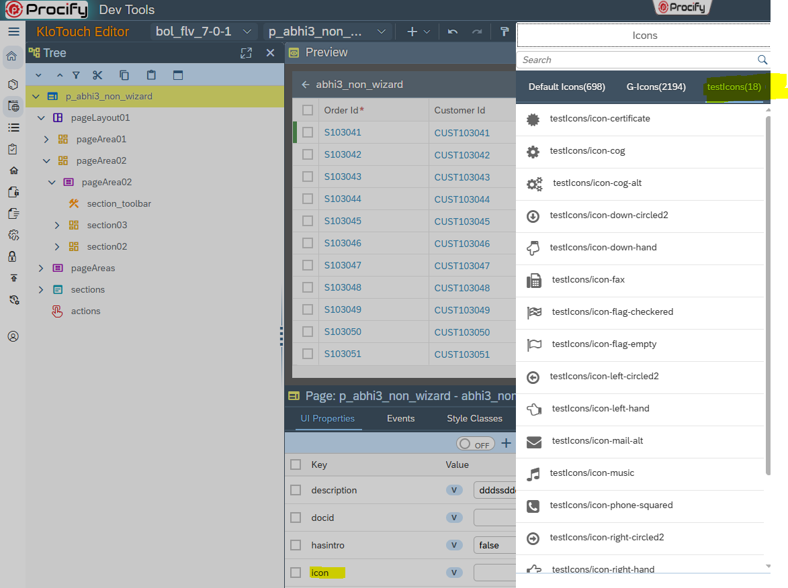
>
> If the icon pool is registered in onAppStart of any particular app/flavor, after saving if the user is opening tools(Procify Data Studio/ Page Builder) directly, then icon suggestions will not be displayed in any icon’s value help. Alternatively, do a preview of any screen of that app/flavor. During actual scenario, this issue will not be there (in non-dev environment)
>
> 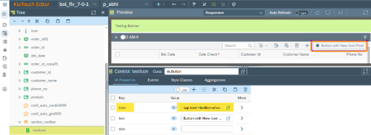
>
> **Runtime:**
>
> 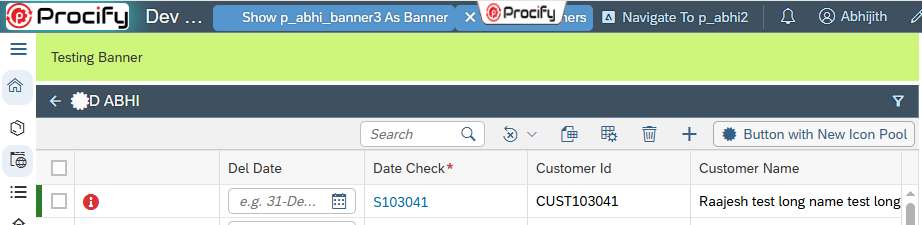
