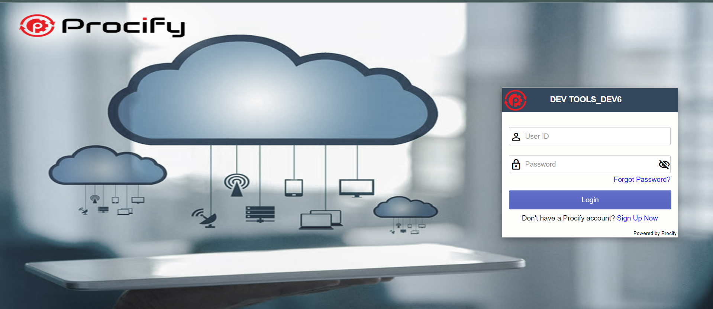
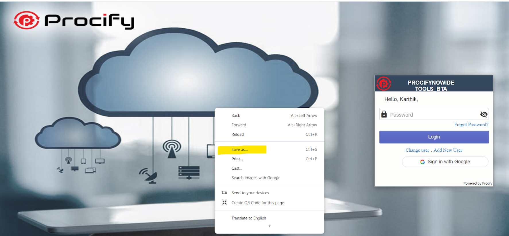
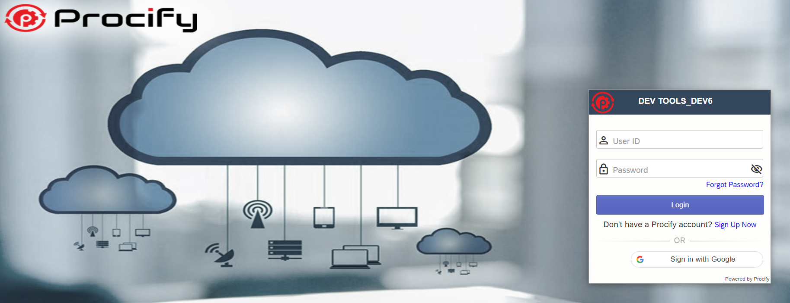
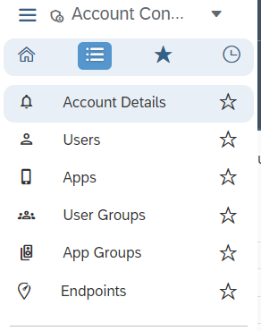
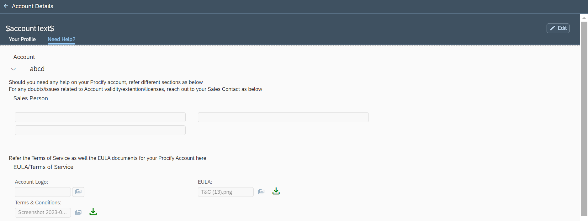
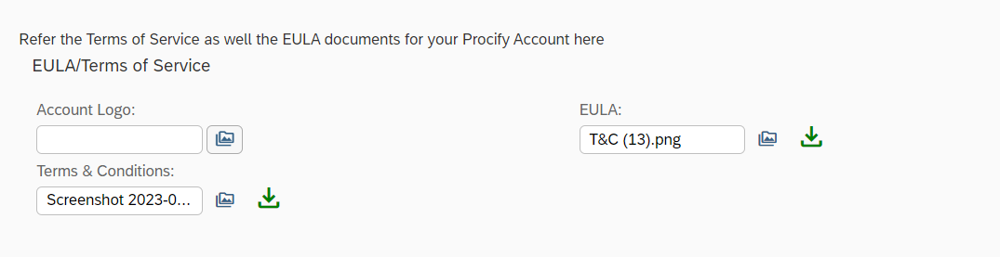
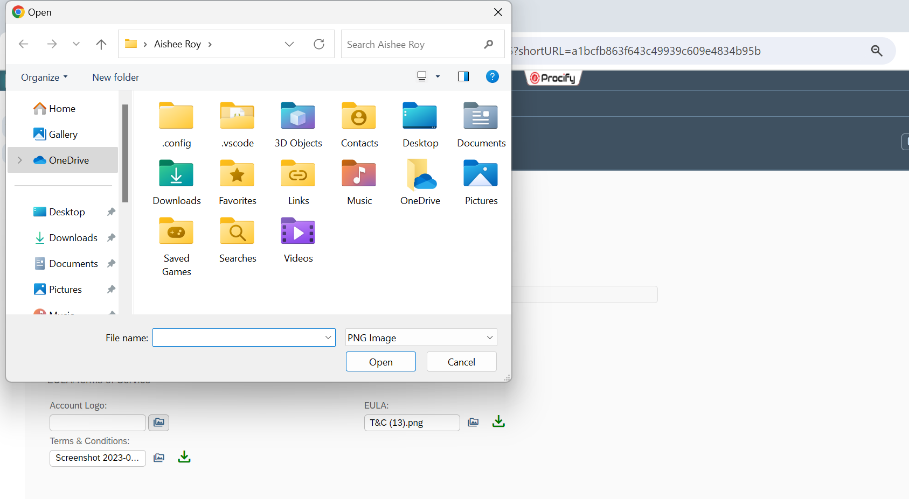
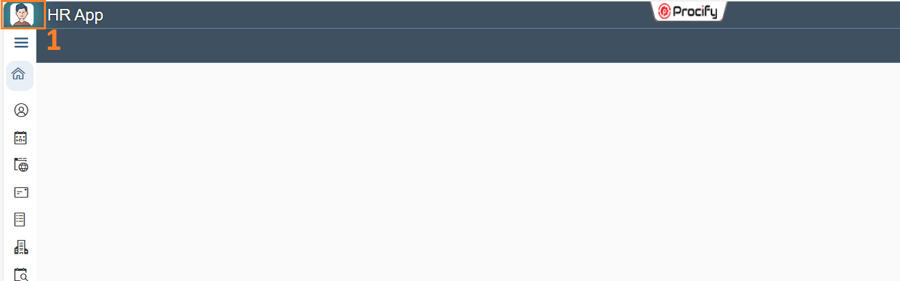

# Paths and Dimension details

Following are the data paths that one needs to maintain for the following brand logos:

1.  **For** **Desktop login page Background** - shared_6-0/media/web_image.JPG

> **Dimension to be maintained:** 1280 × 840 px \[tab/desktop\]
>
> 

## Steps to follow for the Desktop Image Upload Process

- You should have Shared flavor metadata.

- In the Shared flavor, you should be assigned as a **developer**.

- Do your [Private node Setup](https://docs.google.com/document/u/0/d/1clcrzrDYxol9CEZAzVlbwoscosjGwzo3uwGd1GEij6M/edit).

- Commit the image file in the above-mentioned location.

**Note:** When you upload the image, it should be the most recent image available to you. The date in the image properties should be the most recent one, otherwise, the image won't get uploaded.

- Application build is required that will be done by the infra team. **\[Raise a ticket to the Infra team for shared flavor build. Provide the server and landscape details\]**

2.  The **title** needs to be changed in index.html in the below function: **init function**

> document.getElementById('loginHeader').innerHTML = ((clientGlobalObj.isClientCordova() ? clientGlobalObj.\_CONFIG_VAL.SERVICE_MIX_URL : document.domain).split(".")\[0\]+" "+landscape).toUpperCase()
>
> **Note:** You need to change the above function according to your requirements.
>
> 

## Steps to follow for the implementation of index.html changes

- The application team or the developers should download the index.html file.

- Make the required changes in the downloaded file.

- Share the file with the infra team so that they can update the server, in case you don't have server access

- The infra team will update the file with the new name (**example:** eam.html).

- After the server and file update, the application team can test and confirm.

### Steps to download the index.html file

- Visit the application site [https://dev.procify38.com/p6/\<landscape\>/index.html](https://dev.procify38.com/p6/TOOLS_BTA/index.html)

- Right-click on the page and select **Save** **as.**

> 

- This will download the file.

**Note:** The same steps will be followed for all index.html changes.

3.  **Google sign in** we will be using **index.html** and the change will be made in the function

> div id 'g_id_onload'

4.  **Mobile login page Background -** shared_6-0/media/background.jpg

> **Dimension to be maintained:** 720 × 1280 px
>
> 

5\. **Application Logo -** shared_6-0/media/customer_logo.png

**Dimension to be maintained:** 56 × 27 px

**Note:** When you upload the image, it should be the most recent image available to you. The date in the image properties should be the most recent one, otherwise, the image won't get uploaded.

## Steps to Upload Application Logo

- In Workspace Hub, go to **Account Details**.

> 

- Go to **Need help?** Section of the Account Details.

> 

- Edit the Page, there will be an option to upload Account Logo upload.

> 

- Select the Logo from your local drive/system.

> 

- Save the process.

- A build is required in the shared flavor so that the changes reflect. **\[Contact the Infra team for the same. Provide the server and landscape details \]**

**Note:** Once all the changes, **\[be it app logo changes or background changes\]** are made in the shared app ( shared_6-0) you need to trigger build to see the changes being reflected.

**Note:** When you upload the image, it should be the most recent image available to you. The date in the image properties should be the most recent one, otherwise, the image won't get uploaded.

## Android APK Details

**Splash Screen:**

**Name:** logo_splash2

**Type of image:** png

**Location:** cordova_project\www\media

**Dimensions:** 902 x 910 pixels

**Note:** When you upload the image, it should be the most recent image available to you. The date in the image properties should be the most recent one, otherwise, the image won't get uploaded.

**Application Logo:**

**Name:** app_icon

**Type of image:** png

**Location:** cordova_project\www\media

**Dimensions:** 902 x 910 pixels

**Note:** When you upload the image, it should be the most recent image available to you. The date in the image properties should be the most recent one, otherwise, the image won't get uploaded.

**Application Name:**

**File name:** config.xml

Should be maintained in name tag \<name\>APL FFM V5\</name\>

## iOS Details

Splash screen

Default@2x~iphone - 640 x 960 px

Default@2x~iphone_1 - 640 x 960 px

Default~iphone. - 320 x 480 px

Default~iphone - 320 x 480 px

Default~iphone_1 - 320 x 480 px

Default-568h@2x~iphone - 640 x 1136 px

Default-568h@2x~iphone_1 - 640 x 1136 px

Default-667h 750 x 1334 px

Default-667h_1 750 x 1334 px

Default-736h - 1242 x 2208 px

Default-736h_1 - 1242 x 2208 px

Default-Landscape@2x~ipad - 2048 x 1536 px

Default-Landscape@2x~ipad_1 - 2048 x 1536 px

Default-Landscape~ipad - 1024 x 768 px

Default-Landscape~ipad_1 - 1024 x 768 px

Default-Landscape-736h - 2208 x 1242 px

Default-Landscape-736h_1 - 2208 x 1242 px

Default-Portrait@2x~ipad - 1536 x 2048 px

Default-Portrait@2x~ipad_1 - 1536 x 2048 px

Default-Portrait~ipad - 768 x 1024 px

Default-Portrait~ipad_1 - 768 x 1024 px
