# Data Studio — Data Studio

Data that are stored in the database are in table format. Data Studio is used to create tables for our database. In BOL, all entities and queries act as attributes of the table.

1.0.1 The Editor is divided into two major sections:

- [Tree](#tree)

- [Detail](#detail)

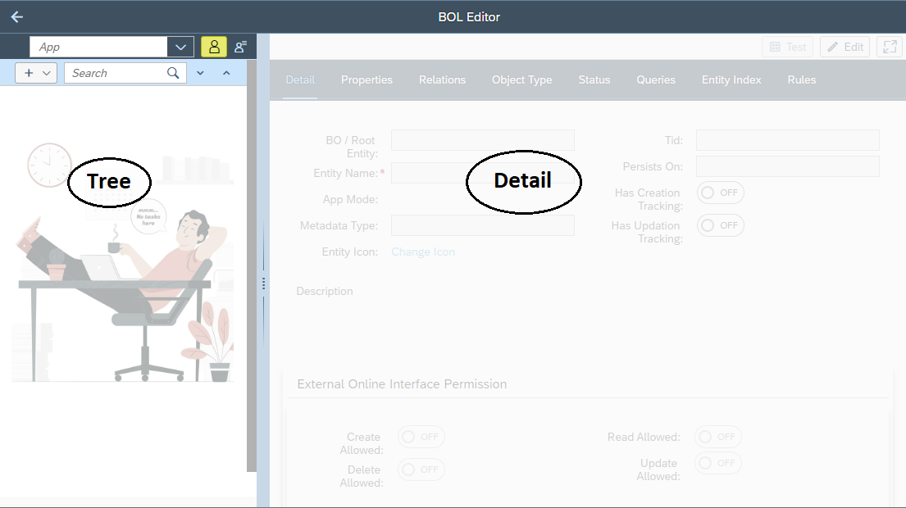

## 1.1. App Selection {#app-selection}

The app or Flavor selection drop-down contains a list of apps that have been assigned to the user. By using the drop down users can select the app on which users are going to work on.

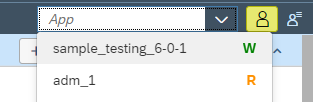

## 1.2. List Of Entities {#list-of-entities}

Once the app is selected, it will list down all the entities present inside the selected app. To select any specific entity, click on that entity.

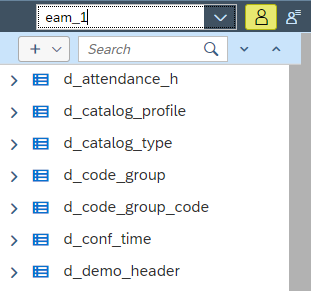

## 1.3. Search for Entities {#search-for-entities}

You can search for any entity by filling in the entity name in the search field provided in the entity list section.

## 1.4. Modes in Data Studio {#modes-in-data-studio}

Data Studio supports two types of modes, **Normal mode** and **Expert mode**.

**Normal Mode -** It supports all the basic functionalities like Entity, Query, and Value Help creation along with app settings.

**Expert Mode -** It supports all the functionalities from the normal mode along with add-on features like Status Config, config properties for object type, and entity indexes.

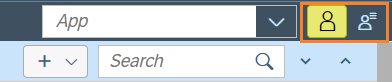

**Note:** One can switch between the two modes at any point in time.

## 1.5. Create {#create}

Create button lists down various options for table creation.

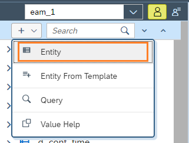

Create Menu supports the below actions:

- Entity

- Entity From Template

- Query

- Value Help

## 1.6. Save and Edit {#save-and-edit}

By default, the editor will be in non-editable mode. Clicking on the edit button will make the data editable.

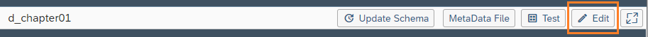

Once the edit mode is enabled, it will update the list of available options in the toolbar. The mode gets changed to editable and the save option will be enabled.

The below icon shows the save icon which will be used for committing the changes to the DB.

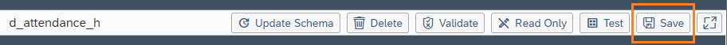

## 1.7. Toolbar Options {#toolbar-options}

Once the entity is in editable mode, it lists down the list of available options as shown in the below image.

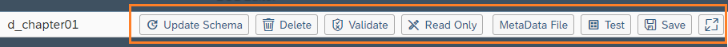

### 1.7.1. Update Schema {#update-schema}

Once all the metadata regarding the entity is provided and saved, the **update schema** is used to convert the entity into an actual database table.

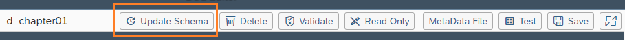

### 1.7.2. Delete {#delete}

This option will be used for deleting any item selected in the left tree. Using this option, any item like entity/query or value help can be deleted.

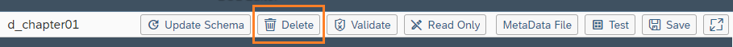

### 1.7.3. Validate {#validate}

The validate option verifies whether the metadata maintained for the entity is correct or not.

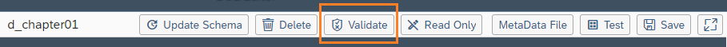

### 1.7.4. Read Only {#read-only}

The read-only and cancel options are only visible in editable mode. On the click of the read-only icon, the editor becomes non-editable.

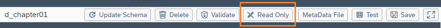

### 1.7.5. MetaData File {#metadata-file}

This comprises the metadata file that you want to upload from your local system to the Data Studio.

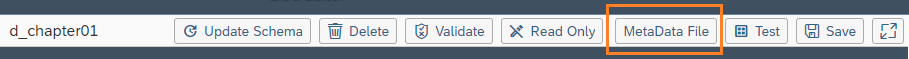

### 1.7.6 Test {#test}

Test allows checking the CRUD operation on the created/selected which stands for create, read, update, and delete. These are four basic functions executed in relational database applications.

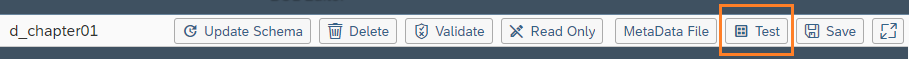

### 1.7.7. Import from SAP {#import-from-sap}

This option imports the selected entity & its properties from SAP tables.

Developers can import an entity -\> verify their changes -\> and then click "Save" to commit their changes.

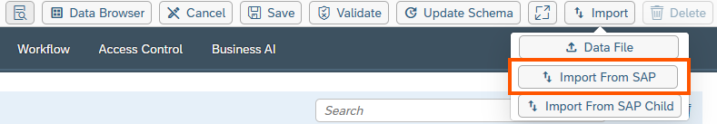

**Pre-requisite:**

1.  In config.json, under "**mm_klobroker_ext**" array, an object needs to be maintained having details as follow, mentioning the connection between your flavor in platform and the respective SAP system:

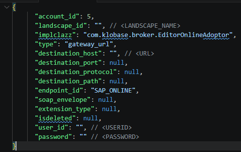

2.  The flavor should have some entities already maintained in SAP-side which will be used to import.

**Steps:**

1.  Navigate to "Design Studio" -\> "Data Studio" Screen and select your flavor. **The flavor needs to be configured on the SAP side.** **The flavor_name and major_version should be the same.** The minor version and patch version can be different from each other.

2.  Create a new entity and do not add any properties yet. Otherwise, use an existing entity having some existing properties. And then click the "**Import from SAP**" button.  
    > 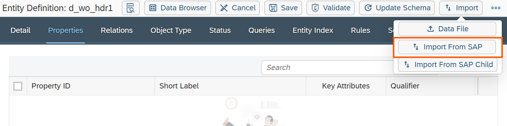

3.  If the entity is maintained in the SAP-side, then it will show an error dialog. Else, the import process will start.  
    > 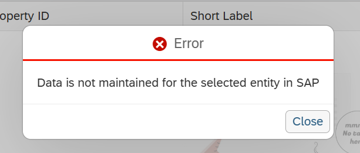

4.  **Validation:** During the process, if any error comes it will throw the error dialog. And in case any validation fails e.g., propertyid values are having reserved keywords then it will show that respective dialog also - same validation as available we developer normally create properties from the screen. List of reserved keywords: [PROC-27544: List of Reserved Keywords in Data Studio Application](https://docs.google.com/document/d/1p9gA7HkNhTAyFsPCT6JSJRgoNMEluVohG3cW0LI85r8/edit?tab=t.0).  
    > 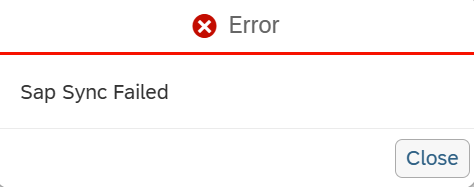  
    > 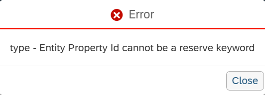

5.  Once the import process starts, at the end step, it will ask the developer to skip any specific properties by selecting the checkbox and clicking the "Skip" button or click "**Sync All**" to accept all data from the payload.  
    > **Important:** [Import from SAP on Existing Entity](#import-from-sap-on-existing-entity-data)  
    > 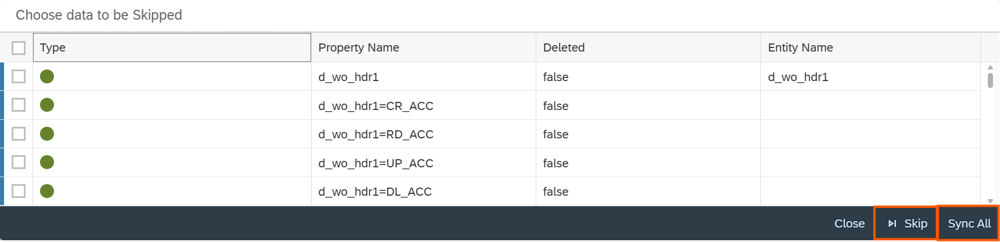  
    > 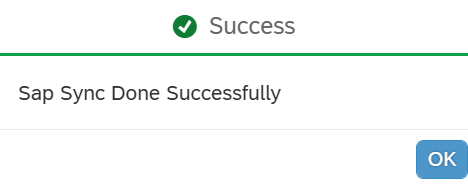

6.  After import is done, developers can save more properties and save it.  
    > **Note:** **SAP Import process only imports the entity and properties. After import, the developer needs to click the Save button to commit all changes.**  
    > 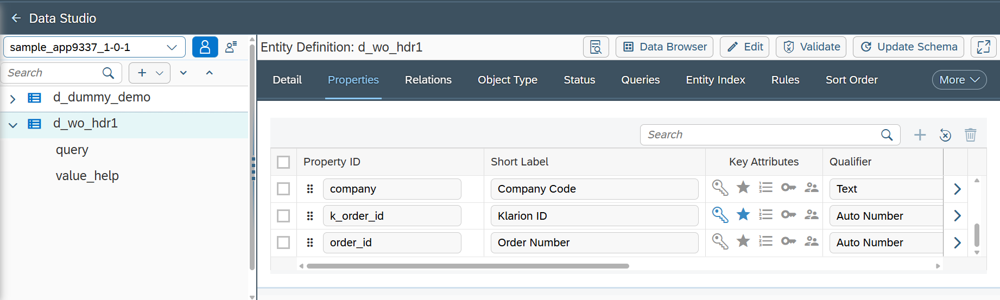

#### 1.7.7.1. Import from SAP on Existing Entity Data {#import-from-sap-on-existing-entity-data}

While doing import again on an existing entity having existing properties, it will ask the developer regarding the existing properties whether to keep those properties or delete them.

For example, here **my_key_1** is a property not present in the sap table and is an existing property in the Procify-side table.

So, here, if the developer will mark the checkbox of it and click "**Skip**", then it will not delete that property. If the developer clicks "**Sync All**", then it will delete the existing properties and import only SAP-side, non-skipped properties.  
  
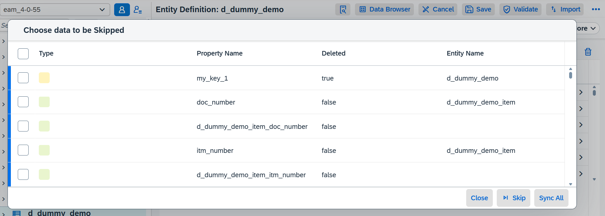

###  1.7.8. Import from SAP Child {#import-from-sap-child}

This option **imports the children entity(s) from an existing parent entity** from SAP tables. **Does not include relations.**

Developers can import an entity -\> verify their changes -\> and then click "Save" to commit their changes.

**Pre-requisite** is the same as mentioned in the [Import from SAP](#import-from-sap) section.

**Steps:**

1.  **Validation:** If a developer has created a parent entity and triggered "**Import from SAP Child**" before saving the parent entity, then it will throw a validation error. So, **it is needed to create & save its parent entity first, before importing its respective children entities**.  
    > 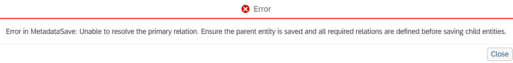

2.  If the parent entity is maintained in the SAP-side, then it will show an error dialog. Else, the import process will start.  
    > 

3.  From Data Studio, select the flavor -\> click the parent entity -\> click edit button -\> click "**Import from SAP Child**" button.

4.  **Validation:** During the process, if any error comes it will throw the error dialog. And in case any validation fails e.g., propertyid values are having reserved keywords then it will show that respective dialog also - same validation as available we developer normally create properties from the screen. **List of reserved keywords:** [PROC-27544: List of Reserved Keywords in Data Studio Application](https://docs.google.com/document/d/1p9gA7HkNhTAyFsPCT6JSJRgoNMEluVohG3cW0LI85r8/edit?tab=t.0).  
    >   
    > 

5.  Once the import process starts, at the end step, it will ask the developer to skip any specific properties by selecting the checkbox and clicking the "Skip" button or click "**Sync All**" to accept all data from the payload.  
    > **Important:** [Import from SAP Child on Existing Entity](#import-from-sap-on-existing-entity-data)  
    > 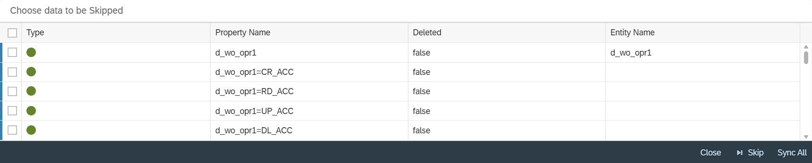  
    > 

6.  **Important:** Before Save, developers need to maintain the Primary Keys in all of the imported children entities. Otherwise, it will throw a validation error before clicking Save.  
    > 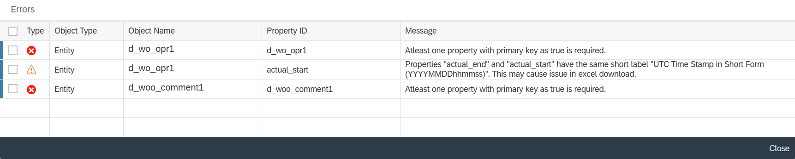

7.  After maintaining the Primary Keys in all imported children entities, it will allow the developers to save the changes.  
    > 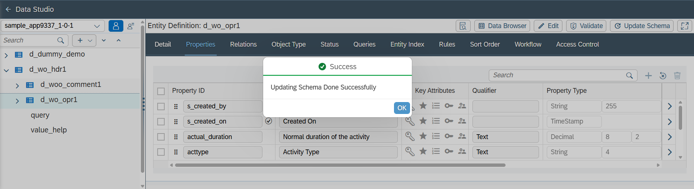

8.  **Important:** As relations are not maintained via the import process, after save, developers need to maintain the relations manually from the Data Studio tool.

    a.  Parent to Child Primary Relation:  
        > 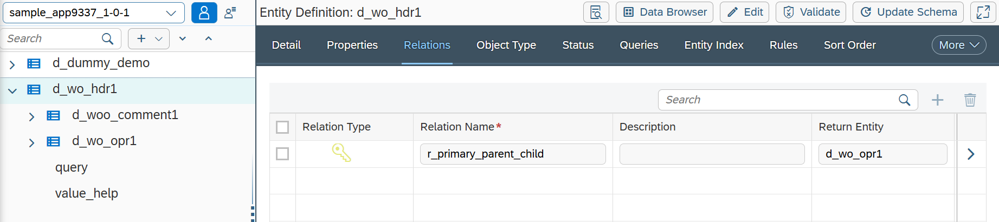

    b.  Child to Grandchild Primary Relation:

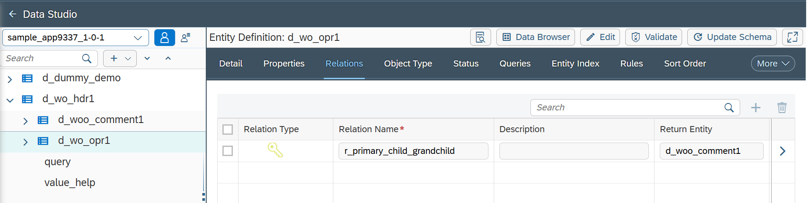

9.  Once the relations are maintained, the developers can start using the entity's data browser or from screen for CRUD operations.  
    > 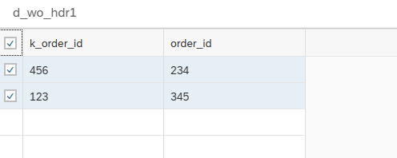  
    > 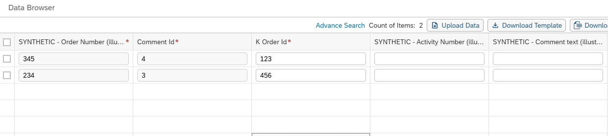

#### 1.7.8.1. Import from SAP Child on Existing Entity Data {#import-from-sap-child-on-existing-entity-data}

Mentioned in [**1.7.7.1**](#import-from-sap-on-existing-entity-data) .
