# Data Studio — Editor Sections

Data Studio is divided into two major sections, which are listed below:

- [Tree](#tree)

- [Detail](#detail)

## 2.1. Tree {#tree}

The tree present in the left section lists all the entities present in the selected app.

### 2.1.1. Expand All {#expand-all}

Expand All option is to expand all the collapsed sections (entity, query, value help).

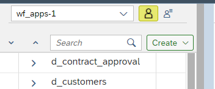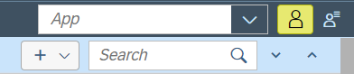

### 2.1.2 Collapse All {#collapse-all}

Collapse all option is to collapse all the expanded sections (entity, query, value help)


## 2.2 Detail {#detail}

This section contains all the details related to the selected entity/query or value help like properties, relations, object type, status, queries, and many more.

### 2.2.1 Entity Detail {#entity-detail}

On selection of any entity in the tree, it will display all available options in the detail section. The description of each tab is given below:

#### 2.2.1.1. Detail {#detail-1}

This section contains all the basic information about the entity. It contains fields like Root Entity name, App Mode, Entity Icon, Entity Name, Metadata type, and also a few buttons to enable or disable CRUD over the entity.

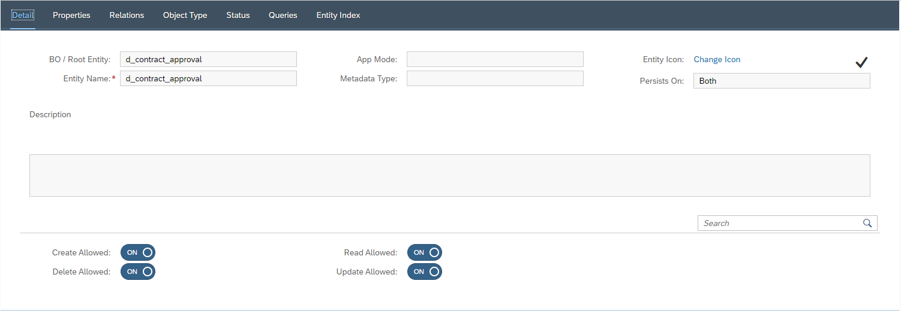

The description of each field is provided below:

##### **BO/Root Entity :** {#boroot-entity}

BO stands for Business Object. Root Entity means that if any entity is a root entity then it will have the same name as the BO and it will be the parent entity.

##### **App Mode :** {#app-mode}

App mode refers to the network mode of the entity/query. It supports network modes such as those specified below:

######  **Offline :** {#offline}

> Offline network mode refers to the capability to run the program with weak or infrequent network availability. The application stores the relevant data locally and updates the local cache and server data as and when it finds connectivity. Browsers and installed mobile apps (client) both are capable of offline operations. In offline mode, the values are maintained/fetched from the web SQL.

###### **Online :** {#online}

> Online network mode refers to the capability of running the program in a browser or installed mobile app (client) to communicate with the server for day-to-day needs. Network connectivity from client to server is a must. All the changes on the browser or device app will be collected and sent to the server for validating and saving. In the online mode, the values are maintained/fetched from the transactional database.

###### **SAP Online :** {#sap-online}

> This refers to the capability of all the transactions that go to SAP via the gateway server. In SAP online mode the values are maintained/fetched from the SAP server.

###### **SAP Preferred Online :** {#sap-preferred-online}

> Any transaction that takes place between your application goes through SAP to your web SQL.

##### **Entity Icon :** {#entity-icon}

This will associate the specified icon with the entity.

##### **Entity Name :** {#entity-name}

Entity name refers to the actual name/id of the entity.

#### **Metadata type:** {#metadata-type}

1.  **Runtime entity:** This is the default type of entity, where the table persists in the DB (unlike Transient Entities). The table is created in the Trans DB and CRUD operations can be performed on it.

2.  ~~**Config entity:** This is the type of entity, where the table persists but only in meta DB. This is usually used to store data for status and role fields.~~

##### Transient Entities {#transient-entities}

A transient entity is a non-persistent entity---meaning it does not store data in the database. It is primarily used for runtime calculations, data aggregation, or displaying derived data in the UI. These entities are ideal when you need to display or process combined data from multiple sources without storing it permanently.
> **Use Case Example:** Suppose you have two entities and want to display certain fields from each, but do not wish to persist the combined data. In this case:

- Create a transient entity that includes only the required properties.

- Write custom logic to query both source entities.

- Populate the transient entity with the result.

- Display this transient data on the screen with full support for UI features like Sort, Filter, and Fuzzy Search.

Users can also fetch data from external sources, populate the transient entity, and leverage built-in platform features such as:Sort, Filter, Fuzzy search, Excel download,Pivot view (report/chart generation).

**NOTE:**

- **Data Must Be Fully Loaded**:The transient entity's query must execute with **loadAll: true.**

- **Unique Primary Key**: Ensure that the transient entity has a **unique primary key** to enable proper identification and UI support.

- **Custom Data Handling Logic**: You must define how and from where the data is fetched, processed, and whether or not it should be saved back to a persistent entity.

##### **Persists On :** {#persists-on}

Persists On consists of three options which are explained below:

###### **null -**

> Entities will be created based on the app's network mode. If the network mode of the app is online then it will be created on the server side. If the network mode of the app is offline then it will be created in web sql.

###### **Both -**

> Entities will be created for both sides.

###### **Client Only -**  {#client-only--}

> An entity will only be created in web SQL for the device or browser during registration.

###### **Server Only -**  {#server-only--}

> An entity will be created in server-side DB and not in web SQL.

**NOTE:**

Entity persistence will be decided primarily based on the Persists On mentioned.

In case the persist on is set as null , Persists On will be checked based on app network mode.

Offline Flavor - Entity will be created in both server and client DB

Online Flavor - Entity will be created only on server DB.

##### **Universal Link Details :** {#universal-link-details}

Universal Link Details is used to build a Universal Link that opens the specific record of the current entity in its respective screen based on the provided parameters. These parameters are similar to navTo parameters available in screens which will be used for generating the deep link.

###### **Target Page -**

> Screen Id of the page.

###### **Section -**

> Section to which the link needs to be navigated.

###### **Page Data Model -**  {#page-data-model--}

> Name of the transnode to which the link needs to be navigated.

###### **Query Parameters -**  {#query-parameters--}

> Additional QueryParameters that need to be passed to the navigated screen.

##### **Create Allowed:** {#create-allowed}

This button enables/disables the creation accessibility over the entity.

##### **Read Allowed:** {#read-allowed}

This button enables/disables the data read access over the entity.

##### **Delete Allowed:** {#delete-allowed}

This button enables/disables the deletion accessibility over the entity.

##### **Update Allowed:** {#update-allowed}

This button enables/disables the modification access over the entity.

#### 2.2.1.2. Properties {#properties}

This tab contains all the properties present inside the entity. It is also used to add/delete properties from the entity.

Entity Property is also known as an attribute or variable in an entity or field in the database table.

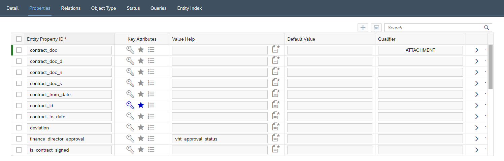

The entity Detail section consists of multiple fields. All the fields are explained below :

##### **Entity Property ID :** {#entity-property-id}

Property ID is unique within the entity across all apps. Once created this can't be changed later.

[PROC-27544: List of Reserved Keywords in Data Studio Application](https://docs.google.com/document/d/1p9gA7HkNhTAyFsPCT6JSJRgoNMEluVohG3cW0LI85r8/edit?tab=t.0) - List of reserved keywords which are not restricted to use as property ID value.

##### **Short Label :** {#short-label}

Provide label for your property which will be used as labels in screen.

Note: It is recommended not to provide same label for two or more properties.

Validation Warning:

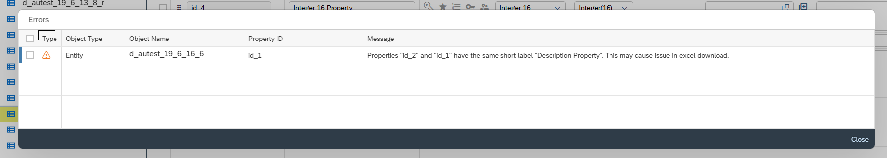

##### **Key Attributes :** {#key-attributes}

Key attributes show whether the property is a primary key, mandatory, or auto-incrementing field. Each of these attributes is explained in the below table:

| **Icon**                                                                               | **Description**                                                                                                                                                                                                                                                                       |
|----------------------------------------------------------------------------------------|---------------------------------------------------------------------------------------------------------------------------------------------------------------------------------------------------------------------------------------------------------------------------------------|
| 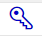    | This icon shows if the respective property is a primary key or not. If it's highlighted, then it's a primary key, else not. Each entity should have a primary key irrespective of the entity type                                                                                     |
|   | This icon shows whether the selected property is mandatory or not. If any property is marked as compulsory, its value needs to be maintained before saving it to the DB. If the icon is highlighted, the entity is compulsory.                                                        |
|   | This icon represents whether the respective property has auto-incrementing functionality or not.                                                                                                                                                                                      |
|    | This icon indicates whether the chosen property is a unique key. When highlighted, it means the selected property will only store unique data in the database. If a user attempts to add duplicate data, an error will occur.                                                         |
|  | This icon indicates whether the selected property is a Parent key, meaning it is common to both the parent and child entities. A parent key is created only when a child entity exists, and all primary keys of the parent entity are established as parent keys in the child entity. |

##### **Value Help :** {#value-help}

Can set the already defined value help for this property.

##### **Default Value :** {#default-value}

It refers to the predefined value for that specific property. This field will be automatically filled with the specified value.

##### **Qualifier :** {#qualifier}

Add a Qualifier for the entity. A qualifier helps to make the entity property work in a predefined manner. The property with qualifier stores and acts as per the definition of the qualifier.

Please refer to Qualifiers to know more about qualifiers.

##### **Root :**  {#root}

##### Root key {#root-key}

All primary properties of a Business Object (BO) will be designated as Root keys in its child entities. This can be identified by checking the property details and if the Root checkbox is true,it indicates that the property is a root key. On adding data using a data browser, it will copy the data of the Root Key from its immediate parent.
**NOTE 1:** Root keys are created only when the child entity is created.

**NOTE 2:** In the case of the Parent Child flavor scenario, the data type (domain, length, etc.) for the same Property Id in both the flavors should not be the same.

##### **Is Unique Key:**  {#is-unique-key}

A unique key can be assigned to any property, aside from the primary key. When a child entity is created, all the root and parent keys are automatically marked as unique, and an index is generated for them. Any regular property can be designated as a unique key.

**Use Case of Unique Key:  
**Consider a student table that includes columns for registration number (reg_no), student name (student_name), and date of birth (date_of_birth), with multiple records where the reg_no is the primary key.

| **reg_no(Primary)** | student_name | date_of_birth |
|---------------------|--------------|---------------|
| 1001                | Ankit        | 21/04/2001    |
| 1002                | Abhijith     | 22/08/2005    |
| 1003                | Amit         | 12/02/2004    |
| 1004                | Prem         | 08/05/2000    |

**  
**Consider adding a new column, "aadhar_no," to store the Aadhaar numbers of all the students. Since each Aadhaar number should be unique, we want to ensure the database doesn\'t allow duplicate entries. The only option available is to mark "aadhar_no" as a primary key, but this would prevent the user from making any updates to the existing data.

To solve this, the concept of a unique key is introduced. By marking the "aadhar_no" as a unique key, we ensure that duplicate values can\'t be stored in the column while still allowing null values. This allows us to modify the data in the table without enforcing a primary key constraint.

| **reg_no(Primary)** | student_name | aadhar_no(unique) | date_of_birth |
|---------------------|--------------|-------------------|---------------|
| 1001                | Ankit        |                   | 21/04/2001    |
| 1002                | Abhijith     | 22071             | 22/08/2005    |
| 1003                | Amit         |                   | 12/02/2004    |
| 1004                | Prem         |                   | 08/05/2000    |

When a property is marked as unique, it offers the following benefits:

1.  It prevents the storage of duplicate data, regardless of case (case-insensitive).

2.  It allows null values to be stored in the column.

3.  When creating a child entity, it is mandatory to mark a property as unique to support the \"one parent, multiple children\" concept. This is because the parent key, which is unique, will be fetched from the parent entity and referenced in the child. If someone tries to add another child with the same parent data, a unique key violation will occur. To resolve this, an additional unique key must be defined in the child entity that is independent of the parent entity.

4.  When a unique key is defined in a child entity that has a primary relationship with a parent entity, uniqueness is enforced as a composite constraint comprising the parent key and the child unique key (i.e., **parent_key + unique_key**).

##### **Is Parent Key:**  {#is-parent-key}

All the primary properties of the immediate parent entity will be created as Parent Key in the child entity and will be marked as regular. This property cannot be changed by the user.

On adding data from Data Browser, it will copy the Parent Key data from its parent and create it in the child.

##### **Formula:**  {#formula}

It is a property of an entity. It evaluates the given expression and returns the evaluated result.

Example :

Syntax : `={"test "+ this.order_id }`

Here this.order_id is the entity property

##### **Data Type:**  {#data-type}

It is a property data type. Ex- String, Boolean, Integer.Data type conversion in the Data Studio is only available for compatible data types, as outlined in the provided Excel file;[Data Type Conversion](https://docs.google.com/spreadsheets/d/1R9q02xgUj3yKylELajMxkEfC2cp3lFDek6W-prHaXiw/edit?gid=1323613538#gid=1323613538).

##### **Filter Option:**  {#filter-option}

If this field is marked as true for a property then only **applyFilterP** API can be used for that property.

##### **Is Restricted:**  {#is-restricted}

If this field is marked as true for a property which has a value help assigned to it then validation will be called for this property in UI which will check if the key is present in the value help.

##### **Min Value:**  {#min-value}

The minimum value is the minimum value for your property that a user can enter.

##### **Max Value**:  {#max-value}

The maximum value is the maximum value for your property that a user can enter.

##### **Authorization:** {#authorization}

The authorization field takes the Login **user id** as an input and only that user can get access to that property. Ex- \$USER.login_id

**ID Series :**

ID series is used for populating the IDs/Keys in the entity's property with kloBO. If an application wants to allocate the ID itself, either it should not assign the ID series or mark it as none. kloBO will allocate the ID on the first read of the ID.

##### **Transient Property:** {#transient-property}

An entity property can be made transient by setting the type of property to "Transient Field" so that within that entity property's value is not stored in the database. It exists only at runtime and is never persisted in or retrieved from the database.

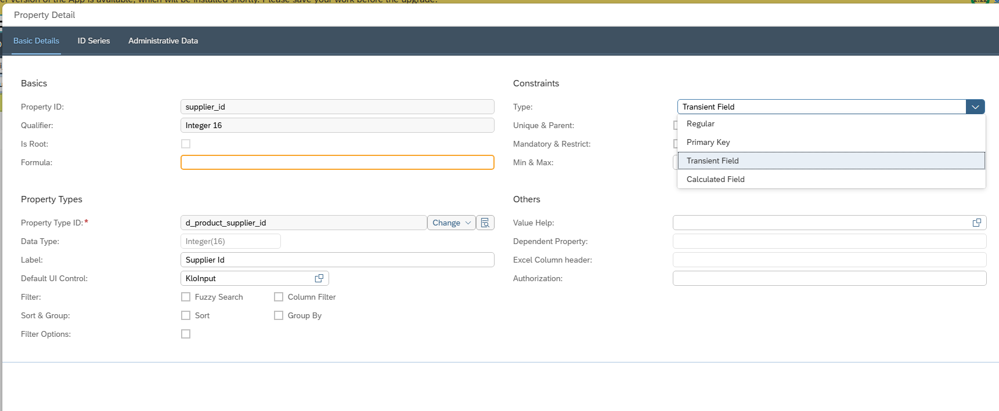

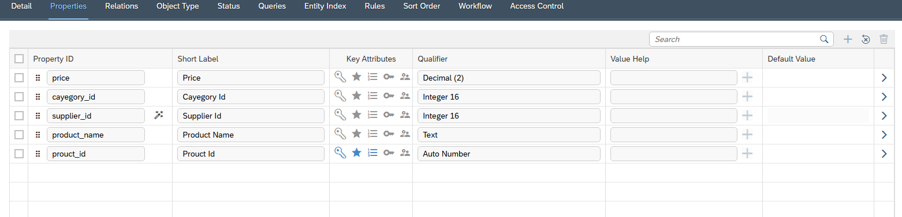

Use Cases:

1.  **Accessing Properties of Relational Entities  
    > ** Transient fields can be used to display values from related entities without actually adding them as properties/database table columns.

> For example, if an entity is related to another entity(e.g., User → Department), a transient field like departmentName can fetch and show department.name without requiring an actual field in the database.

2.  **Custom Getter/Setter Logic  
    > **Standard transient property getters and setters can be used for dynamically calculating values, formatting data before sending it in a response, or temporarily accepting input and storing it without saving it to the database.

> In this example, d_customer is the entity, and fullName is a transient property.  
The fullName property is computed from the underlying firstName and lastName fields.

The getter and setter for fullName should be written directly inside the entity file /src/\<app folder\>/entity/d_customer.ts
>
Eg:

```ts
get fullName(): string {
  return `${this.firstName} ${this.lastName}`;
}
set fullName(name: string) {
  const [firstName, lastName] = name.split(' ');
  this.firstName = firstName;
  this.lastName = lastName;
}
```

**Note :**

In case a user wants to change the property type of any property, they have to re-add the same property in their screen metadata using UI Editor (wherever applicable) from their transnode for reflecting the changes.

For ex:

This is the property type created by default using Data Studio:

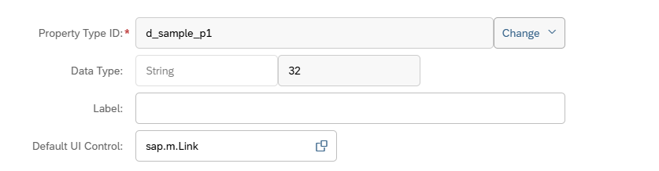

Suppose the property type has been changed as per below:

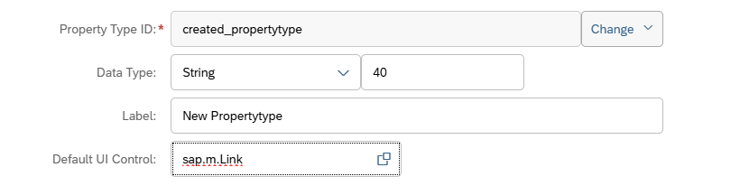

To reflect the same changes in the application as well please follow the mentioned steps:

**Step 1**: Open the screen metadata in the UI Editor. Now delete all occurrences of the changed property type's property.

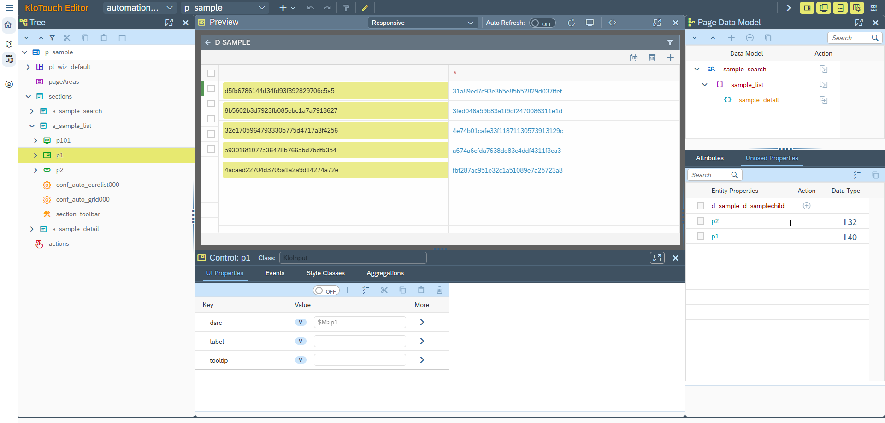

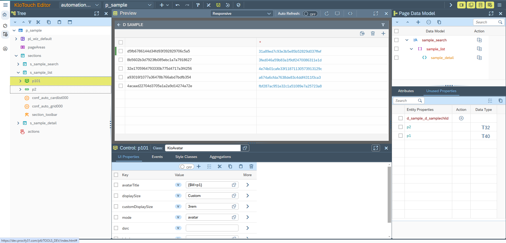

**Step 2**: Now drag and drop the same property from the transnode to the section.

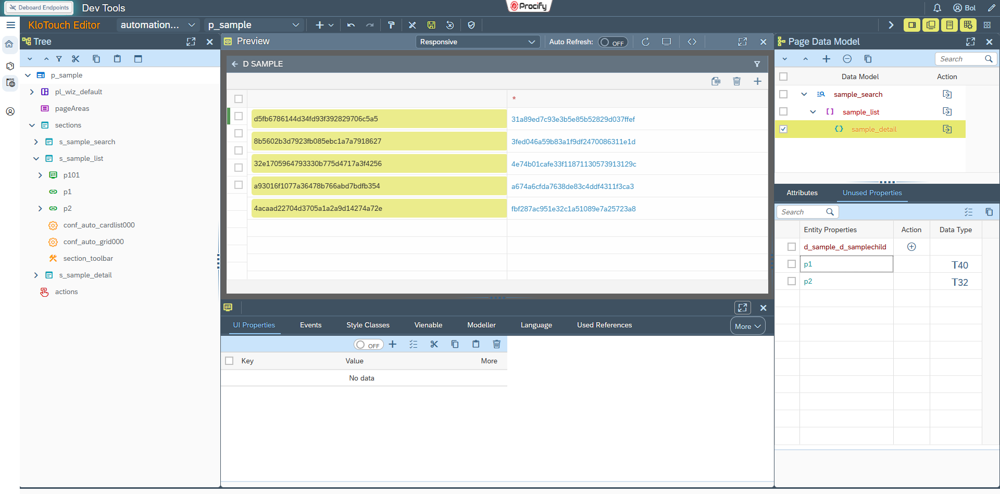

##### **Created By / Modified By Value Help:** {#created-by-modified-by-value-help}

The system fields s_created_by and s_modified_by store the user ID of the user who created or last changed a record. These fields have a built-in value help, so screens and data views show the user\'s name instead of the login ID.

**Features:**

- Names instead of user IDs: the user\'s display name is shown wherever these fields appear.

- Filter and search: filtering and fuzzy search work on the user\'s name.

- Sorting: the columns sort by the user\'s name.

**NOTE:**

- Created By is fixed: once a record is saved, s_created_by can\'t be changed. Any attempt to change it is ignored.

- Modified By is automatic: s_modified_by is updated every time the record is saved.

#### 2.2.1.3. Relations {#relations}

This tab contains all the relations created inside the entity. Entity relation relates one entity with another entity.

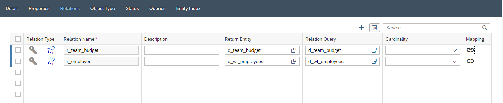

Entity relation consists of multiple fields. All the fields are explained below:

##### **Relation Type:** {#relation-type}

It specifies the type of the relation whether it's a primary or non-primary relation. This also contains two icons which are described below:

###### **Primary Relation** {#primary-relation}

Primary relation is a special kind of aggregate relation within the BO boundary. All entities in a BO are navigable from the root entity only once unidirectional.

A primary relation is a direct relation between two entities. There will be a parent entity and a child entity and the child entity will be dependent on the parent entity.

The **Return Entity** value help is applicable only for **aggregate (non-primary)** relations. The primary relation is created only during the creation of a child entity and cannot be assigned by selecting a return entity.

###### **Aggregated Relation** {#aggregated-relation}

An aggregation relationship can be described in simple words as \"an object of one class can own or access the objects of another class\". If a parent is deleted/archived, all other parts associated with it are deleted. Aggregated relations can be across BOs.

When a relation is created as **non-primary**, the related data cannot be fetched in callbacks if both the parent and child entities are being saved in the same transaction.

This occurs because the child entity has not yet been persisted at the time the relation is evaluated, and therefore the relation data is unavailable.

| **Icon**                                                                              | **Description**                                             |
|---------------------------------------------------------------------------------------|-------------------------------------------------------------|
| 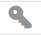             | This shows whether a relation is primary or not.            |
| 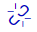 | This icon displays whether a relation is aggregated or not. |

##### **Relation Name:** {#relation-name}

Unique within an Entity. Relation names and Property names can't be the same.

##### **Description:** {#description}

Provides a small description of the relation.

##### **Return Entity:** {#return-entity}

Return entity is the actual name of the entity.

##### **Relation Query:** {#relation-query}

The relation Query is the entity/query ID using which the relation needs to be established.

NOTE: If the relation is created using a relation query, the relational data will be fetched according to that query. Therefore, features like sort order should be implemented at the query level, rather than at the entity level, to retrieve the data in the correct sorted order.

##### **Cardinality:** {#cardinality}

Cardinality shows how the entities are connected. Select the cardinality for the relation (0:n, 1:1, 1:n).

- 0:n - Zero to Many relationships (A minimum cardinality of 0 indicates that the relationship is optional.)

- 1:1 - One to One relationship

- 1:n - One to Many relationships

##### **Mapping:** {#mapping}

It will map based on the target entity property and source entity property with a mapping type.

This field provides the following options:

- ON CREATE ( mapping will be called On Create of an entity)

- ON QUERY ( mapping will be called On execution of an entity query)

- BOTH

##### **Note:** {#note}

In case of aggregated relation where the mapping property of the entity is null, then all the data of the related entity will be fetched from the relation

#### 2.2.1.4. Object Type {#object-type}

Object Type defines the possible behaviour of an entity / BO. Object type has a unique key and description.

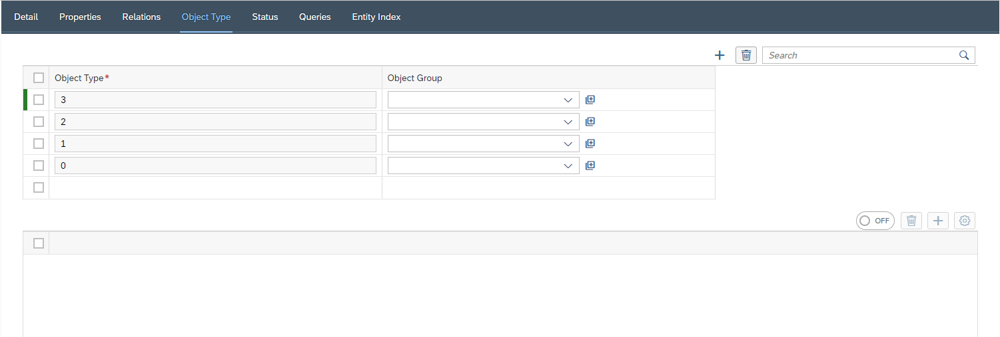

Object type contains multiple fields which are explained below:

##### **Object Type:** {#object-type-1}

This field displays the object type. The object type may include alphabets or numerals.

##### **Object Group:** {#object-group}

It is a group of object types. Select the object group from the drop-down.

#### **2.2.1.5. Status** {#status}

This tab is used for the configuration and maintenance of status-based data under specified object types. This also helps in assigning status, and status groups under specific object types.

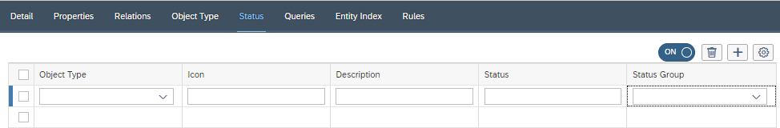

This tab consists of a few fields which are mentioned below.

##### ***Object Type:***  {#object-type-2}

This field displays the object types available for this entity. The object type may include alphabets or numerals.

##### ***Icon:*** {#icon}

This field displays an icon for your newly created entry in the status section.

#####  ***Description:*** {#description-1}

A short description

##### ***Status:***  {#status-1}

This field displays the entity status which you are going to map with the status group

***Status Group:***

This field lists down the predefined status groups, which can be mapped with the status and will be used in Vienable.

**NOTE:**

If changing any system field property's (s_status, s_object_type, s_status_group) propertytype columns, will change it in the whole app.

For ex: If changing the value help id of s_status property from "**vh_s_status**" to "**vhc_city**" then this change will reflect in each of the entities s_status property wherever added.

#### 2.2.1.6. Queries {#queries}

This tab will list all the queries present under the current entity. Using this section we can also add new queries.

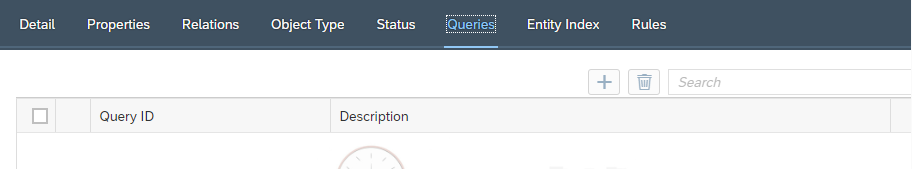

Queries consist of a few fields like Query ID and description.

##### **Query ID:** {#query-id}

The query ID is the name of the query which is used to identify the specific query.

##### **Description:** {#description-2}

A short description of the query.

#### 2.2.1.7. Entity Index {#entity-index}

The Entity index tab is used to retrieve data from a database very fast. When you are creating indexing, It will create an index in your database along with the properties you have added. Next time when you search those properties, It will directly fetch that index from the database and give you the data.

An index on a table works like an index in a book (that\'s where the name came from):

Let\'s say you have a book about databases and want to find some information about storage. Without an index (assuming no other aid, such as a table of contents) you\'d have to go through the pages one by one until you found the topic (that\'s a full table scan). On the other hand, an index has a list of keywords, so you\'d consult the index and see that storage is mentioned on pages 113-120,231 and 354. Then you could flip to those pages directly, without searching (that\'s a search with an index, somewhat faster).

**Entity Index creation:**

**Step 1:** Go to the Entity Index tab and click on the **add icon(+)**

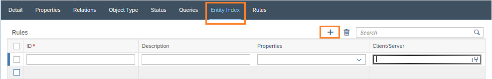

Entity index consists of a few fields which are mentioned below:

**ID:** The entity index ID is used to identify the specific entity index.

**Description:** A short description of the entity index.

**Properties:** Properties for your indexing. These properties data will be retrieved very fast.

**Client/Server:** Entity indexing will call on which side, server-side, client-side or both.

**Step 2:** Fill in the detail section as per your requirement.

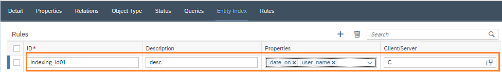

**Step 3:** Click on the save button.

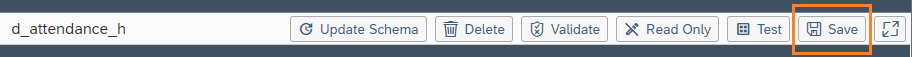

**NOTE:**

Indices will be created based on the **Client/Server** mentioned.

Server Only - Creates index only in server DB

Client Only - Creates only in client/local DB

Both - Creates on both server and client

Deletion of Entity Indexes is supported at both entity level and flavor level update schema , but some points have to be kept under consideration.

- In a parent-child scenario, if an index is deleted from the parent but still exists in the child, triggering an update schema on the child entity will cause the index to be added back.

- To avoid inconsistencies, an index must be deleted from both the parent and child entities.

#### 2.2.1.8. Rules {#rules}

A **Rule** is a program containing business logic written by a Developer as per the application\'s needs. It works with the event bus, any change in entity triggers the event, and all the rules hooked to the event bus are executed sequentially. Rules are reusable objects across client, server, and middleware. Rules are reusable and hence can be subscribed multiple times with different Channel types or other combinations.

##### **Entity Rule Creation:** {#entity-rule-creation}

**Step 1:** Go to the Rule tab and click on the **add icon(+).**

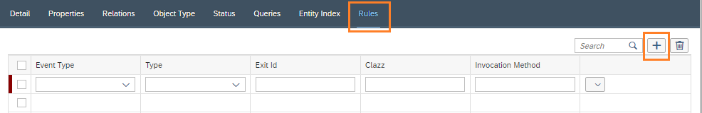

| **Field**         | **Description**                                                                     |
|-------------------|-------------------------------------------------------------------------------------|
| Event type        | Select the event type. Based on the type of event you choose rule will be executed. |
| Type              | Select the channel type, based on this the transaction will be performed.           |
| Exit ID           | is an ID you put in for the rule subscription. (can select from the existing one).  |
| Clazz             | This will be the rule file name.                                                    |
| Invocation Method | The method needs to be called.                                                      |

**Step 2:** Select the Event Type from the drop-down. The event type will mention when the rules will be executed.

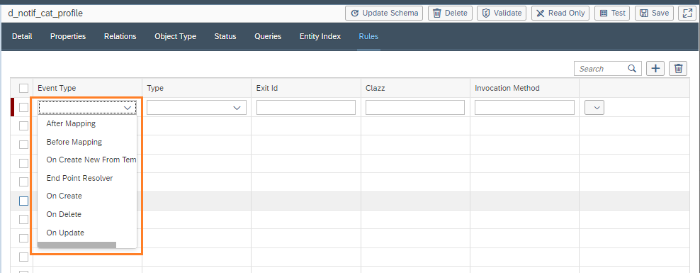

**Event types:**

- Endpoint resolver (Once the rule is being executed in-between it picks Endpoint Resolver and resolves it **or** whenever the online save is going to the klarion server Endpoint resolver will get called)

- On Create ( rule will be executed on create of an entity)

- On Delete (rule will be executed on delete of an entity)

- On Update (rule will be executed on update of an entity)

**Step 3:** Select the channel type(there are different input channels to perform a transaction on an entity, channel type selection decides when to trigger the Rule).

**Channel Type:**

- Endpoint / Device on Klarion server- always on the client

- Endpoint / Device on Klarion server

- Endpoint / Device on Klarion server- always on server

- Endpoint / Device to Server/ Client -Network Context Switch

- Legacy on Klarion server

- Klarion server to Klarion offline server

- Klarion server to Klarion Server

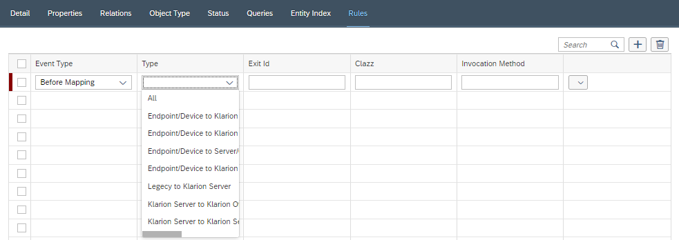

**Step 4:** Fill in the value for **Exit ID.**

**Exit ID:** It\'s an ID that you put in for the rule subscription. (can select from the existing one).

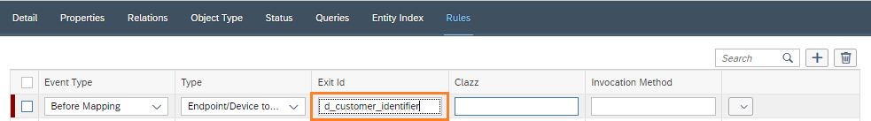

**Step 5:** In the Clazz field provide the rule file name (example: rules/\<file_name\>) and in the invocation method provide an event name. You will be using that event to write your business logic codes.

- **NOTE:** If you are creating a **Rule** for the same entity you can fill **this** inside the **Clazz** field.

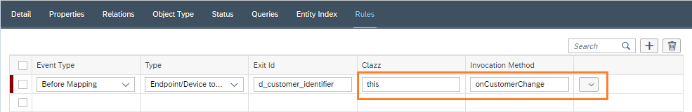

**Step 6:** Click on the **save** button to save the newly created rule.

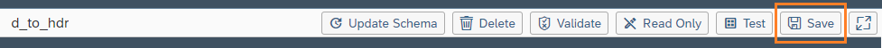

**Note:** The last column drop-down icon has two fields(**Choose Existing** and **Create New**)

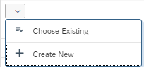

**Choose Existing:** This will list down all the existing rules for that entity. You directly select it and use it.

**Create New:** Create New will clear some fields from the created rule fields.

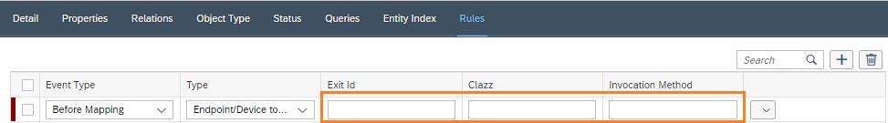

For more information, please refer to the [training guide](https://docs.google.com/document/d/1niR7Yr3kj3ZTTjf5TxjJ_Tetav9FGIzVj4nbqPRe8_U/edit?tab=t.0#heading=h.meukdy).

##### **Debugging a Legacy to Klarion Server Callback on a Private Node:** {#debugging-a-legacy-to-klarion-server-callback-on-a-private-node}

A Legacy to Klarion Server (E2K_MSG) rule runs when a legacy system, such as SAP, sends a message to the Klarion application. These messages are processed on the server nodes, so the rule can\'t normally be debugged from a private node.

To debug such a rule, the node ID of the private node should be sent in the message header. The message is then processed on that private node, where breakpoints can be used like for any other rule.

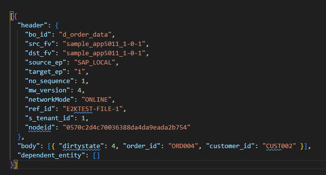

**Steps:**

- Start the private node and note its node ID.

- Send the message with the header **nodeid** set to the node ID of the private node.

- The private node picks up the message and runs the Legacy to Klarion Server (E2K_MSG) rule.

- Debug the rule from the debugger attached to the private node.

**NOTE:**

- If the header is not sent, the message is processed on the server nodes as usual.

### 2.2.2. Query Detail {#query-detail}

On selection of any query in the tree, it will display all available options in the detail section. The description of each tab is given below:

#### 2.2.2.1. Detail {#detail-2}

This tab will list all the basic information related to the query. It contains fields like return entity, DB Selection, Select distinct, app mode, Tenant level, query type and expand all.

The description of each of the fields is given below:

##### **Return Entity:** {#return-entity-1}

Return entity indicates the return type of the query. The second field of the return entity is the **Alias** of that entity.

##### **Transient Entity (Aggregate Queries)** {#transient-entity-aggregate-queries}

- In the case of **aggregate queries** and **native aggregate queries**, an additional field called **Transient Entity** is present.

- In the UI Editor, Page Data Model will be created from the Transient Entity rather than the return entity.

- The **Transient Entity** will include all the properties from the SELECT clause, ensuring that all values are properly displayed on the screen.

**Differences Between Aggregate and Native Aggregate Queries**

- **Aggregate query** automatically generates a transient entity containing all properties used in the SELECT clause. If no SELECT clause is modeled, the return entity is used instead.

- Properties added automatically by the framework to the transient entity cannot be deleted. However, users can add their own properties to the transient entity for additional calculations, display purposes, or other operations.

- **Native aggregate queries** require the user to explicitly create a transient entity and assign it to the "Transient Entity" in the detail tab of the query. All aliases must be included as properties; if no alias is provided, the property name from the Entity should be included in the query.

**Note:** For native aggregate queries, if a transient entity is not specified manually, it will be defaulted to the return entity.

##### **DB Selection:** {#db-selection}

We have two DB instances, one is Reader and another is Writer, where Writer is RunTimeMain and Reader is RunTimeSecondary.

We can shift the load of a particular query to the Reader instance by maintaining the proper DB Selection. By default it runs on RunTimeMain.

In case of RunTimeSecondary, if we are updating some property of the entityset it will persist via RunTimeMain.

##### **Select Distinct:** {#select-distinct}

This field specifies whether the query created will be giving unique records or not.

**Select Distinct** returns unique records based on the specified columns. If the selected columns are not primary keys, and **loadAll** is **false,** the distinction is made based on the primary key, which might still include duplicates. To ensure distinctness based on the selected columns, **loadAll** must be set to **true**.

##### **App Mode:** {#app-mode-1}

App mode refers to the network mode of the entity. This is similar to what we get in identity-level app mode. Click [here](#app-mode) to read about supported app modes in detail.

##### **Tenant Level:** {#tenant-level}

This radio button allows you to make the dependent or independent.

##### **Query Type:** {#query-type}

Query supports multiple types of query modelling which are easy to define and use in the application. Based on the application scenario and use case, the [query type](https://docs.google.com/document/d/1LIe4CFLCNTAuyA7iC5Esv-4pMN07I80htOXBQ7EgQQw/edit#heading=h.3vb77nwymsmg) has to be decided.

###### Runtime Query ( former Entity Query) {#runtime-query-former-entity-query}

###### Modelled Query (former Dynamic Query)

###### Native Query (former Advanced Query)

###### Aggregate Query (ReadOnly with Modelling support)

###### Native Aggregate Query (ReadOnly with Raw SQl)

**Note:** Changing modelled query to aggregate/native aggregate will trigger a dialog mentioning the warnings which have to resolved depending on the developer's need.

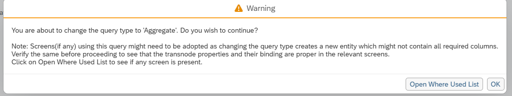

On click of Open Where Used List, a dialog will appear mentioning if any screen is created using the query.

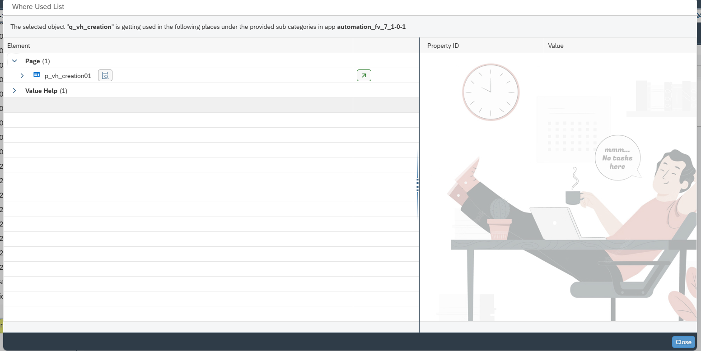

#### **Query Modelling**  {#query-modelling}

##### **Update:** {#update}

This will update the SQL query generated as per the data maintained for the query.

##### **Expand All:** {#expand-all-1}

**The "Expand All"** text area contains all the relations for which the data will be loaded during the parent query execution.Currently, **ExpandAll** does not work when an **INNER JOIN** is used in a query, as we do not support the combination of **ExpandAll** and **INNER JOIN** together.

Note: **Expand All** is **not supported for aggregate queries**.  
When a query uses aggregate functions (like SUM, COUNT, AVG, etc.), it consolidates multiple rows into summary values. Because of this aggregation, the original row-level detail is lost. **Expand All** relies on accessing these underlying row-level relations to fetch related data. Since the individual rows no longer exist in the aggregated result, it is **not possible to expand relations** in this context.

**Expand All with Joins**:

- The Expand All feature is supported in queries that include joins.

- Joins defined in the parent query are automatically appended during Expand All execution.

**Entity Restrictions:**

- The same entity cannot be used simultaneously in both the main query and in the Expand All clause.

- This restriction helps avoid circular references and data redundancy.

**Where Conditions on Joined Entities:**

- You can apply WHERE conditions on secondary (joined) entities in queries that use Expand All.

- This is considered while filtering of expanded data.

**Note:Supported Functionality (BOL\_ Version 7-2-113 and onwards)**

#### 2.2.2.2. Entities And Join {#entities-and-join}

In this tab, we can manually add the joins and choose join types. We can also manually select the fields and can group/order the fields.

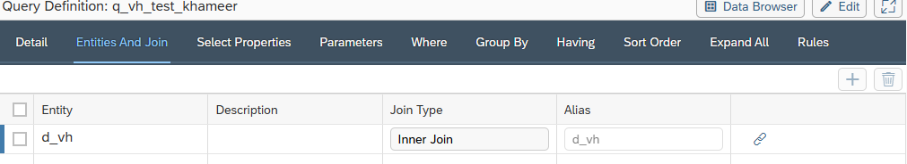

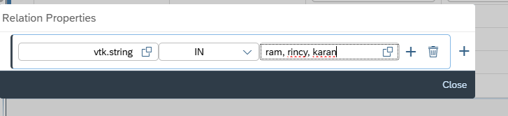

In the Entity Join section of our queries, we can now incorporate fixed values such as 100, 200, \'RAM\', \'Rincy\', \'Karan\', as well as system variables like \$SYSTEM.userID and \$SYSTEM.now within the join conditions.

**Note**:To ensure uniqueness in the results, we enable the SELECT DISTINCT option.

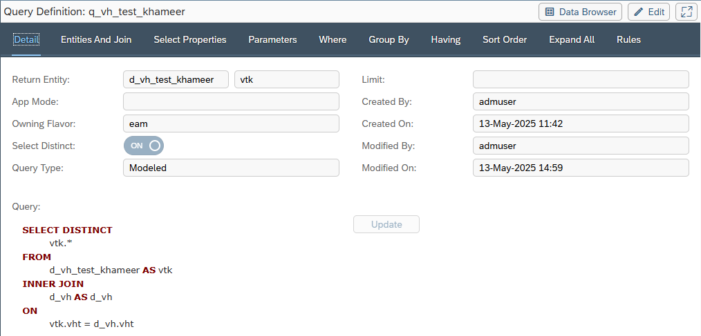

Below are the details of the fields shown above in the image

##### ***Entity:***  {#entity}

This field is for root entities. The entity to which we are applying the Joins.

***Description:***

A short description for entity join

***Join Type:***

A JOIN clause is used to combine rows from two or more tables. There are four types of join.

#### 2.2.2.3. Select Properties {#select-properties}

This tab contains information about properties in the select clause. All the properties present in the query will be listed here.

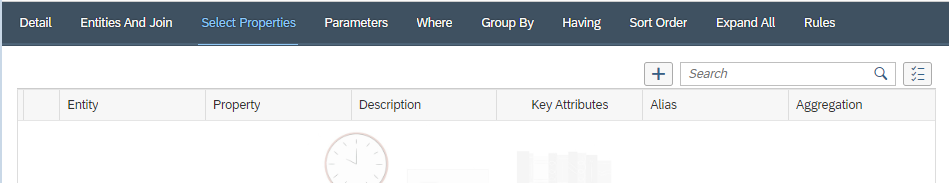

Unlike **modeled queries**, **aggregate queries** allow the same property to be included multiple times with different aggregation functions. For example:

- **Counting** the number of cities and also **listing** the names of the cities.

- Calculating the **minimum**, **maximum**, and **average** values of a property such as marks.

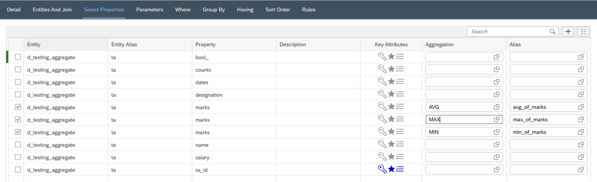

**Note:** Each aggregated instance of a property must have a unique alias to ensure that all values are displayed correctly in the query result.

All the fields of this screen are described below:

##### **Entity** {#entity-1}

Entity name of the selected property.

##### **Property** {#property}

Entity property ID which is present in the query.

##### **Description** {#description-3}

A short description of the query.

##### **Key Attributes** {#key-attributes-1}

This field represents whether the respective property is primary, mandatory, or has an id-series or not. Click [here](#key-attributes) to learn more about each of these.

##### **Alias** {#alias}

Alias refers to the **SQL aliases used** to give a table, or a column in a table, a temporary name.

##### **Aggregation** {#aggregation}

Aggregation in a query refers to the process of combining multiple rows of data into a single summary value. It is commonly used to calculate metrics such as **sum**, **average**, **count**, **maximum**, **minimum**, or other summary statistics.

**Note:** When using a **modeled query**, it is recommended to provide an alias to display the aggregated value on the screen. This can be done either by creating a **transient property** or by using an existing property. Or the **count_of_property** or other aggregated result returned by the database may not appear in the transient node or returned entity.

**Additional Note:** When performing aggregation within an **aggregate query**, an alias is automatically generated. However, it can also be manually specified if desired.

#### 2.2.2.4. Parameters {#parameters}

This tab lists all the query properties that are created under this query. A query property is similar to what an entity is having but this property will be used only in the runtime and no actual attributes will be added in the database table.

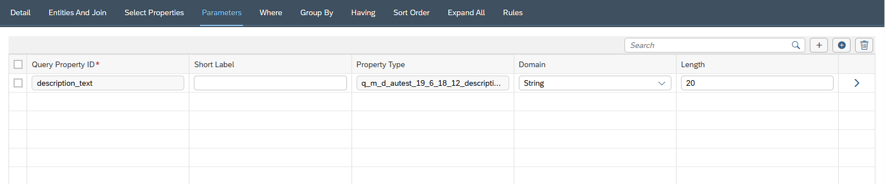

Below is the definition of the fields shown above in the image:

##### **Query Property ID:** {#query-property-id}

Provide the ID for query property (should only contain small chars, numerical, '\_'). This is the unique key used for accessing the specified query property.

##### **Short Label:** {#short-label-1}

Mention the label which is required to be shown in the UI when using search or any other function.

##### **Default Value:** {#default-value-1}

When providing default value in a query property it will act as a predefined value for that property and when the query will be executed it will prefill the query property with the provided default value.

**Description:**

A short description of the query property.

##### **Property Type:** {#property-type}

Property Type is generated in association with the query ID. This also refers to the element ID.

##### **Domain:** {#domain}

It shows the data type for the query property. This generally means what will be the data type of the property specified like String, Int, Boolean, etc.

##### **Length:** {#length}

This field will display the length of the field specified. For example: For String it can have a Length 255 or 32; For Integer it can have a length of 16,32 or 64 etc.

#### 2.2.2.5. Where {#where}

Where the tab contains all the conditional data present in the query.

To use the **where** clause, follow these steps:

**Step 1:** Go to the **Where** tab and click on **Add icon(+)**

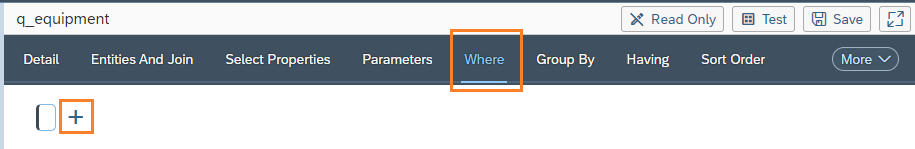

**Step 2:** Fill the fields according to your requirements.

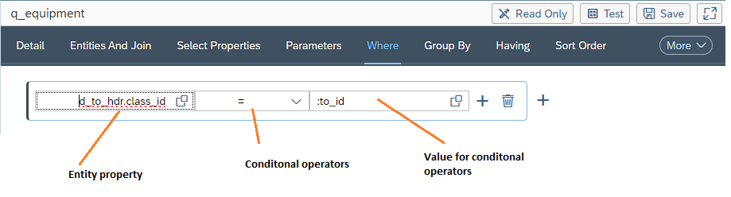

**Step 3:** Click on **save** button

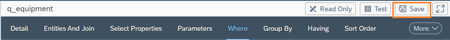

#### 2.2.2.6. Group By {#group-by}

Group by tab contains all the properties present in the group by clause.

To use a group, follow these steps:

**Step 1:** Go to group by tab and click on **add icon(+)**

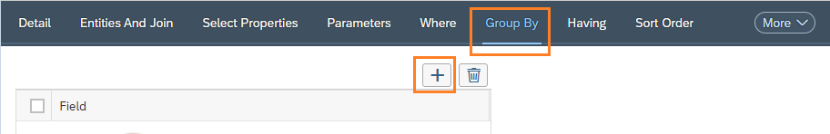

**Step 2:** Select the field from vh on which you want to apply group by

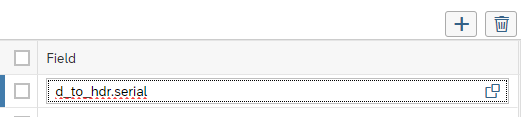

**Step 3:** Click on the **save** button


#### 2.2.2.7. Having {#having}

The Having tab will list down all the properties present in the having clause.

To use having on an entity property follow the same steps as we followed in the [**Where**](#where) clause

#### 2.2.2.8. Sort Order {#sort-order}

Sort order is used to sort the property in either ascending or descending order.

The fields are explained below:

##### **Field:** {#field}

It refers to the property for which a sort order has been created.

##### **Order:** {#order}

Order specifies whether the data will be sorted in ascending or descending order.

**Note:** To use sort order on any property, go to the sort order tab and inside that tab click on the **add icon(+)** fill in the data for your requirement and click on the save button.

#### 2.2.2.9. Expand All {#expand-all-2}

The **"Expand All"** tab contains all the relations in one place for which the data will be loaded during the parent query execution.

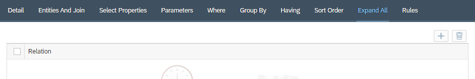

**Note:** In all the above sections listed, you can add and delete properties as and when required. The option for the same is given in all the sections.

### 2.2.3 Value Help Detail {#value-help-detail}

This tab contains all the details about the value help.

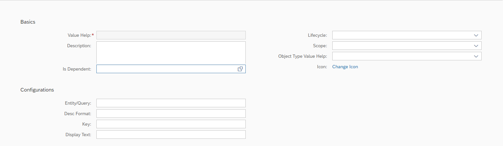

##### **Value Help:** {#value-help-1}

In the Application, ID/key is frequently used to store the related data and at the same time in the user interface descriptive explanation is required. To achieve this, the ID/key is represented by other single/multiple data from the related table.

Value help is also used to supply the choices available to fill (combo, dropdown, auto-complete) as selection data. Value help can restrict accepting the input value from valid sets.

##### **Description:** {#description-4}

A short description of the value help and its use case.

##### **Is Dependant :** {#is-dependant}

This specifies whether the current VH is dependent on any other VH or not.

**For Example,** Two Value Helps are there, for State and City, so the city value help will be dependent on the state value help.

##### **Object Type Value Help :** {#object-type-value-help}

Select the object type from the drop-down. The type of ValueHelp needs to be selected while defining the ValueHelp in Data Studio depending on the scenario.

The following are ValueHelp Types:

- CONFIG

- QUERY

- VH_TRANSACTION

###### **CONFIG** {#config}

VH Config works similarly to **VH Transaction** except for the fact that the values are maintained/fetched from the metadata (config) DB rather than transactional DB. Maintain the ValueHelp as the configuration in the Data Studio, this is part of the metadata. The data maintained here are Flavor-dependent. VH values can be overridden in any child app.

Note: Whenever a config vh is created or updated then build is necessary without which value help won't load in UI.

###### **QUERY** {#query}

For the VH type **Query**, Query ID is to be provided as a parameter at the time of value help definition, which will return a set of values and will be used as suggestion items. It could be any type of Query :

- Runtime Query: any existing Entity name.

- Modelled Query: Query ID.

- Native Query: Query ID.

Entity authorization is automatically applied to the queries assigned to VH.

- Select the Object Type Value Help as **Query.**

- Select any existing **Query ID** or **Entity Name.**

Key Property & Display Text:

- If a Runtime Query is selected it contains the **entity properties** from the **selected Entity Name**.

- If a Modelled query or Native Query is selected it contains the list of **entity properties** of the **Return Entity **of the **Selected Query**.

Dependents :

- If Runtime Query is selected it contains a list of **entity properties** from the **selected Entity** represented as **EntityName.PropertyId**.

- If the Modelled query or Native query is selected it contains a list of **query properties** based on the selected query.

Icon:

- Entity property of return entity where SAPUI5 icon URL or image path is stored.

Maintain the data in the returned entity of the selected query. Depending on the scenario, data maintenance needs to be taken care of by the application.

- Master data

- Transactional data

###### **SAVED_QUERY** {#saved_query}

For the VH type **Saved** **Query**, first the user has to create a value help of type **"QUERY"** and then select in the parameter field a Saved Query ID, which will change the value help definition to **"SAVED_QUERY"** and will return a set of values and will be used as suggestion items.

**NOTE:** Saved Query can be created from advance search in Data Browser.

Entity authorization is automatically applied to the queries assigned to VH.

- Select the Object Type Value Help as **Query.**

- Select any existing **Saved Query ID** from the value help.

Key Property & Display Text:

- If the provided saved query is created for an entity then it will contain the list of properties of **that Entity.**

- If the provided saved query is created for a query then it will contain the list of properties of the **Return Entity of that Query**.

Dependents :

- If the provided saved query is created for an entity then it will contain the list of properties of **that Entity.**

- If the provided saved query is created for a query then it will contain the list of properties of the **Return Entity of that Query**.

Icon:

- Entity property of return entity where SAPUI5 icon URL or image path is stored.

###### **VH_TRANSACTION** {#vh_transaction}

VH Transaction is a common ValueHelp functionality provided by KloBase which can fulfil most of the basic requirements in the application. Here you can maintain the suggestion values for multiple ValueHelps. This is part of the transaction database. Which is also synced in the device at the time of initial sync and values are fetched from the same. No need to create any query.

##### **Icon:** {#icon-1}

It is used in case we want to add an icon for any of the value help.

##### **Entity/Query:** {#entityquery}

This will display the entity/query name associated with this value help.

##### **Desc Format:** {#desc-format}

Desc format of a value help defines how the value help should be formatted and displayed.

**For Example:** Desc Format = :id--:text

Here ID and text should be replaced with entity property ID

**Key:**

The key is the property of the entity and needs to be selected from the drop-down.

##### **Display Text:** {#display-text}

Display text is also an entity property that needs to be selected from the dropdown.
