# Data Studio — Creation of Objects

This topic will guide you through the different object creations such as entity, query, and value help.

## 3.0.1. Entity {#entity-2}

The data object in KloBase is known as Entity. An entity has one or more named properties, each of which can have one or more values. Each entity in the KloBase Datastore has a key that uniquely identifies it. In simple words, an Entity is a database table.

### Business Object (BO) {#business-object-bo}

- Business Object (BO) is a logical unit used in a business. It is made up of one or multiple entities. BO is a hierarchical tree of entities.

- BO has only one root entity (top-level). The rest of the entities (child entities) are aggregated into root entities to construct the entity tree.

- The root entity represents the BO, root entity name becomes the BO name. Root entity also takes full responsibility as BO apart from its entity responsibility.

### Bo hierarchy {#bo-hierarchy}

- d_order (root entity/BO)

  - d_order_item (child entity)

  - d_order_conditions (child entity)

### Create New Entity {#create-new-entity}

**Step 1:** **Select the required App**

Once the Data Studio is loaded, select the app under which you want to create the new entity.

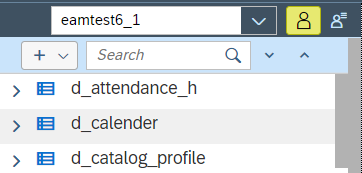

**Step 2: Select the Entity under the Create option**

Select the **Add icon(+)** option from the menu and click on **Entity**.

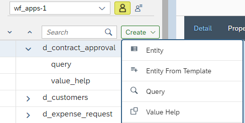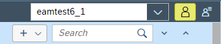

**Step 3:** **Fill in the details and create**

Fill in the entity name in the input field and click on the **Create** button.

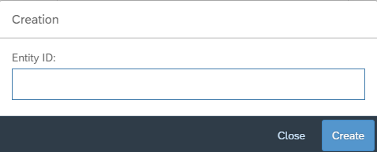

After following the above steps, it will navigate to the entity dashboard as shown below:

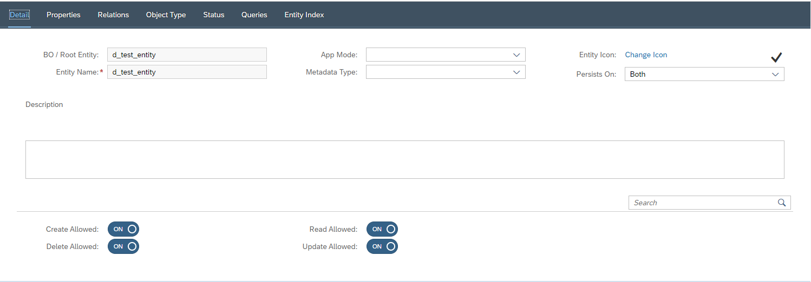

Refer to the [Detail](#detail-1) Section for more information about the field shown here.

### Create New Entity from Excel: {#create-new-entity-from-excel}

Note: Create an entity first and cancel for adding the first property popup

Create a excel sheet like the below format:

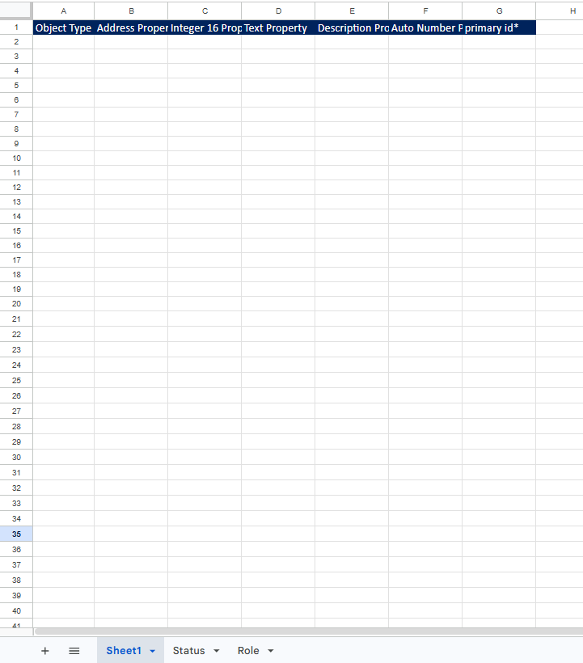

Add Status and Role sheet if applicable in the below format:

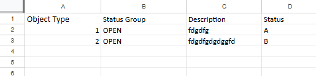

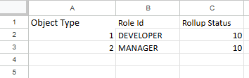

Now click on the Data File and choose this file to upload and create properties and configs

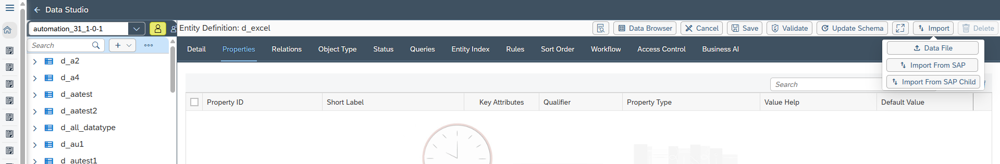

### Creating Entity Property {#creating-entity-property}

**Step 1:** **Click on the add button in the properties tab**

Click on the properties tab and click on the **Add (+)** icon.

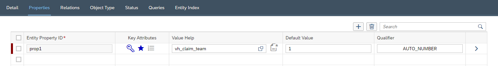

**Step 2: Select the required Qualifier**

It will open the qualifier menu, which gives the option to select the required qualifier for the property.

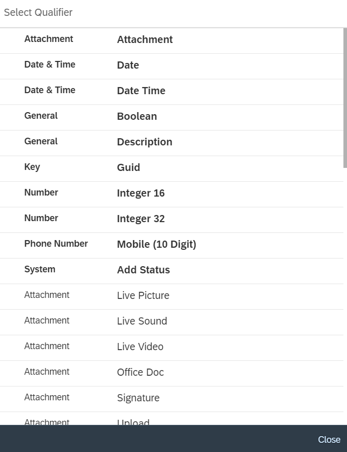

**Step 3: Fill the information in the field**

Fill in the required data such as entity property ID, key attributes, value help, and default value. For more information on each of the fields click [here](#properties).

Toggle the required icons as per the requirement such as primary key or mandatory field.

**Step 4:** **Save the entire process**

Once done with the entity and property creation, save the data. This action will push all the data into the database. Click on the [save button](#save-and-edit) in the toolbar.

Once save is successful, the fields will become non-editable and in the toolbar, the edit icon will start appearing.

### Creating ID Series {#creating-id-series}

To navigate to the id-series section follow the below steps:

**Step 1: Go to Entity Properties**

Navigate to the properties tab after selecting the entity from the entity tree.

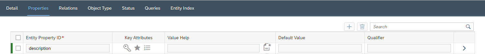

**Step 2: Click on the arrow to go to the main page**

Click on the right directional arrow, this will open the main dialog which will give access to ID series creation.

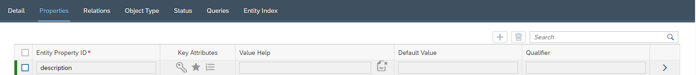

**Step 3: Add a new Entity**

Click on the **Add** icon to add a new entry in the id series section.

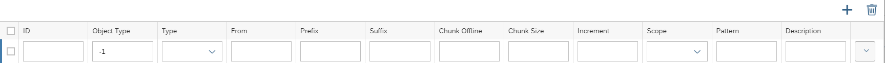

**Step 4: Fill in the details of your ID Series**

Fill in all the required details, close the dialog, and click on save. A new set of ID series has been created for the selected property. For more details about each of the fields continue reading below:

***ID:***

This field accepts the unique id of the id series as input. For naming convention click [here](https://docs.google.com/document/d/1HW3ZrXBFRF6LBArUTebvnR6UwtrzrLVE_0WEcnOQAuI/edit).

***Object Type:***

If the order instance in question belongs to B1 and object type 1 then the order_b1_ot1_series definition will be picked for processing.  
If the order instance in question belongs to B1 and object type 2 then the order_b1_series definition will be picked for processing.  
If the order instance in question belongs to B2 and object type 3 then the order_base_series definition will be picked for processing.

***Type:***

Out of the listed options, the three that are widely used are explained below:

- **GUID -** Returns 32 char UUID as key.

- **Autonumber -** Returns incremental number for the allocated chunk. The auto number section.

- **None -** No number is assigned to the developer to fill the number. Generally used during override in tuner to remove the ID series.

***From:***

This takes the starting number/id series from where it will start generating numbers.

***Prefix:***

Prefix value for generating id series as a pattern.

***Suffix:***

Suffix value for generating id series as a pattern.

***Chunk Offline:***

Chunk offline is the number of entries you can create in your entity when network mode is offline. Everytime a new chunk is assigned to the user whenever he/she does an application registration.

***Chunk Size:***

Default 100 can be set to the desired number.

***Increment:***

It will accept the number by which the auto-generated number will be getting incremented.

For example - From = 100, Increment = 1

So the next auto-generated number will be as follows: 101,102,103,104...

***Scope:***

The default is global, only one auto number is used for all the tenant and offline endpoint intervals.

***Pattern:***

Using the pattern option, we can generate the id series as a pattern, or by concatenating some string in the auto-generated number.

**For example** - if we need a series like **ORDER_ID-1103**

Then we have to maintain the prefix in the pattern as **ORDER_ID** and the framework will automatically concat the auto-generated number with the entered string.

***Description:***

A short description explaining the use case/purpose of the id-series.

###  Create Relations {#create-relations}

**Step 1:** **Go To the Relations Tab**

Click on the **Relations Tab**.

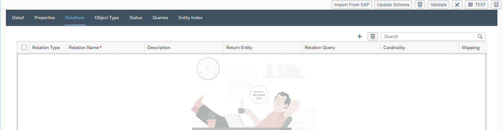

**Step 2: Add a New Relation**

Now click on the **add** button to create a new relation and click on the **key** icon for primary relation or select the other icon for aggregate relation and fill in the other mandatory fields. Then click on the mapping icon.

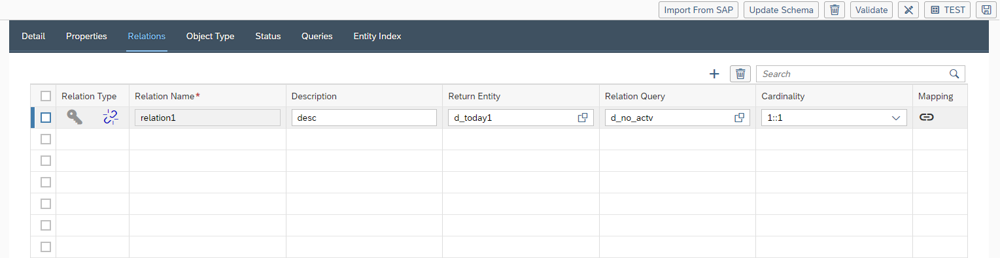

**Step 3: Add source property information**

Add source property for the selected entity, mapping type, and target property for the chosen return entity after clicking on the **add** icon. Now save the relation.

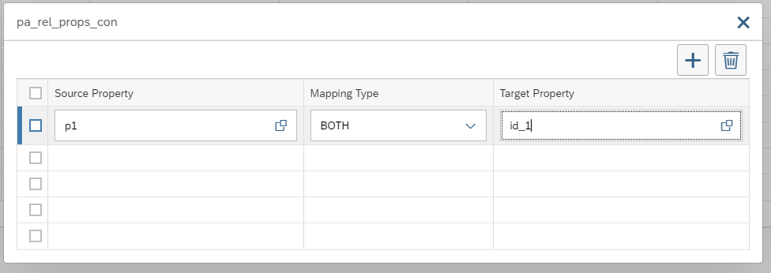

### Create Object Type and Object Group {#create-object-type-and-object-group}

**Step 1:** **Go to the Object Type Tab**

Click on the **Object Type** Tab.

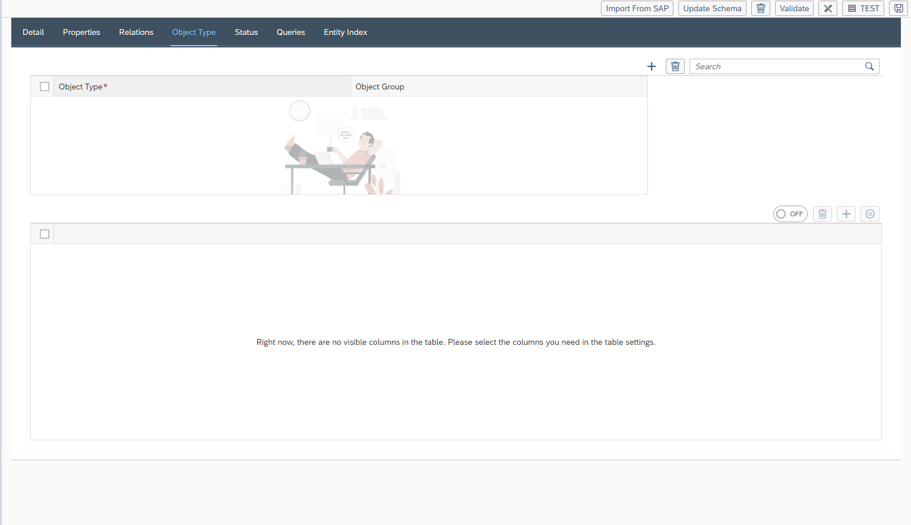

**Step 2:** **Add new Object Type**

Click on the add button to create a new object type. Fill in the object type. For more details on object type and object group, click [here](#object-type).

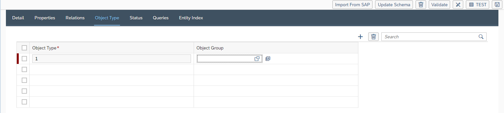

**Step 3: Click on the dialog icon**

Now click on the icon beside the object group value help to open the object group dialog.

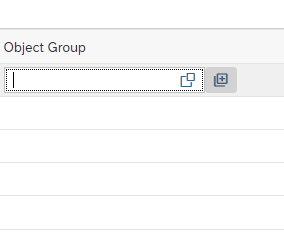

**Step 4: Add Object Group**

In the object group dialog click on add and provide object group and description.

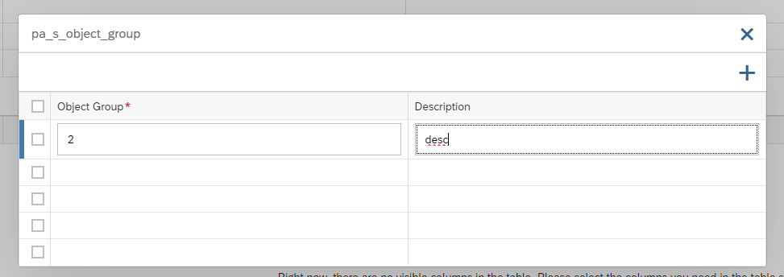

**Step 5:**

Now click on the cancel button on the top right.

**Step 6: Select Object Group**

Click on the icon present in the input field of Object Group and select the required object group. Click on **Save** to persist all the changes.

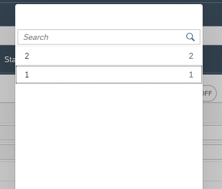

### Create Object Group Config {#create-object-group-config}

**Step 1: object Type Field**

Click on the **object type** tab

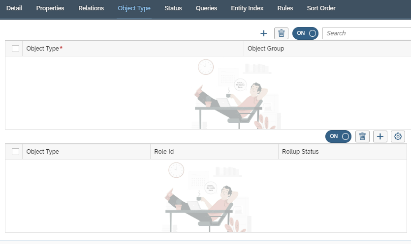

**Step 2: Click on the Add icon**

Click on the second section to **add** an icon.

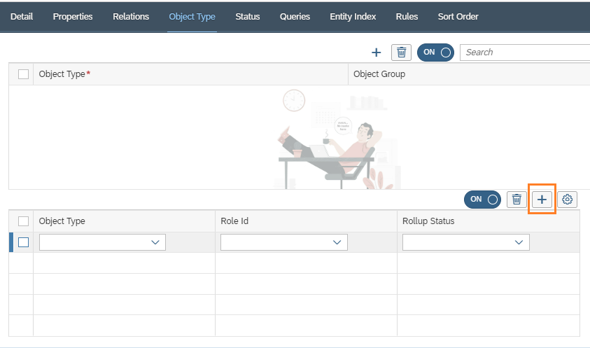

Select **object Type**, **role ID** and **rollup status** based on your requirement.

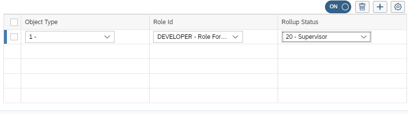

**Note**: Click on save to save all the changes

### Create Status and Status Group {#create-status-and-status-group}

**Step 1: Status field**

Click on the **Status** Tab

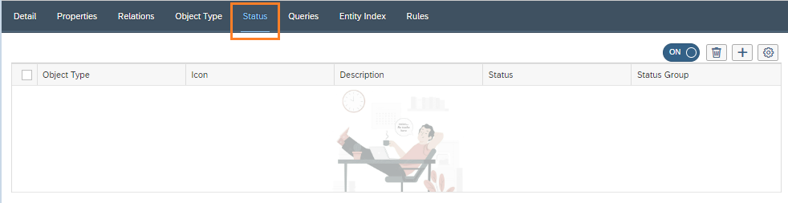

**Step 2: Add Status**

Click on the **add icon(+)** to create a new status and fill in the mandatory fields.

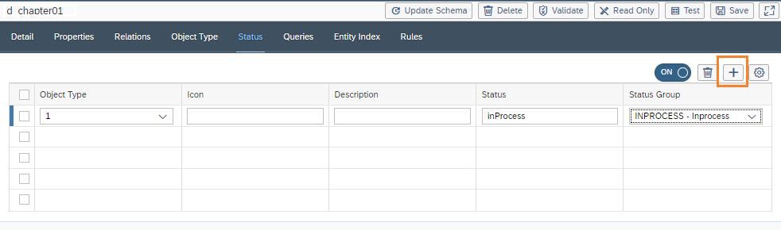

Now click on the save icon to save the particular mapping for the status.

### Create Entity Index {#create-entity-index}

**Step 1:** **Entity Index field**

Click on the **Entity Index** Tab.

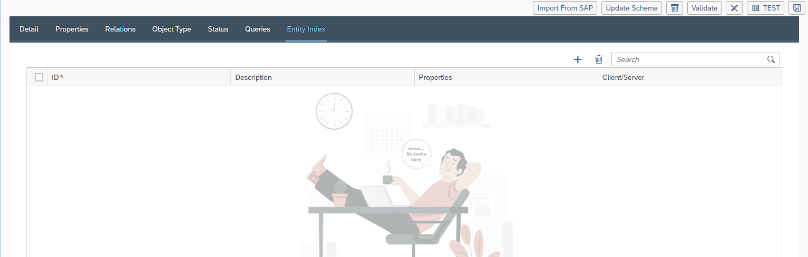

**Step 2:** **Add Entity Index**

Click on the **add** icon to create a new entity index and fill in the mandatory fields.

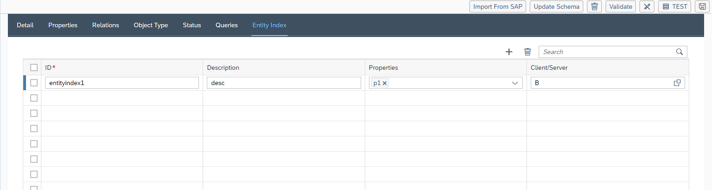

Now click on the save icon to save the particular entity index data.

### Update Schema {#update-schema-1}

Once you are done with the entity and property creation, you can proceed with the **updated schema**. This will create the actual table in the database along with all the attributes.

To perform an update schema, click on update schema.

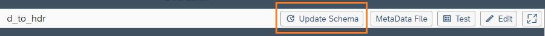

It will give a toast message like **Updating Schema Done Successfully.**

After this step, our entity is ready for storing transactional data which will be used on the screen side or elsewhere.

Now we have to store some data in the entity. It can be done using the Test option given in the toolbar.

### Incompatible changes {#incompatible-changes}

If a property\'s type or attributes (e.g. precision, length) were changed in the metadata since the table was last created, clicking **Update Schema** may show a confirmation dialog listing the incompatible changes, for example:

Some incompatible changes were found. Please press OK if you want to make the changes forcefully.  
NOTE: This will change / truncate the data in the table.

followed by one line per affected property, e.g. Incompatible changes found (DEC:-decimal -\> DEC:-decimal) in property:\<property_name\> in entity:\<entity_name\> in flavor:\<flavor_name\>.  
  
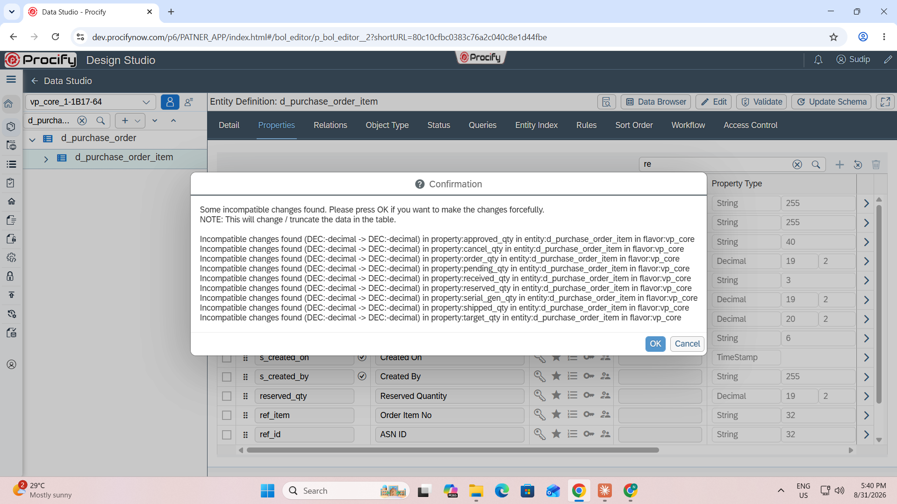

This means the metadata definition and the physical database column are out of sync --- usually because a prior property change (e.g. a precision or type change) was saved in metadata but **Update Schema** was not confirmed at that time.

- Clicking **OK** applies the change to the table forcefully. **Existing data in the affected column(s) may be truncated or altered** --- for example, reducing decimal precision will truncate any stored values beyond the new precision. Confirm this is acceptable, or back up/migrate the affected data first, before proceeding.

- Clicking **Cancel** leaves the table unchanged. The metadata will continue to report the new definition (e.g. the new precision) even though the underlying table still uses the old one --- this mismatch is silent and will resurface anywhere the discrepancy matters (e.g. UI display of decimal precision) until **Update Schema** is confirmed.

**Recommendation:** Always confirm **Update Schema** in the same session as a property type/precision change, so metadata and the physical schema never drift apart.

### Data Browser {#data-browser}

The test is used for create, read, update, and delete. These are four basic functions executed in relational database applications.

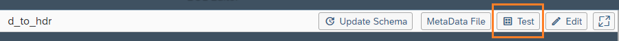

Clicking on TEST will take you to the Result table that has been created with all the entity properties and their functionalities.

### Advance Search  {#advance-search}

In data browser dialog "Advance Search" option is there which is helpful in searching the required data from the list of entries made in the entity.

**Step 1:** Click on advance search which will open a dialog. Click the add button to add an entry.

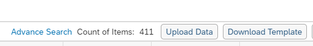

**Step 2:** Fill the property id along with the operator and the value to be searched.

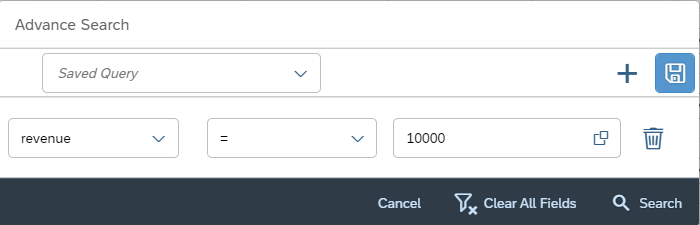

**Step 3:** Use appropriate operators depending on the requirement.

For ex: If data needs to be searched for any field which has multiple value then use "IN" operator.

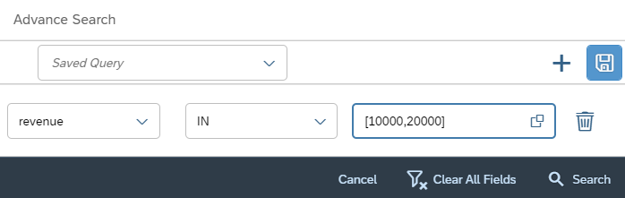

**Note:** If search parameters are needed to be saved then click on save button and provide an id.

### Delete ID Series {#delete-id-series}

To delete the ID series, follow the below steps:

**Step 1:** Open the Data Studio and select the entity in which you want to delete the id series.

**Step 2:** Click on the right directional arrow and open the dialog that lists down all the id series.

**Step 3:** Select the ID series which you want to delete.

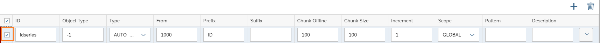

**Step 4:** Click on the delete button.

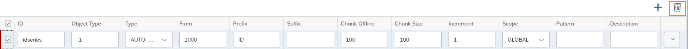

**Step 5:** Close the dialog and click on save.

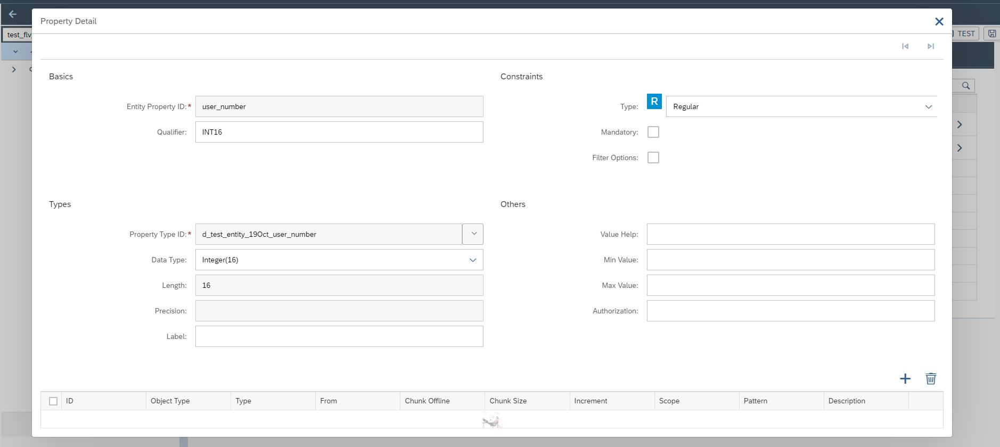

### Delete Entity Property {#delete-entity-property}

For deleting entity property, follow the below steps:

**Step 1:** Open the Data Studio and select the entity in which you want to delete the property.

**Step 2:** Click on the **Properties** tab and select the properties which you want to delete.

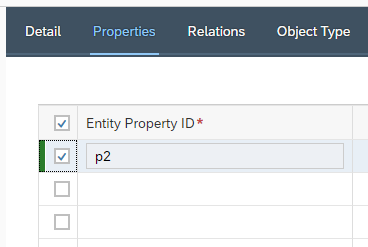

**Step 3:** Click on the **Delete** button shown in the properties tab toolbar.

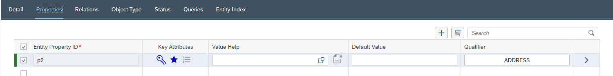

**Step 4:** Click on the **Save** button.

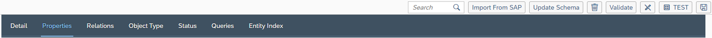

### Delete an Entity {#delete-an-entity}

**For deleting an entity, follow these steps:**

**Step 1:** Open the Data Studio and select the app in which you want to delete the entity.

**Step 2:** Select the entity from the left tree which you want to delete. You can select the entity by clicking on the entity name in the tree. Once an entity is selected, it will enable the detail section.

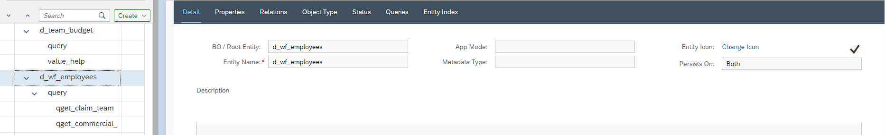

**Step 3:** Click on the **Edit** icon in the editor toolbar if the editor is not in editable mode, then click the **delete** icon.

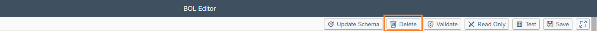

Select **OK** in the confirmation dialog.

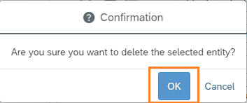

**Step 4:** Click on the **Save** icon to save the changes and commit it to the DB.

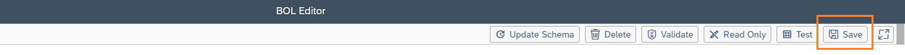

## 3.0.2. Query / KloQuery {#query-kloquery}

kloQuery is a metamodel for fetching the data from the data store, like SQL in RDBMS. For example, the entity (table) name "d_order" has multiple columns including "s_status". To fetch all the records for open order in RDBMS need SQL as "Select ord_id, qty, ord_date from d_order WHERE d_order.status = 'open' Orderby ord_date ASC" and execute to get the desired result.

kloQuery behaves similarly with a few value-added services, it gives the ability to fetch the data seamlessly for both offline and online applications. Abstracts out multiple syntaxes of Odata, SQL, JSON, etc. so that programmers can concentrate on the business logic. It gives a few short-hand optimizations like pagination column selection. Security features like authorization etc.

### Create New Query {#create-new-query}

To create a new query, follow the following steps:

**Step 1:** Once the editor is loaded and you have selected the app under which the query has to be created, click on the entity from the tree in which you want to create the question.

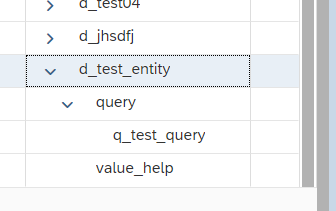

**Step 2:** Click on the **Create** button in the left tree and select **Query** from the menu.

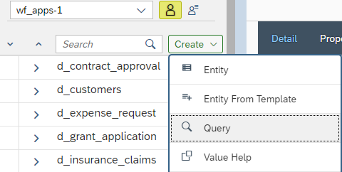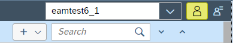

**Step 3:** Fill in the query ID in the input field. Make sure the entity selected should be pre-filled. This query will be added to the specified entity.

Make sure you click on the query from the tree once it\'s created. As it will open the detail section for the query.

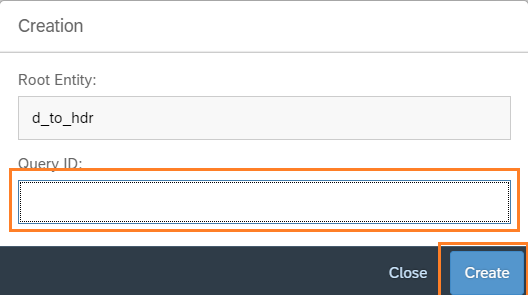

For naming convention please refer [here](https://docs.google.com/document/d/1HW3ZrXBFRF6LBArUTebvnR6UwtrzrLVE_0WEcnOQAuI/edit).

**Step 4:** Once on the query detail page, fill in the required fields like app mode, query type, db selection, and query type. Click [here](#detail-2) to learn more about each of these.

### Add Query Property {#add-query-property}

**Step 1:** Click on the **Properties** tab in the query detail section. And then click on the add **(+)** icon.

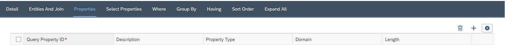

**Step 2:** Fill in the required data such as property ID, property type, domain, length, and other required details.

**Step 3:** Once done with maintaining all data, click on save to persist all data.

**Step 4:** There are multiple tabs, click [here](#query-detail) to learn more about each of the sections in detail.

Once the above steps are completed, the query is ready to use.

### Delete Query Property {#delete-query-property}

For deleting a query property, follow these steps:

**Step 1:** Open the Data Studio and select the **query** in which you want to delete the property.

**Step 2:** Click on the **Properties** tab and select the properties which you want to delete.

**Step 3:** Click the Delete button in the properties tab toolbar. Click on **Delete** if it asks for a confirmation.

**Step 4:** Click on the **Save** button.

### Entity and Joins {#entity-and-joins}

The entity and joins tab is used to join two or more entities with the help of the **JOIN** clause.

To join two or more entities, follow these steps:

**Step 1:** Click on the Entity and Join tab in the query detail section. Click on add icon(**+**)

**Step 2:** After clicking the add icon(+), A pop comes to select the root entity (entity to which we are applying the join). Select the root entity and its relation (not mandatory. Only if you want to join the root entity's relation)

**Step 3:** Select the required **Join Type.**

**Step 4:** Click on **Save** button

### Delete a Query {#delete-a-query}

To delete a query, follow these steps:

**Step 1:** Open the Data Studio and select the **app** in which you want to delete the query.

**Step 2:** Select the query from the left tree which you want to delete. You can select the query by clicking on the query name in the tree. Once the query is selected, it will enable the **detail section.**

**Step 3:** Click on the **Edit** icon in the editor toolbar if the editor is not in editable mode, then click the delete icon. Select **OK** in the confirmation dialog.

**Step 4:** Click on the **Save** icon to save the changes and commit them to the DB.

## 3.0.3 Value Help {#value-help-2}

In the Application, ID/key is frequently used to store the related data and at the same time in the user interface, descriptive explanation is required. To achieve it, the ID/key is represented by other single/ multiple data from the related table. Value help is also used to supply the choices available to fill (combo, dropdown, auto-complete) as selection data. Value help can restrict accepting the input value only from valid sets.

### Create Value Help {#create-value-help}

**Step 1:** Select the **entity** from the tree in which you want to create the value help.

**Step 2:** Click on the **Value Help** option from the menu and fill in the **Value Help ID**.

**Step 3:** Click on **Create** and then click on the newly created value help from the left tree. This will load the detail section for that value help.

**Step 4:** Fill out all the information in the detail section and click on **Save** to save all the data. For more information about each of the fields refer to [this section](#value-help-detail).

### Create VH Trans {#create-vh-trans}

**Step 1:** Select the **entity** from the tree in which you want to create the VH Trans.

**Step 2:** Click on the **Value Help** option from the menu.

**Step 3**: Fill in the **Value Help ID** and **Value Help Type** as VH_TRANSACTION.

**Step 4:** Click on **Create** and then click on the newly created value help from the left tree. This will load the detail section for that value help.

Fill out all the required fields.

**Step 5:** Click on the **add icon** in the **Vh Trans** field to add vh trans items

**Note**: If we provide **is Dependent** as true then one more field will get added inside the **VH Trans** section.

Fill out the fields according to your requirements. The descriptions for the fields are explained below:

- **Key:** The key is your VH Trans Item ID

- **Display Text:** Display text value will display the provided text as the value help item.

- **Icon:** The provided icon will also be displayed with the display text

- **Dependent:** If a VH Trans item has any dependent value then provide that value to the **dependent** field. Wherever the dependent item will render, The VH trans item will also render along with that.

- **Lang:** It is a language field for your VH item.

**Step 6:** Click on **save** button to save your vh transaction.

###   {#section}

**Step 1:** Select the **entity** from the tree in which you want to create the VH Trans.

**Step 2:** Click on the **Value Help** option from the menu.

**Step 3**: Fill in the **Value Help ID** and **Value Help Type** as VH_CONFIG

**Step 4:** Click on **Create** and then click on the newly created value help from the left tree. This will load the detail section for that value help.

Fill out all the required fields.

**Step 5:** Click on the **add icon** in the **Vh Config** field to add Vh config items.

Fill out the **key** and **Display Text** field according to your requirements.

**Step 6:** Click on **save** button to save your vh config.

**Creating data using Excel Upload:**

**Step 1:** Select the value help and click on the Download button. It will excel template.

Open that excel file in google sheets.

**Step 2:** Fill the rows with data the user wants to create and download the excel file

**Step 3:** Upload the excel file using the Upload button and select the excel file. It will create the mentioned data and save

### Delete Value Help {#delete-value-help}

For deleting a value help, follow these steps:

**Step 1:** Open the Data Studio and select the **app** in which you want to delete the value help.

**Step 2:** Select the value help from the left tree which you want to delete. You can select the value help by clicking on the value help name in the tree. Once the VH is selected, it will enable the **detail** **section**.

**Step 3:** Click on the **Edit** icon in the editor toolbar if the editor is not in editable mode, then click the delete icon. Select **OK** in the confirmation dialog.

**Step 4:** Click on the **Save** icon to save the changes and commit it to the DB.

## 4.0 Permissions {#permissions}

Permissions is a feature provided to control the access to application resources. By default an application user can access any entity of the application and perform CRUD operation if enabled. To control the access, CRUD permissions can be enabled at entity level and appropriate permissions can be granted to selected users.

For more information regarding Permissions refer the below sheet:

[Permissions - User Guide](https://docs.google.com/document/d/1LrdiK4cKTTItwJZRUUyfu9sO744EfMzW7vYsbTj4zss/edit?usp=sharing)

### How to Enable Permissions: {#how-to-enable-permissions}

**Step 1:** Go to Data Studio, select any flavor and select any entity and select "Access Control" tab

**Step 2:** Click on Edit and turn on the flags as per needed for "Create", "Read", "Update", "Delete"

**Step 3:** Navigate to Permissions screen by clicking on the below link

## 5.0 Row Wise Authorization {#row-wise-authorization}

Row wise authorization is a security feature provided by a framework with which access to entity data can be restricted to selective row items on user level. By default, when a simple select query is fired on any entity, it returns all data that is present in the entity. But, by enabling and configuring row wise authorization on an entity, the list of records accessible to any user can be controlled using access tokens.

### How to Enable Row Wise Authorization: {#how-to-enable-row-wise-authorization}

**Step 1:** Enable the Row Wise Authorization flag.

**Step 2:** Click on add button which will create a new line item.

**Step 3:** Fill the id which is the primary key, access key and then click on the property column icon to add properties.

**Step 4:** Now a dialog will come which will contain all the properties which have been added, by default it will be empty. Now click on add button

**Step 5:** Now select all the properties which need to be added as properties and click on add button

**Step 6:** If sequencing needs to be changed then drag and drop can be done and then click on OK

**Step 7:** Now save the data and a popup will come mentioning if the user wants to recalculate access token, click on OK to continue

