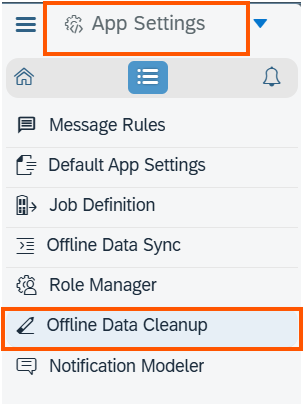
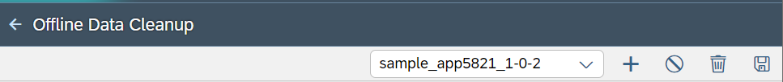
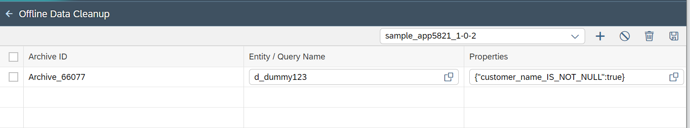

# How to enable the feature

The local archive is triggered automatically when archive rules are created.

## Navigation to the page

**Step 1. Click on Application Settings menu header**

**Step 2 : Click on Data Sync Settings**

We can navigate using the menu item(Data Sync Settings) under the Application Settings Header

## Toolbar Options

### Add Button

Users can create a new entry inside the m_archive entity for deleting unnecessary data.

### Save Button

Users can save the newly created entry to the m_archive entity.

### Delete Button

To delete a selected entry, Users can click on the delete button.

### Cancel Button

To revert the unsaved/dirty data.

### List

| **Columns**       | **Description**                                                                                                                                                |
|-------------------|----------------------------------------------------------------------------------------------------------------------------------------------------------------|
| Archive Id        | Archive id (It will take string values and it is a mandatory field)                                                                                            |
| Entity/Query Name | Entity/Query name from which you are deleting the unnecessary data                                                                                             |
| Properties        | This field indicates which specific value will be deleted from a particular property. If no selection is made, all data for the chosen entity will be deleted. |
